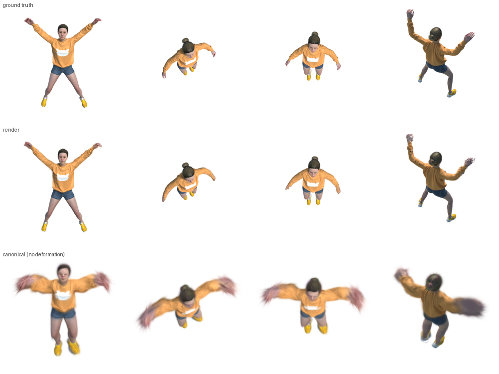

# 3D Gaussian Splatting from scratch (PyTorch)

A learning-oriented implementation of Kerbl et al. (2023), "3D Gaussian Splatting for Real-Time Radiance Field
Rendering", with no external 3DGS library. The differentiable rasterizer, which the official code writes by hand
in CUDA, is written with PyTorch tensor operations and differentiated by autograd.
Input is the Blender synthetic format (`transforms_*.json` + images).

It also contains minimal versions of three dynamic-scene (4DGS) representations, and three experiments: on glossy
surfaces, on how well dynamic representations recover the true motion, and on relighting a translucent object
with an existing relightable method.

Everything was developed and measured on a Quadro M4000 (8 GB, Maxwell generation).

## At a glance

- **3DGS from scratch.** The whole pipeline, including the differentiable tile rasterizer, is PyTorch tensor
  code. It is checked against a naive per-pixel renderer (image and gradients agree to within 1e-6).
- **4DGS in the same code base.** Three dynamic representations (deformation field, spacetime Gaussians,
  per-time trajectories), compared on scenes whose true motion is known. The deformation field is also run on D-NeRF.
- **Experiments that ask where the method fails and why**, on gloss, motion, and translucency. Each one
  ends in a cause that was tested, not only a score.

| What | Result |
|---|---|
| Static 3DGS, toy scene | 37.9 dB test PSNR |
| Deformation-field 4DGS, D-NeRF `jumpingjacks` (400 px) | 34.7 dB, SSIM 0.987 |
| Gloss | 3DGS is 16–17 dB worse on a gold statue than on a diffuse one; a higher SH degree does not fix it |
| Motion | A model can score well on PSNR while getting the motion wrong (surface sliding, error 0.74) |
| Translucency | A relightable method (R3DG) keeps the look in novel views but relights wax as if it were opaque |



*Deformation-field 4DGS on D-NeRF `jumpingjacks`, test views at unseen times. Bottom row: the canonical
Gaussians before the deformation is applied.*

## Layout

| File | Contents |
|---|---|
| `gs/gaussians.py` | Gaussian parameters, initialization, densification (clone / split / prune), rebuilding the Adam state, `.ply` export |
| `gs/rasterize.py` | Differentiable rasterizer: 3D→2D projection, tile binning and sorting, alpha blending |
| `gs/render.py` | Activation → projection → SH colour → rasterization |
| `gs/sh.py` | View-dependent colour with spherical harmonics |
| `gs/loss.py` | L1 + SSIM loss, PSNR |
| `gs/camera.py`, `gs/dataset.py` | Cameras and Blender / D-NeRF format loading |
| `gs/deform.py` | Dynamic: deformation field (an MLP maps canonical position and time to offsets) |
| `gs/spacetime.py` | Dynamic: Gaussians with their own time, temporal width, and velocity |
| `gs/trajectory.py` | Dynamic: fixed set of Gaussians with a position per time knot |
| `train.py`, `render_video.py` | Static training and novel-view rendering |
| `train_dynamic.py` | Dynamic training |
| `make_toy_dataset.py`, `make_toy_dynamic.py` | Analytic toy datasets (a striped sphere and a cube; static and moving) |
| `tests/` | Rasterizer checks against a naive per-pixel version (image and gradients), `gradcheck` of the hand-written backward |
| `experiments/` | Experiments (below) |

## Algorithm and code

1. **Representation** (`gaussians.py`): mean μ, scale s (stored as log), rotation q (quaternion),
   opacity o (stored as logit), SH coefficients.
2. **3D covariance** (`rasterize.covariance_3d`): Σ = R S Sᵀ Rᵀ (Eq. 6).
3. **Projection** (`rasterize.project_gaussians`): Σ' = J W Σ Wᵀ Jᵀ (Eq. 5, EWA splatting).
4. **Colour** (`sh.py`): SH evaluated in the view direction. Starts at degree 0, one degree added every 1000 iterations.
5. **Tile binning and sorting** (`rasterize.bin_tiles`): one sort by the key (tile index, depth) gives
   front-to-back order for all tiles at once.
6. **Alpha blending** (`rasterize.composite`): α_i = o_i exp(−½ dᵀ Σ'⁻¹ d), C = Σ c_i α_i T_i,
   T_i = Π_{j<i}(1 − α_j). α below 1/255 is dropped, α is capped at 0.99.
7. **Loss** (`loss.py`): L = 0.8 L1 + 0.2 (1 − SSIM) (Eq. 7).
8. **Densification** (`GaussianModel.densify_and_prune`): every 100 iterations, clone small / split large
   Gaussians with a large mean screen-space gradient, prune transparent or oversized ones. Opacity is reset
   every 3000 iterations.

## Differences from the official implementation

- Only the forward pass is written; autograd does the backward pass. The one exception is the transmittance
  cumulative sum (`SegmentedExclusiveCumsum`): autograd's backward for it needs a float64 `atomicAdd`,
  which Maxwell GPUs lack, so the adjoint is written by hand.
- All (pixel, Gaussian) pairs in a tile are computed in one tensor, with no early termination at T < 10⁻⁴.
- Tiles are 8 px by default (official: 16 px). With the batched approach, smaller tiles waste fewer pixels.
- The binning radius is cut where α falls below 1/255, taking opacity into account. The image is exactly
  the same (checked in the tests); only the work decreases.
- When the (pixel × Gaussian) tensor exceeds `--max-entries`, tiles are processed in chunks with
  gradient checkpointing.
- Later additions to the official code (antialiasing option, exposure compensation) are not included.

## Setup

```bash
python -m venv .venv
.venv/Scripts/python -m pip install torch==2.7.1 --index-url https://download.pytorch.org/whl/cu118
.venv/Scripts/python -m pip install -r requirements.txt
```

The Quadro M4000 is Maxwell (sm_52), which CUDA 12.8+ builds no longer support, hence the CUDA 11.8 build.

## Usage

Rasterizer check:

```bash
.venv/Scripts/python tests/test_rasterize.py
```

Static toy scene:

```bash
.venv/Scripts/python make_toy_dataset.py --out data/toy_sphere
.venv/Scripts/python train.py --datadir data/toy_sphere --expname toy --iters 7000
.venv/Scripts/python render_video.py --ckpt logs/toy/ckpt_007000.pt --gif
```

`logs/toy/point_cloud.ply` uses the official format and opens in 3DGS viewers such as SuperSplat.

nerf_synthetic (place the official data in `data/nerf_synthetic/lego`):

```bash
.venv/Scripts/python train.py --datadir data/nerf_synthetic/lego --expname lego --half-res --init-points 50000
```

Dynamic toy scene (D-NeRF format, one view per time step):

```bash
.venv/Scripts/python make_toy_dynamic.py
.venv/Scripts/python train_dynamic.py --datadir data/toy_dynamic --expname dyn_toy --iters 7000 --warm-up 1000 --densify-until 5000 --init-extent 2.0
```

| Flag | Representation | Simplified from |
|---|---|---|
| (default) | Deformation field: one canonical set, an MLP outputs (δx, δq, δs) from position and time | Deformable 3D Gaussians (Yang et al., CVPR 2024) |
| `--spacetime` | Each Gaussian has a time μ_t, temporal width σ_t, and velocity v; it appears only around μ_t and moves in a straight line | Spacetime Gaussians (Li et al., CVPR 2024) |
| `--trajectory` | Count, colour, opacity, and size are fixed; only the position is stored per time knot (21 by default). Use with `--lambda-smooth` | Dynamic 3D Gaussians (Luiten et al., 3DV 2024) |
| `--static` | No motion (baseline) | |

`--lambda-smooth` adds a loss that aligns the velocities of neighbouring Gaussians. `--min-t-scale` puts a lower
bound on the temporal width (`--spacetime` only). `--lambda-track` adds an error-free 2D tracking loss built from
the known toy motion, to measure the upper bound of what a point tracker could give.

Main options: `--iters`, `--init-points` / `--init-extent` / `--init-center`, `--bg R G B` or `--black-bkgd`,
`--grad-thresh`, `--densify-until` (0 disables densification), `--tile`, `--max-entries` (lower it on CUDA OOM).

## Results

### Static toy scene (200 px, 7000 iterations)

| | |
|---|---|
| Training time | about 22 min (0.13–0.19 s/iter) |
| Test PSNR (8 views) | 37.9 dB |
| Gaussians | 20,000 (initial) → 28,659 |
| Peak VRAM | 2.4 GB |
| Rendering | about 68 ms/frame (about 15 fps) |

In `log.csv`, the val PSNR at iteration 3000 is about 8 dB because it is evaluated right after the opacity reset.

### A pitfall: aliased ground truth

The toy renderers first shot one ray per pixel, so edges were staircase-shaped. The rasterizer adds 0.3 px² to
the screen-space covariance, so it cannot reproduce staircase edges. Test PSNR was stuck at 30 dB, and that
number was reported as the capability of the implementation. It was a limit of the scoring.

| Trained on | Scored on aliased test images | Scored on antialiased test images |
|---|---|---|
| `--supersample 1` (aliased) | 30.4 dB | 35.0 dB |
| `--supersample 4` (antialiased, now the default) | 30.5 dB | 37.9 dB |

The same model gains 4.7 dB just by being scored against antialiased ground truth, and training on
antialiased images adds another 2.9 dB. Scored on aliased images, the two models cannot be told apart.

### Dynamic toy scene (256 px, 100 training frames, 20 test frames at unseen times)

| | Small motion | Large motion (`--orbit`, the cube travels half a circle) |
|---|---|---|
| Deformation field | **25.7 dB** | 15.1 dB |
| Spacetime | 23.7 dB | **23.0 dB** |
| Trajectory + `--lambda-smooth 1e-4` | 24.3 dB | 20.4 dB (7000 iterations; the other rows in this column use 5000) |
| Static | 14.1 dB | 11.8 dB |

These numbers were measured on the older aliased data (`--supersample 1`). On the current data the deformation
field reaches 28.3 dB; its motion accuracy does not change. The other rows were not re-measured, so they
compare with each other but sit 2–3 dB below what the current data would give.

### D-NeRF `jumpingjacks` (deformation field, 400 px, 200 training frames, 20 test frames)

```bash
.venv/Scripts/python train_dynamic.py --datadir data/dnerf/data/jumpingjacks --expname dnerf_jj --half-res --iters 20000 --warm-up 600 --densify-until 10000
```

| Iterations | Test PSNR / SSIM | Test PSNR at t = 0 and t = 1 (arms fully raised) | Gaussians | Training time |
|---|---|---|---|---|
| 7,000 | 29.7 dB / 0.973 | 22.0 / 19.2 dB | 30,133 | 35 min |
| 20,000 | 34.7 dB / 0.987 | 29.3 / 28.3 dB | 55,824 | 141 min |

- With 7,000 iterations the arms do not reach the raised position. The canonical arms become a fan-shaped
  haze, and Gaussians are shrunk away per time step instead of being moved.
- The cause was the training length: the learning rate of the deformation MLP decays before the arms have
  moved. With 20,000 iterations the canonical arms are one solid pair and they are moved into place.
- The hands, the thinnest and fastest part, are still broken (bottom row of the figure above).
- If the deformation starts before the first pruning (`--warm-up 200`), the MLP diverges and the render goes blank.
- One scene, at half resolution and with shorter training than the papers use: this is a check that the
  implementation works on a standard benchmark, not a reproduction of published numbers.

## Experiments

### [Does 3DGS break on glossy surfaces?](experiments/gloss/README.md)

A gold statue and a diffuse statue of the same colour, identical in everything else.

- Gold is 16–17 dB worse in PSNR over the statue region, and equally bad on the training views.
  The failure is a lack of capacity, not a failure to generalize.
- Raising the SH degree does not fix it. In per-point SH fits, higher degrees memorize the training views,
  but test views saturate at 24–27 dB. The ceiling is set by how coarsely each point is observed, not by the SH degree.
- A model that shares lighting across points through the reflection direction recovers the lighting correctly.
  On this statue it still loses to per-point SH overall, because of interreflection (38% of observations) and
  sub-pixel bumps. It wins only where those are excluded.
- On a sphere with controlled bumps, the per-point optimized roughness matches the roughness converted from the
  normal variation inside the pixel footprint (rank correlation 0.93). With an anisotropy correction, the
  conversion is as good as or better than the optimized roughness, with no learned parameter.
- With deferred shading added to this implementation, the relative blur per region is learned correctly.
  But the learned Gaussians form a thick semi-transparent layer inside the surface, so the length of the blended
  normal is not the average over the pixel, and it changes in the wrong direction when the pixel size changes.

A [literature survey of glossy 3DGS methods](experiments/gloss/reports/glossy_3dgs_literature_survey.md)
is organised around the four failure modes seen above.

### [Dynamic scenes: three representations against the true motion](experiments/dynamic/README.md)

The toy motion is known in closed form, so the motion of the Gaussians can be compared with the truth.

- Strengths are opposite. The deformation field is 2 dB ahead on small motion; spacetime Gaussians are 8 dB
  ahead on large motion.
- Even the deformation field gets the tangential motion on the sphere mostly wrong (error 0.74 of the true
  displacement). On a uniformly coloured surface, sliding does not change the image (the aperture problem).
  PSNR does not show this.
- Spacetime Gaussians barely learn motion. Their temporal width shrinks to about two frames and they overfit
  the training views by appearing and disappearing.
- Aligning neighbouring velocities reduces sliding for the deformation field (0.74 → 0.49) but hurts
  spacetime Gaussians, where the cheapest way to agree is for everyone to stop.
- The trajectory representation collapses without regularization. Training it in time order, as the original
  paper does with 27 cameras, leaves floaters when there is one view per time step.
- Even an error-free 2D tracking loss reduces the sliding only to 0.51.

### [Relighting a translucent object with Relightable 3D Gaussians](experiments/relight/README.md)

A wax-like statue and an opaque control, reconstructed and relit with R3DG (run from the official code, which
is not included here), and compared with ground-truth renders under each new light.

- Novel views under the training light keep the look (35–37 dB). Relighting does not: the relit wax scores
  22–30 dB on the statue.
- The relit wax has two to three times the shading contrast and about twice the sharpness of the truth,
  under every light. These are image cues to translucency, so the relit wax is predicted to look more opaque.
- Training length is not the cause: running the material stage five times longer (the official length)
  leaves the relit scores and the contrast error unchanged.
- PSNR ranks the conditions differently from the cues: the wax under uniform light has the best PSNR and the
  largest contrast error.
- Next step: a perception experiment to test whether observers see the material the cues predict.

## License

MIT
