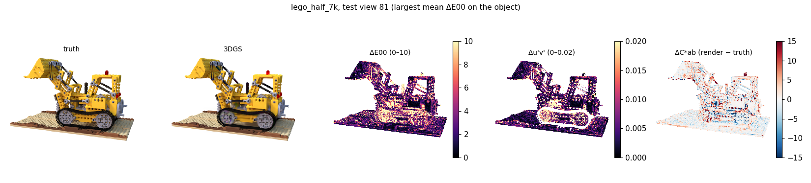
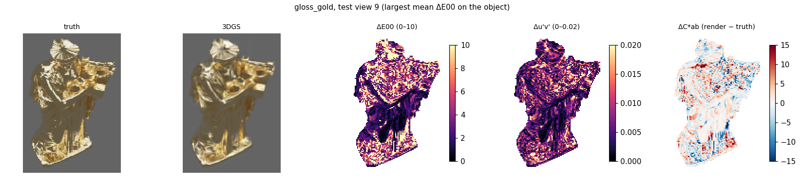
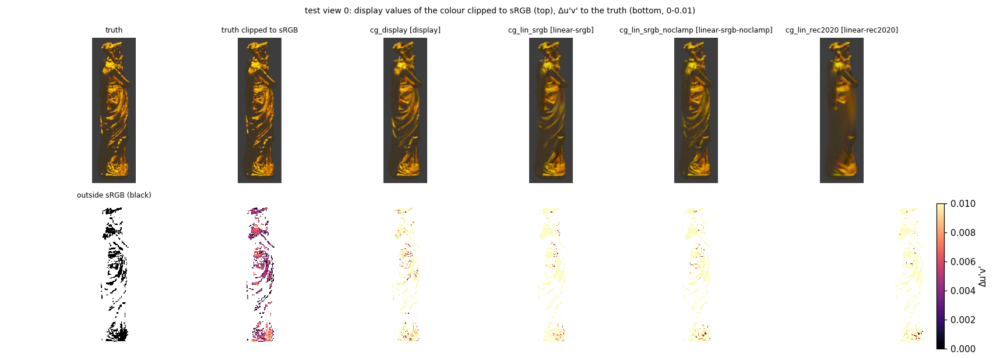
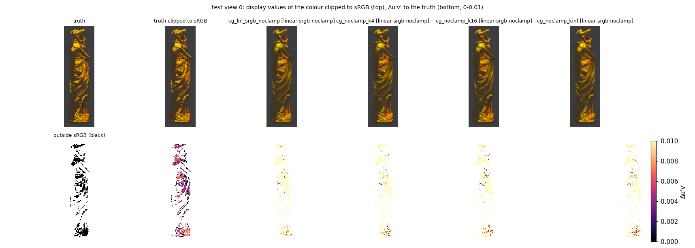
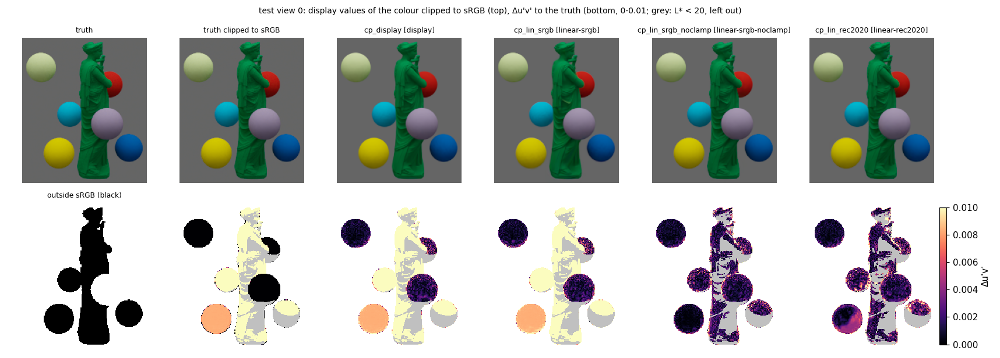

# Colour: does 3DGS get the chromaticity right?

PSNR scores RGB error. It does not say whether an error is a change of brightness or a change of colour, and
for material perception (the [relight experiment](../relight/README.md) ends in a plan for observers) the
colour on the display has to be right. This experiment measures the colour error of 3DGS directly, in
CIE terms.

## Summary

| Stage | Question | Answer |
|---|---|---|
| [0](#stage-0-colour-error-of-existing-models-on-display-referred-data) | Does PSNR hide colour error in existing models? | No, not per view: views with lower PSNR have larger ΔE00 and Δu'v' (correlation −0.75 to −0.95). The colour error sits at edges (2–7× flat regions); in flat regions the chromaticity error is at or below a rough visibility threshold. The gold statue's failure is 88% lightness, not colour |
| [1](#stage-1-scene-linear-ground-truth-outside-the-srgb-gamut) | With scene-linear ground truth outside the sRGB gamut, does the clamp at 0 cost colour? | Yes, but it is not the main cost. Without the clamp (or in Rec.2020) the model does put out-of-gamut pixels out of gamut, and on dim pixels this removes about the shift the clipped truth predicts (Δu'v' 0.005). But the summed chromaticity of out-of-gamut pixels is off by 0.043–0.053 in every mode (7–8× the clip floor), mostly because the models reproduce the bright, saturated pixels with only 24–42% of their energy |
| [1b](#stage-1b-a-loss-that-weighs-highlights-more) | Is the loss to blame for the lost highlight energy? | Partly. A loss that compresses highlights less cuts the summed chromaticity error of out-of-gamut pixels by 20% (0.050 → 0.040), but the brightest pixels still get only 38% of their energy, and part of what is gained is smeared onto dim pixels. PSNR barely moves either way. The training views lose the same energy, so it is a limit of what the model can fit (sharp, view-dependent glints), not of new views |
| [2](#stage-2-a-matte-scene-whose-colours-are-outside-srgb) | On a matte scene the models fit, with colours outside sRGB because of the materials, does the clamp at 0 cost colour? | Yes, exactly what clipping the truth costs. On the 70% of pixels outside sRGB, both clamped modes (display and linear sRGB) match the clip floor to three digits (Δu'v' agg 0.022, ΔC*ab −18, per pixel about 10× a rough visibility threshold). Without the clamp, the error falls to the truth's noise. The display model's own test PSNR (44.2 dB, as high as the no-clamp model's) does not show the loss. Outside Rec.2020 is untested, because the renderer's denoiser clips there |

Stage 0 cannot test the two causes that motivated the experiment (the clamp of colour at 0, and blending in
display values), because its ground truth is already sRGB display values. Stage 1 renders scene-linear ground truth
with colours outside the sRGB gamut and trains four colour modes on it. Stage 2 does the same on a matte scene the models fit well, so that the cost of the clamp is not
buried under other error.

## Stage 0: colour error of existing models on display-referred data

### Method

- Models: the existing 7,000-iteration checkpoints. `lego_half_7k` (nerf_synthetic lego, 400 px, 200 test
  views), `gloss_gold` and `gloss_matte` (the Erato statue of the [gloss experiment](../gloss/README.md),
  256 px, 10 test views), `toy_aa` (the analytic toy sphere, 200 px, 8 test views). No training.
- Colour: render and ground truth are read as sRGB display values (`colorimetry.py`: sRGB curve, sRGB primaries,
  D65). This is the colour a calibrated sRGB display shows, not the colour of the scene: the gloss data passed
  through Reinhard tone mapping per channel, which itself moves chromaticity.
- Measures: ΔE00 split into its lightness, chroma, and hue terms (share of ΔE00² over the pixels); Δu'v' and
  Δxy only where the truth has L* ≥ 20; signed ΔL* and ΔC*ab for systematic bias. ΔE00 is checked against the
  published test pairs of Sharma et al. (2005) (to 4e-5).
- Pixel classes are defined on the ground truth only (`chroma_eval.py`): edge = a 4-neighbour differs by
  ΔE*ab > 10, or within 1 px of the silhouette; dark L* < 20; bright L* > 90; saturated C*ab > 40;
  gamut = smallest display channel < 0.02 with L* ≥ 20.
- Rough visibility guides, for reading the numbers only: ΔE00 ≈ 1–2, Δu'v' ≈ 0.004.

```bash
.venv/Scripts/python experiments/color/render_tests.py logs/lego_half_7k/ckpt_007000.pt logs/gloss_gold/ckpt_007000.pt logs/gloss_matte/ckpt_007000.pt logs/toy_aa/ckpt_007000.pt
cd experiments/color && ../../.venv/Scripts/python chroma_eval.py ../../logs/lego_half_7k ../../logs/gloss_gold ../../logs/gloss_matte ../../logs/toy_aa
```

### Results

Object pixels, all test views. Full numbers, all classes and per-view values: [`results/stage0.json`](results/stage0.json).

| | PSNR | ΔE00 mean / p95 | ΔE00 share L / C / H | Δu'v' all | Δu'v' edge | Δu'v' flat | Edge pixels | Corr. of view PSNR with ΔE00 / Δu'v' |
|---|---|---|---|---|---|---|---|---|
| lego | 27.0 | 2.74 / 9.2 | 0.57 / 0.20 / 0.23 | 0.0050 | 0.0068 | 0.0032 | 50% | −0.81 / −0.82 |
| gold statue | 22.2 | 4.45 / 16.3 | 0.88 / 0.08 / 0.04 | 0.0059 | 0.0079 | 0.0039 | 50% | −0.92 / −0.75 |
| diffuse statue | 38.8 | 0.89 / 2.2 | 0.80 / 0.10 / 0.10 | 0.0012 | 0.0018 | 0.0010 | 17% | −0.95 / −0.95 |
| toy | 35.0 | 1.09 / 4.9 | 0.37 / 0.08 / 0.54 | 0.0036 | 0.0108 | 0.0016 | 21% | −0.93 / −0.89 |

Systematic bias (mean signed difference, render − truth) is small on the object as a whole (|ΔL*| ≤ 0.25,
|ΔC*ab| ≤ 0.35). It is larger in small classes: saturated pixels of the gold statue lose chroma
(ΔC*ab −4.6, 2% of the statue), and bright pixels of lego are darker and more saturated (ΔL* −2.1, ΔC*ab +2.2,
6% of the object).

|  |
|---|
|  |

*The test view with the largest mean ΔE00 of each model. Δu'v' is blank where the truth is dark (L* < 20).*

### Findings

1. **PSNR does not hide colour error at the level of views.** Across test views, lower PSNR goes with larger
   ΔE00 and larger Δu'v' in every model (correlation −0.75 to −0.95). The idea "good PSNR, wrong colour" is not
   supported on these data.
2. **Colour error is an edge phenomenon.** Δu'v' at edges is 2× the flat regions on lego and the gold statue,
   and 7× on the toy (0.0108 vs 0.0016), where the edges are boundaries between red and yellow stripes and hue
   carries half of ΔE00². In flat regions, Δu'v' is 0.001–0.004, at or below the rough visibility guide.
   At 256–400 px, half of the object pixels of lego and the statue count as edges, so this is not a small region.
3. **The gold statue fails in lightness, not colour.** 88% of ΔE00² is the lightness term. The gloss failure
   (16–17 dB, [gloss experiment](../gloss/README.md)) is the highlight pattern, and its chromaticity error
   (Δu'v' 0.0059) is close to lego's.
4. **Saturated colours at the gamut boundary have twice the chromaticity error in flat regions on lego**
   (Δu'v' 0.0063 vs 0.0032 for all flat pixels; 0.5% of the flat pixels). This is a clue, not a test of the
   clamp at 0: these pixels are a small, particular set of colours, and the ground truth contains no colour
   outside the sRGB gamut at all.

### Limitations

- One checkpoint per scene, at 7,000 iterations; lego at half resolution.
- Display-referred data only. Tone mapping, clipping, and 8-bit quantization of the ground truth are not
  separated from errors of 3DGS, and colours outside the sRGB gamut do not occur.
- The visibility guides are for side-by-side uniform patches. They are not thresholds for pixels in an image.
- The toy's RGB values are not defined in any colour space; it is used only as a case with clean hue edges.

## Stage 1: scene-linear ground truth outside the sRGB gamut

### Method

- Data (`make_views_spectral.py`, `data/color_gold_candle`): the gold statue of the [gloss experiment](../gloss/README.md)
  with the same geometry, cameras, views (90 train, 10 test) and seeds, rendered with the spectral build of GoLD_rayt
  (512 spp, OIDN). Two changes: the softbox and the four sphere lights emit a candle spectrum (Planck 1850 K, whose sRGB
  blue is negative), and the uniform D65 ambient is 0.05 instead of 0.15. The film integrates CIE 1931 colour matching
  functions and writes linear Rec.2020 without clipping (`.pfm`, `--gamut rec2020`; Rec.2020 is one exact matrix from
  XYZ, and the denoiser works in it, so colours outside sRGB survive; colours outside Rec.2020 do not, see stage 2). **25.9% of the statue's pixels in the test views
  are outside sRGB** (a negative linear-sRGB channel). Rendering the 110 views took 30 min.
- Four models, 7,000 iterations each, same settings as the gloss experiment, differing only in `--color-mode`
  (`gs/color.py`):

  | Mode | The Gaussians' colour is | Clamp at 0 | Can leave sRGB |
  |---|---|---|---|
  | `display` | display sRGB values of the data as GoLD_rayt writes a PNG (clip, Reinhard per channel, sRGB curve): the original 3DGS on display-referred data | yes | no |
  | `linear-srgb` | linear sRGB | yes | no |
  | `linear-srgb-noclamp` | linear sRGB | no | yes |
  | `linear-rec2020` | linear Rec.2020 | yes | inside Rec.2020 |

  The three linear modes take L1 and SSIM on encode(x) = sign(x)·sRGB(|x| / (1 + |x|)) of linear sRGB, which equals
  the display transform for colours inside sRGB, so all four modes weight in-gamut errors the same way.
- Evaluation (`stage1_eval.py`): each render is brought to linear sRGB (the `display` model through the inverse of the
  display transform) and compared to the unclipped truth in XYZ on the statue. Δu'v' per pixel (truth L* ≥ 20) and
  **Δu'v' agg**, the chromaticity of the summed XYZ of a pixel class. The truth's own noise gives a per-pixel Δu'v'
  (0.004–0.008) as large as the effects here, but cancels in the sum (0.0001–0.0012), while a systematic shift does not.
  Also: ΔE00 with a fixed white (D65 at the 99th percentile of the truth's Y), signed ΔC*ab, Y ratio (summed Y of the
  render over the truth), and the share of pixels the render puts outside sRGB.
- Two floors on the same pixels: **clip**, the truth against itself clipped to sRGB (what a renderer that cannot leave
  sRGB loses at least), and **noise**, the truth against the same views rendered with other seeds (`test_seed2/`).
- Pixel classes on the truth: outside / inside sRGB, and outside split by the truth's L* (dim < 40, mid 40–70,
  hi ≥ 70). Every bright pixel of the statue is outside sRGB: inside pixels are all dim.

```bash
.venv/Scripts/python experiments/color/make_views_spectral.py --render
# --bg: the background in the mode's own space (display 0.2417 = linear 0.05 through the display transform)
.venv/Scripts/python train.py --datadir data/color_gold_candle --iters 7000 --init-extent 0.3 --init-center 0 0.25 0 --expname cg_display --color-mode display --bg 0.2417 0.2417 0.2417
.venv/Scripts/python train.py --datadir data/color_gold_candle --iters 7000 --init-extent 0.3 --init-center 0 0.25 0 --expname cg_lin_srgb --color-mode linear-srgb --bg 0.05 0.05 0.05
#   ... cg_lin_srgb_noclamp (linear-srgb-noclamp), cg_lin_rec2020 (linear-rec2020), otherwise as cg_lin_srgb
.venv/Scripts/python experiments/color/stage1_eval.py logs/cg_display/ckpt_007000.pt logs/cg_lin_srgb/ckpt_007000.pt logs/cg_lin_srgb_noclamp/ckpt_007000.pt logs/cg_lin_rec2020/ckpt_007000.pt
```

### Results

Pixels outside sRGB in the truth (18,967 over the 10 test views), and the dim ones among them (7,431). Every class and
measure: [`results/stage1.json`](results/stage1.json).

| | Gaussians | PSNR statue | Outside: Δu'v' agg | ΔC*ab | Y ratio | Put outside sRGB | Out, L* < 40: Δu'v' agg | Y ratio | Out, L* ≥ 70: Y ratio |
|---|---|---|---|---|---|---|---|---|---|
| floor: noise | | 33.9 | 0.0001 | −0.1 | 1.00 | 97% | 0.0003 | 1.01 | 1.00 |
| floor: clip | | 21.1 | 0.0064 | −8.2 | 1.00 | 0% | 0.0047 | 1.00 | 1.00 |
| `display` | 18,572 | 18.2 | 0.0912 | −1.2 | 5.73 | 0% | 0.0436 | 1.91 | 7.71 |
| `linear-srgb` | 13,172 | 17.4 | 0.0528 | −34.4 | 0.39 | 0% | 0.0320 | 0.91 | 0.25 |
| `linear-srgb-noclamp` | 18,211 | 20.2 | 0.0504 | −20.6 | 0.42 | 90% | **0.0268** | 0.93 | 0.29 |
| `linear-rec2020` | 6,464 | 17.9 | 0.0433 | −28.6 | 0.36 | 79% | **0.0270** | 0.85 | 0.24 |

PSNR is on encode() of linear sRGB over the statue (whole image, test views: 27.7, 26.8, 29.6, 27.3 dB).



*Test view 0. Top: display values of each colour clipped to sRGB. Bottom: where the truth is outside sRGB, and Δu'v'
per pixel (0–0.01; nearly every model pixel is above the scale).*

### Findings

1. **The colour modes do what they are meant to.** With the clamp at 0 in sRGB, no pixel leaves sRGB. Without it, 90%
   of the pixels that are outside sRGB in the truth are outside in the render too. In Rec.2020 (clamped), 79% are.
2. **On dim pixels, leaving the gamut removes about the shift the clip floor predicts.** Where the models get the
   energy right (outside, L* < 40, Y ratio 0.85–0.93), Δu'v' agg falls from 0.0320 (sRGB, clamped) to 0.0268 / 0.0270
   (no clamp / Rec.2020): 0.005, against a clip floor of 0.0047. This is the effect the experiment was looking for,
   and it has the predicted size. But it sits on top of about 0.027 of chromaticity error from something else.
3. **The main error is energy lost in highlights.** The linear models reproduce only 36–42% of the luminance of the
   outside pixels and 24–29% of the brightest ones (L* ≥ 70). On this scene the brightest pixels are the most saturated
   (candle light reflected by gold), so losing them desaturates the statue (ΔC*ab −21 to −34 on outside pixels, 3–4×
   the clip floor) and moves its summed colour toward yellow (Δu'v' agg 0.043–0.053, 7–8× the clip floor). A likely
   cause, not tested: the loss is taken on x / (1 + x), where a red of 17 and a red of 5 differ by only 0.04, so the
   loss barely sees how much light a highlight carries. Blurring the truth by σ = 2 px loses only 4% of its energy,
   so this is not the blur of the renders.
4. **The display-referred model cannot be turned back into scene colour.** Its training data was clipped and
   tone-mapped per channel. Inverting that turns small errors near display 1 into large ones (Y ratio 5.7 on outside
   pixels), and its summed chromaticity is the worst of the four (Δu'v' agg 0.091). By its own measure it looks best
   (31.3 dB on display values of the test views, against 26.8–29.8 dB for the linear modes on encode()). The score
   depends on which space it is taken in.
5. **Without the clamp, PSNR is 2.8 dB higher** (statue 20.2 vs 17.4; whole image 29.6 vs 26.8). encode() is steep near
   0, so a negative channel the clamped model cannot follow costs much (clip floor alone: 15.3 dB on outside pixels).
   This is one run per mode, and the no-clamp model also ended with more Gaussians (18,211 vs 13,172).

### Limitations

- One run per mode. The differences in findings 2 and 5 have not been checked against variation between seeds.
- The Gaussian count differs by up to 3× between modes (6,464 in Rec.2020, visibly blurrier). Densification sees the
  same loss, but a different colour space and clamp change the course of training, and this was not controlled.
- One scene, with extreme dynamic range (the truth's red reaches 17, against 0.05 for the background, and the brightest
  5% of the statue's pixels hold 50% of its luminance). The gamut effect would be easier to see on a scene the models
  fit well.
- The per-pixel noise of the spectral truth (4 wavelengths per path) is as large as the effect per pixel. Only the
  aggregate measures separate them.

## Stage 1b: a loss that weighs highlights more

Stage 1 found that most of the chromaticity error comes from highlights reproduced with too little energy, and guessed
that the loss is to blame: x / (1 + x) barely tells a red of 5 from a red of 17. Stage 1b changes only that.

### Method

- `--loss-knee k` (`gs/color.py`): the loss is taken on the sRGB curve of x / (1 + x / k) instead of x / (1 + x).
  k = 1 is stage 1; k = inf is the sRGB curve alone. Dark values hardly change (x / (1 + x / k) ≈ x for x ≪ k), so the
  weight moves to highlights only. The gap between a red of 5 and a red of 17 in the loss is 0.05 at k = 1, 0.25 at
  k = 4, 0.70 at k = 16, 1.37 at k = inf. PSNR and saved images still use k = 1, so the runs are scored alike.
- Same data and settings as `linear-srgb-noclamp` in stage 1 (which is the k = 1 run), 7,000 iterations, one run per k.

```bash
.venv/Scripts/python train.py --datadir data/color_gold_candle --iters 7000 --init-extent 0.3 --init-center 0 0.25 0 --color-mode linear-srgb-noclamp --bg 0.05 0.05 0.05 --expname cg_noclamp_k4 --loss-knee 4
#   ... cg_noclamp_k16 (--loss-knee 16), cg_noclamp_kinf (--loss-knee inf)
.venv/Scripts/python experiments/color/stage1_eval.py logs/cg_lin_srgb_noclamp/ckpt_007000.pt logs/cg_noclamp_k4/ckpt_007000.pt logs/cg_noclamp_k16/ckpt_007000.pt logs/cg_noclamp_kinf/ckpt_007000.pt --out experiments/color/results/stage1_knee.json --fig experiments/color/figures/stage1_knee_views.png
```

### Results

Every class and measure: [`results/stage1_knee.json`](results/stage1_knee.json). Floors as in stage 1 (clip: outside
Δu'v' agg 0.0064, ΔC*ab −8.2; dim outside 0.0047).

| k | Gaussians | PSNR statue | Statue: Y ratio | Outside: Δu'v' agg | ΔC*ab | Y ratio | Out, L* ≥ 70: Y ratio | Out, L* < 40: Δu'v' agg | Inside: Δu'v' agg | Y ratio |
|---|---|---|---|---|---|---|---|---|---|---|
| 1 (stage 1) | 18,211 | 20.2 | 0.51 | 0.0504 | −20.6 | 0.42 | 0.29 | 0.0268 | 0.0082 | 1.29 |
| 4 | 19,057 | 20.1 | 0.57 | 0.0444 | −18.6 | 0.48 | 0.34 | 0.0208 | 0.0125 | 1.40 |
| 16 | 19,803 | 20.0 | 0.60 | 0.0417 | −17.9 | 0.51 | 0.37 | 0.0183 | 0.0151 | 1.42 |
| inf | 20,181 | 19.9 | 0.62 | 0.0401 | −17.6 | 0.52 | 0.38 | 0.0179 | 0.0166 | 1.47 |

Whole image, test views: 29.8, 29.6, 29.6, 29.4 dB.



*Test view 0, as in stage 1. With larger k the statue turns from yellow toward the orange of the truth, but the sharp
glints are still missing.*

### Findings

1. **Weighing highlights more helps, every step of k in the same direction, with diminishing returns.** On the
   outside pixels, the summed chromaticity error falls by 20% (Δu'v' agg 0.050 → 0.040), and by a third on the dim ones
   (0.0268 → 0.0179). Most of it is reached by k = 4–16.
2. **But most of the highlight energy is still missing.** The brightest pixels rise only from 29% to 38% of their
   luminance, and the statue as a whole from 51% to 62%. The loss accounts for part of the energy loss, not most of it.
   What is left is likely what the model can render at all here: sharp, view-dependent glints on gold, with SH degree 3,
   7,000 iterations and 256 px. Not tested yet.
3. **The energy that is gained partly lands in the wrong place.** Dim pixels inside sRGB get brighter than the truth
   (Y ratio 1.29 → 1.47) and their summed chromaticity worse (0.0082 → 0.0166): the model spreads highlight light over
   the dim pixels around it instead of drawing a sharp glint. PSNR hardly moves through all of this (statue 20.2 → 19.9).
4. Gaussian counts stayed within 11% of each other (18,211–20,181), so the trend is not a change in densification.
   One run per k.
5. **The models cannot draw the highlights even on the views they were trained on.** On the 90 training views
   (`--split train`, [`results/stage1_knee_train.json`](results/stage1_knee_train.json)) the numbers are almost the
   same as on the test views: the brightest pixels get 28 / 33 / 36 / 37% of their luminance (k = 1 / 4 / 16 / inf;
   test views: 29 / 34 / 37 / 38%), the statue's PSNR is 20.4–20.7 dB (test: 19.9–20.2), and the summed chromaticity
   of the outside pixels is off by 0.053 → 0.043 (test: 0.050 → 0.040). So the lost energy is a limit of fitting,
   not of interpolating to new views: with SH degree 3, ~20k Gaussians and 7,000 iterations, the model has no way to
   put a sharp glint into one view and not the next. This is the same failure as the gold statue in the
   [gloss experiment](../gloss/README.md), now seen in colour: the glints carry the most saturated light, so losing
   them desaturates the statue.

## Stage 2: a matte scene whose colours are outside sRGB

Stages 1 and 1b showed the clamp at 0 costing about what the clip floor predicts, but under several times more error
from highlights the models cannot fit. Stage 2 removes the highlights: a matte scene under ordinary daylight, whose
colours lie outside sRGB because of the materials themselves.

### Method

- Data (`make_views_pigment.py`, `data/color_pigment`): the statue of the gloss experiment and six balls around it,
  all diffuse, each with a measured spectral reflectance from GoLD_rayt (`assets/Fading_measured`, pigments and dyed
  papers). The statue is pigment green. Three balls are outside sRGB (pigment blue, dyed-paper blue, pigment yellow),
  and three are inside it as controls (pigment vermilion, dyed-paper yellow-green, dyed-origami purple). Lights,
  cameras, views (90 train, 10 test) and seeds are as in the gloss experiment, all D65. Rendering is the same as in
  stage 1 (spectral, 512 spp, OIDN, linear Rec.2020). **70.5% of the object pixels in the test views are outside
  sRGB.** The brightest are at Y ≈ 2, and the background is linear 0.15. Rendering the 110 views took 34 min.
- **The truth is clipped at Rec.2020.** GoLD_rayt's denoiser works in the output gamut and clips what is outside it.
  This only matters for the pigment green, which is barely outside Rec.2020 (linear Rec.2020 R = −0.0015 under D65).
  Clipping it moves its chromaticity by Δu'v' 0.0019, against 0.064 for clipping to sRGB. The other colours are
  inside Rec.2020. So this scene tests sRGB against no gamut limit, and cannot tell Rec.2020 from no gamut limit.
- The same four modes, settings and evaluation as stage 1, one run each. The background is display 0.3965 for the
  `display` mode, which is linear 0.15. Pixel classes are as in stage 1, and the evaluation now counts a truth pixel as
  outside Rec.2020 only below −1e-6, so round-off is not counted. **edge** marks pixels where the truth changes by more
  than ΔE00 10 to a neighbour, or the mask does (ball against statue, object against background).

```bash
.venv/Scripts/python experiments/color/make_views_pigment.py --render
.venv/Scripts/python train.py --datadir data/color_pigment --iters 7000 --init-extent 0.3 --init-center 0 0.25 0 --expname cp_display --color-mode display --bg 0.3965 0.3965 0.3965
.venv/Scripts/python train.py --datadir data/color_pigment --iters 7000 --init-extent 0.3 --init-center 0 0.25 0 --expname cp_lin_srgb --color-mode linear-srgb --bg 0.15 0.15 0.15
#   ... cp_lin_srgb_noclamp (linear-srgb-noclamp), cp_lin_rec2020 (linear-rec2020), otherwise as cp_lin_srgb
.venv/Scripts/python experiments/color/stage1_eval.py logs/cp_display/ckpt_007000.pt logs/cp_lin_srgb/ckpt_007000.pt logs/cp_lin_srgb_noclamp/ckpt_007000.pt logs/cp_lin_rec2020/ckpt_007000.pt --out experiments/color/results/stage2.json --fig experiments/color/figures/stage2_views.png
```

### Results

Test views. The "outside" columns cover the 92,521 object pixels outside sRGB, and the "inside" columns the 38,764
inside it. Every class and measure: [`results/stage2.json`](results/stage2.json).

| | Gaussians | PSNR objects | Outside: Δu'v' | Δu'v' agg | ΔC*ab | Y ratio | Put outside sRGB | Inside: Δu'v' | PSNR | Edge: Δu'v' |
|---|---|---|---|---|---|---|---|---|---|---|
| floor: noise | | 41.4 | 0.0019 | 0.0000 | 0.0 | 1.00 | 100% | 0.0024 | 40.3 | 0.0026 |
| floor: clip | | 17.2 | 0.0445 | 0.0221 | −18.0 | 1.08 | 0% | 0 | — | 0.0375 |
| `display` | 10,461 | 17.2 | 0.0449 | 0.0221 | −18.0 | 1.08 | 0% | 0.0026 | 37.5 | 0.0404 |
| `linear-srgb` | 9,103 | 17.1 | 0.0451 | 0.0222 | −18.1 | 1.08 | 0% | 0.0028 | 36.7 | 0.0411 |
| `linear-srgb-noclamp` | 17,330 | **38.5** | **0.0023** | **0.0000** | −0.1 | 1.00 | 100% | 0.0023 | 37.9 | 0.0045 |
| `linear-rec2020` | 19,481 | 37.0 | 0.0030 | 0.0001 | 0.0 | 0.99 | 100% | 0.0026 | 37.1 | 0.0054 |

Δu'v' is the mean per pixel (truth L* ≥ 20). PSNR is on encode() of linear sRGB, as in stage 1.



*Test view 0. Top: display values of each colour clipped to sRGB. Bottom: Δu'v' per pixel. Grey pixels are dark
(L* < 20) and are left out. The clamped modes miss the green statue and the three balls outside sRGB by more than the
scale everywhere. Without the clamp, only noise and the edges are left.*

### Findings

1. **On a scene the models fit, the clamp costs exactly what clipping the truth costs.** Inside sRGB, every mode is
   near the truth's noise (Δu'v' 0.0023–0.0028 against 0.0024). Outside it, the two clamped modes (`display` and
   `linear-srgb`) match the clip floor to three digits: Δu'v' agg 0.0221, ΔC*ab −18, and a per-pixel Δu'v' of 0.045,
   about 10× the rough visibility threshold. The green statue and the blue and yellow balls lose 18 units of chroma
   and turn lighter (Y ratio 1.08: clipping a negative channel adds light). This is stage 1's effect without the
   highlights on top: there it was 0.005 under 0.04 of other error, here it is all of the error.
2. **Without the clamp, the error falls to the truth's noise.** `linear-srgb-noclamp` puts every outside pixel outside
   sRGB. Its summed chromaticity matches the truth (Δu'v' agg 0.0000, ΔC*ab −0.1), and its per-pixel Δu'v' is near the
   noise (0.0023 against 0.0019). PSNR on the objects is 38.5 dB, against 17.2 for the clamped modes.
3. **Rec.2020 does nearly as well, but this scene cannot show its limit,** since the truth itself is inside Rec.2020
   (Method). It is slightly behind the no-clamp mode (per pixel 0.0030 vs 0.0023, edges 0.0054 vs 0.0045). This is one
   run per mode, so that difference is not established.
4. **Blending in display values versus linear values made no difference where it could show.** Inside sRGB,
   `display` and `linear-srgb` are equal (Δu'v' 0.0026 vs 0.0028, PSNR 37.5 vs 36.7 dB). At colour edges both are
   dominated by the clip, so the evaluation cannot separate the blending there (Limitations). The models without
   the clamp have twice the noise floor at edges (0.0045–0.0054 against 0.0026), and that is where their remaining
   error is, as in stage 0.
5. **Each model's own score hides the clamp.** The test PSNR that `train.py` reports compares each model with its own
   target. For `display` this is the clipped, tone-mapped data, and it scores 44.2 dB, as high as the no-clamp model
   (44.5 dB). `linear-srgb` is scored against the unclipped truth and gets 24.1 dB. The two clamped models render
   almost the same colours (finding 1). The `display` model just never sees what it loses.
6. The clamped modes ended with about half the Gaussians (9,103–10,461 against 17,330–19,481). This is a guess, not
   tested: the residual on outside pixels has no gradient through the clamp, so it does not drive densification.

### Limitations

- One run per mode.
- The truth is clipped at Rec.2020 by the denoiser, so colours outside Rec.2020 are not tested. For pigment green,
  the cost is small (Δu'v' 0.0019).
- The edge class mixes edges between colours with the object's outline and with out-of-gamut pixels. Blending in
  display values versus linear values would need edges between colours inside sRGB, and no such class was evaluated.
- One light (D65) and one set of materials. The colours outside sRGB come from strongly coloured pigments and dyes,
  which are common in paintings and printed or dyed objects. Everyday materials of lower chroma would mostly stay
  inside sRGB.

## Next

- **Give the model a way to draw glints.** The energy is lost in fitting (stage 1b, finding 5), so the next lever is
  the representation, not the loss: longer training and more Gaussians first (cheap, shows whether it is only
  under-training), then view-dependent colour that can be sharper than SH degree 3 (e.g. a higher degree, or a
  specular term per Gaussian), keeping the evaluation of stage 1.
- **A second seed for stage 2**, to settle the small differences (Rec.2020 against no clamp, finding 3).
- **Colours outside Rec.2020.** The truth must not be clipped there: denoise in a wider working space in GoLD_rayt
  (e.g. XYZ or ACES AP0), or render more samples and skip the denoiser. The pigment green is barely outside Rec.2020,
  so this needs a more extreme colour (e.g. under narrow-band light) to matter.
- **Blending in display values against linear values, on its own.** An edge class between colours inside sRGB, or a
  scene of in-gamut colour edges, so the clip does not hide it.
