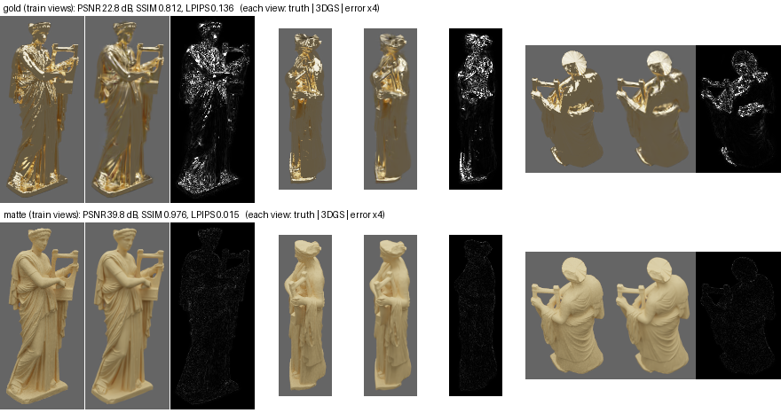
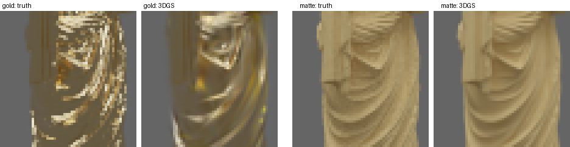
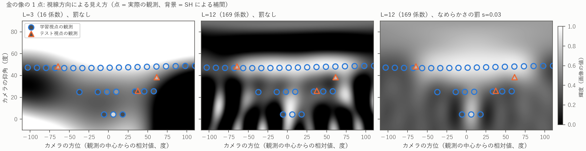
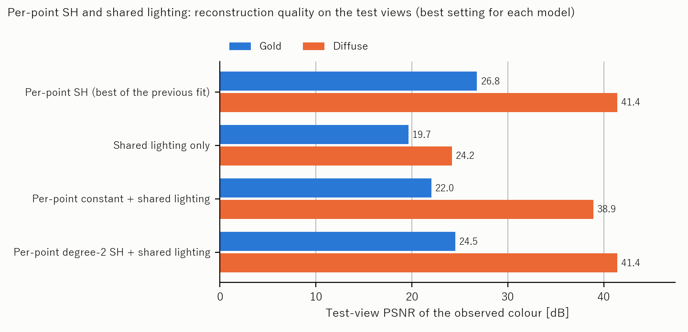
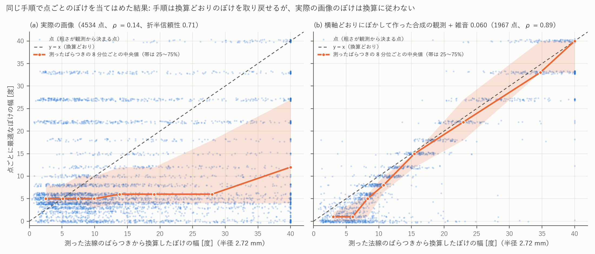
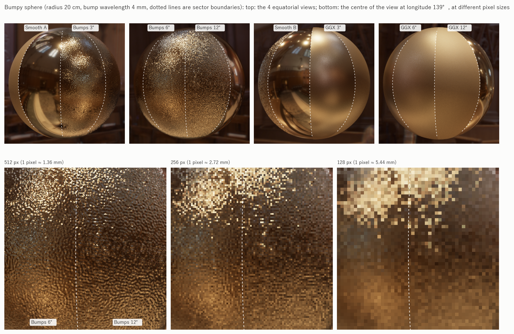
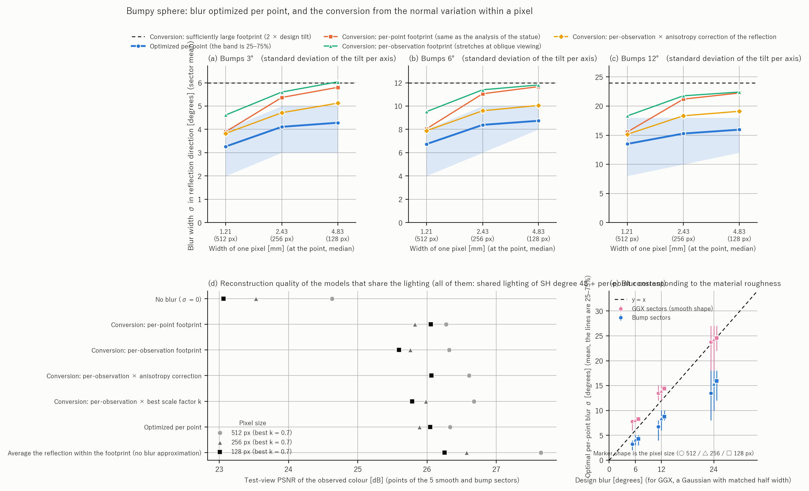
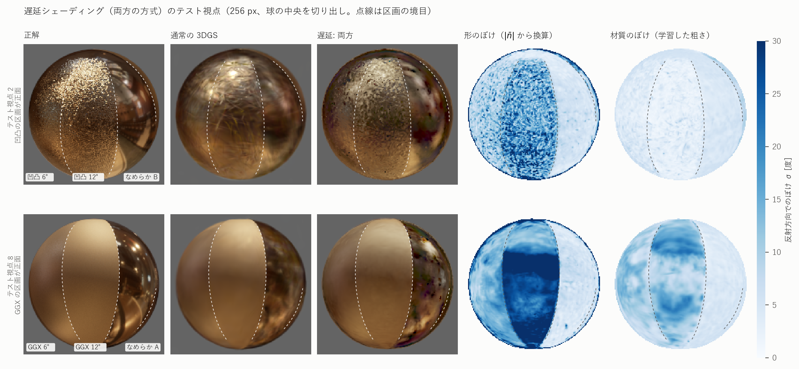

# 光沢面で 3DGS は破綻するか（金 vs 拡散面）

2026-11-17。手を加えない 3DGS（このリポジトリの実装、SH 3 次）で、光沢の強い面の再現が崩れることを、
素材以外をすべてそろえた対照付きで確かめた。

## 目的

- 光沢の強い面で 3DGS の再現が崩れるかを確かめる。
- 崩れ方が次のどちらかを区別する。
  - **汎化の失敗**: 学習に使った視点は再現できるが、新しい視点で崩れる
  - **表現力の不足**: 学習に使った視点でも再現できない

そのため、すべての指標を学習視点とテスト視点の両方で測った。

## 方法

### 刺激（GoLD_rayt で描画、[`make_views.py`](make_views.py)）

2 条件で違うのは像の素材だけ。形状・照明・カメラ・乱数の種は同一。

| 項目 | 内容 |
|---|---|
| 形状 | Erato 像（高さ 0.5 m） |
| 条件 | **金**: conductor（Au）、roughness 0.1 ／ **拡散面**: diffuse、albedo (0.80, 0.55, 0.22)（金に近い色） |
| 照明 | 上のソフトボックス（1.8 m 四方、D65、放射輝度 8）、周りの球光源 4 個（半径 0.35 m、放射輝度 7）、一様な環境光（0.15） |
| カメラ | 距離 1.3 m、画角 30°。学習 90 視点（仰角 15 / 35 / 55° × 方位 30）、テスト 10 視点（仰角 12〜65°・方位ランダム、学習視点と重ならない） |
| 描画 | GoLD_rayt RGB 版、256 × 256 px、512 spp、OIDN デノイズ、Reinhard トーンマップ。1 視点約 15 秒（100 視点で約 26 分） |
| 背景 | 環境光がそのまま見えるので、全視点で一様な灰色（0.396） |

照明とカメラの配置は `D:/GoLD_rayt/out/studies/gs_gloss/make_views.py` の v2（床なし）にそろえ、一様な環境光を足した。
環境光がないと、金の映り込みが真っ黒になった部分が背景と見分けられなくなるため。

### 学習

このリポジトリの `train.py` を、2 条件で同じ設定で実行した。

- 7000 iter、SH 3 次
- densification は 500〜3500 iter、opacity reset は 3000 iter
- 初期点 20000 個（像を囲む一辺 0.6 m の立方体内にランダムに配置）、背景色 0.396
- 学習時間（Quadro M4000）: 金 21 分（拡散面の描画と CPU を取り合った）、拡散面 18 分

### 評価（[`evaluate.py`](evaluate.py)、[`geom_eval.py`](geom_eval.py)）

- **画質**: PSNR、SSIM（11 × 11 ガウス窓）、LPIPS（AlexNet）。
  - 像の領域だけで平均した値と、全画面の値の両方を出す。像の領域は、GoLD_rayt が書き出す被覆率マスク（縁は中間値）で重み付けした。
  - 学習視点 90 枚とテスト視点 10 枚で別々に平均する。
- **形状**: 不透明度 0.3 以上のガウシアンの中心と、真のメッシュ表面との距離。符号は正が外側、負が内側。

## 結果

### 画質（像の領域）

| 条件 | 視点 | PSNR [dB] ↑ | SSIM ↑ | LPIPS ↓ |
|---|---|---|---|---|
| 金 | 学習 | 22.78 | 0.812 | 0.136 |
| 金 | テスト | 22.32 | 0.784 | 0.132 |
| 拡散面 | 学習 | 39.79 | 0.976 | 0.015 |
| 拡散面 | テスト | 38.88 | 0.972 | 0.018 |

参考として全画面の値を示す。背景は一様な灰色で再現しやすいため、甘く出る。

| 条件 | 視点 | PSNR [dB] | SSIM | LPIPS |
|---|---|---|---|---|
| 金 | 学習 | 32.15 | 0.975 | 0.037 |
| 金 | テスト | 31.83 | 0.973 | 0.035 |
| 拡散面 | 学習 | 48.29 | 0.997 | 0.003 |
| 拡散面 | テスト | 47.65 | 0.996 | 0.004 |

視点ごとの値は [`results.json`](results.json) にある。

### 定性的な結果

**テスト視点**（学習に使っていない視点）。各視点は左から正解、3DGS、誤差（4 倍に強調）。上段が金、下段が拡散面。


**学習視点**（学習に使った視点）。並びは同じ。



**拡大**（テスト視点 0 で金の誤差が最も集中する 56 px 四方を 4 倍に拡大。拡散面も同じ位置）。



### 形状（不透明度 0.3 以上）

| 条件 | ガウシアン数（全体 / 0.3 以上） | 表面までの距離 平均 / 中央値 [mm] | 符号付き平均 [mm] | 浮遊物（2 cm 以上） | 表面の被覆 平均 [mm] |
|---|---|---|---|---|---|
| 金 | 17740 / 4850 | 5.45 / 4.27 | −4.54 | 1.7 % | 10.4 |
| 拡散面 | 11993 / 3050 | 3.04 / 2.27 | −2.74 | 0.3 % | 8.3 |

閾値 0.5、0.7 でも傾向は同じ（[`geometry.json`](geometry.json)）。
参考までに、この解像度での 1 画素は像の位置で約 2.7 mm に当たる。

## 考察

1. **破綻は確認できた。** 金は拡散面より、像の領域の PSNR で 16〜17 dB 低い。LPIPS では 7〜9 倍悪い。
   - 誤差は、衣のひだのきらめき・暗い溝・縁の映り込みといった、鋭い映り込みに集中している。
   - 3DGS の金はくすんで、映り込みがひだに沿って帯状にぼけた見た目になる（拡大図）。
   - 拡散面は細部まで再現できていて、誤差は輪郭のわずかな画素だけ。
2. **崩れ方は「汎化の失敗」ではなく「表現力の不足」だった。** 金は学習視点でも 22.8 dB しか出ていない。学習視点とテスト視点の差は、PSNR で 0.5 dB と拡散面（0.9 dB）より小さく、LPIPS ではむしろテスト視点の方がわずかに良い。
   - 学習した視点ですら見え方を覚えられていない、ということになる。
   - 各ガウシアンは 90 方向から見られ、方向ごとに映り込む光源が大きく変わる。ところが 3 次の SH（1 チャンネル 16 係数）は、方向に対してなだらかな変化しか表せない。そのため、方向について平均したような色（くすんだ金）に落ち着いたと考えられる。
   - ただし、SH の次数を上げるだけでは治らない。次数を上げると学習視点は覚えられるようになるが、テスト視点は頭打ちになる。このことは、下の[追加の検証](#追加の検証-sh-の次数を上げれば治るか3dgs-を使わない-1-点ずつの当てはめ)で確かめた。
3. **形状への影響は小さい。**
   - 金ではガウシアンが表面の内側に寄り（符号付き −4.5 mm、拡散面は −2.7 mm）、表面から離れた浮遊物も 5 倍ある。映り込みを表面の奥に置いて説明する傾向は見える。
   - ただし内側へのずれの差は 1.8 mm で、1 画素（約 2.7 mm）より小さい。
   - 主な破綻は、形状よりも色（視点依存の見え方）の方にある。
   - 金の方がガウシアン数は多い（17740 対 11993）。誤差の大きさに応じて densification が増やしたが、それでも表せていない。

## 限界

- **学習が短い**: 7000 iter（公式は 30000）で、densification も 3500 iter で止めた。長く学習してガウシアンを増やすと、学習視点の当てはまりが上がり、学習視点とテスト視点の差が開く可能性がある。
- **試行数**: 各条件 1 回（乱数の種 1 つ）だけ。
- **水準が少ない**: 解像度は 256 px と低く、光沢は roughness 0.1 の 1 水準だけ。
- **学習画像の処理**: OIDN でデノイズしているので、視点ごとにわずかに異なる処理が入っている。
- **初期化**: ランダムな初期点で、SfM の点群は使っていない。

## 追加の検証: SH の次数を上げれば治るか（3DGS を使わない 1 点ずつの当てはめ）

### 問い

上の結果から、「視点で変わる色を 3 次の SH で表しているのがボトルネックで、SH をいじれば治る」という予測が立つ。
これを、3DGS の最適化の影響を除いて確かめた。

当てはめる前に、表すべき関数の細かさを見積もっておく。

- **金のローブの幅**: GoLD_rayt の roughness は GGX の α = roughness² なので、金は α = 0.01 で、ローブの幅は 1° 程度とほぼ鏡面。
- **表面の 1 点が表すべき関数**: 視線方向に対する色は、「法線で折り返した方向の照明」をこの幅でぼかしたもの。ぼかしはほぼ効かないので、細かさは照明で決まる。球光源は像から見て約 19°、ソフトボックスは約 57° で、どちらも縁がくっきりしている。
- **SH が表せる細かさ**: 次数 L の SH が表せる特徴は、大きさがおよそ 180°/L まで（L=3 で約 60°）。
- **観測の粗さ**: 1 点を見ている学習視点は、方位 12°・仰角 20° 間隔で、仰角 15〜55° の帯の中にしかない。

この見積もりから、次の予測が立つ: 次数を上げると学習視点は覚えられるが、テスト視点は良くならない（表現力の不足が汎化の失敗に置き換わる）。

### 方法（[`sh_oracle.py`](sh_oracle.py)）

1. **点を取る**: 真のメッシュ上に 10000 点を面積に比例して取る。
2. **見えている視点を集める**: 各点が見えている視点での画像の値（観測色）と視線方向を集める。見えているかどうかは次の 3 つで判定する。
   - 表面を密に覆う 200 万点で作った z バッファの深度以下である
   - 75° より斜めから見ていない
   - 像の縁の画素ではない
3. **点を絞る**: 学習視点で 10 回以上見えている 7705 点を使う。1 点あたりの学習視点での観測は、中央値 26 回。
4. **当てはめる**: 点ごとに独立に、次数 L の SH を最小二乗で当てはめる。係数が観測より多くても解が決まるよう、ごく弱い ridge（λ = 10⁻³）を付ける。
5. **評価する**: 学習視点の観測（当てはまり）と、テスト視点の観測（予測）の PSNR を測る。

ガウシアン 1 個が表面の 1 点だけを受け持つ、理想化した場合の 3DGS に当たる。

**正則化を変えた確認**: 結論が正則化の弱さに左右されないかを見るため、なめらかさの罰も試した。
- 罰の形: 次数 l の係数に s·l(l+1) を掛ける。球面上の勾配の大きさの二乗和に当たる。定数項には掛けないので、平均の色は偏らない。
- 強さ: s = 0.003〜0.1。
- 定数項まで縮める普通の ridge では、色そのものが暗く偏り、比較にならなかった。

### 結果


| 次数 L（係数の数） | 金 学習 | 金 テスト | 拡散面 学習 | 拡散面 テスト |
|---|---|---|---|---|
| 0（1） | 20.6 | 20.5 | 39.1 | 38.8 |
| 2（9） | 26.2 | 24.0 | 43.8 | 39.1 |
| **3（16）**: 3DGS の既定 | 28.6 | **24.0** | 45.7 | 34.8 |
| 4（25） | 30.5 | 23.5 | 46.9 | 30.8 |
| 6（49） | 34.0 | 21.7 | 49.2 | 26.7 |
| 12（169） | 45.4 | 19.2 | 59.6 | 20.2 |
| 16（289） | 56.1 | 13.8 | 70.8 | 11.8 |

単位は dB（観測色の PSNR）。正則化はごく弱い ridge だけ。全次数の値と、なめらかさの罰を変えた結果は [`sh_oracle.json`](sh_oracle.json) にある。

なめらかさの罰を入れたときの、テスト視点の最高値:

| 罰の強さ s | 金 | 拡散面 |
|---|---|---|
| 0.003 | 26.3 dB（L=16） | 41.1 dB（L=2） |
| 0.01 | 26.6 dB（L=16） | 41.3 dB（L=2） |
| 0.03 | 26.8 dB（L=12） | 41.4 dB（L=3） |
| 0.1 | 26.7 dB（L=12） | 41.4 dB（L=5） |

**金の像の 1 点の例。** 学習・テストの両方でよく見えていて、見え方の変化が最も大きい点を選んだ。
- 点は実際の観測、背景は当てはめた SH による補間。
- 横軸はカメラの方位（この点の観測の中心からの相対値）、縦軸は仰角。



### 考察

1. **予測どおり、次数を上げるだけでは治らない。**
   - 罰がほぼない場合、学習視点の PSNR は次数とともに上がり続ける（L=16 で 56 dB）。
   - 一方テスト視点は、L=2〜3 の 24.0 dB が最高で、それより上では下がっていく（L=12 で 19.2 dB）。
   - 下がり始めるのは、係数の数 (L+1)² が 1 点あたりの観測数（中央値 26）を超えるあたり（L ≥ 4）。表現力の不足が、そのまま汎化の失敗に置き換わっている。
   - 1 点の例でも、強いハイライトは学習視点の 1 つにしか写っていない（一番下の段の中央）。
     - L=3 はそれをなだらかな塊にして無視する。
     - L=12 はその 1 点に合わせるため、観測のない所に縦縞の偽の明るさを作っている。
2. **SH の扱い方で数 dB は改善するが、天井は観測の粗さで決まる。**
   - なめらかさの罰を入れると高い次数が使えるようになり、金のテスト視点は 26.8 dB まで上がる（L=3 の 24.0 dB より +2.8 dB）。
   - ただし罰の強さを 30 倍変えても 26.3〜26.8 dB で頭打ちで、拡散面（41.4 dB）との差は 14 dB 以上残る。
   - 1 点あたり 26 回・12°×20° 間隔・3 段の帯という観測の粗さに対し、ほぼ鏡面の金の映り込み（約 19° の光源、縁が鋭い）は細かすぎる。
   - したがって、**点ごとに独立に視点依存の色を持つ方式では、SH でも他の関数でも越えられない**。
   - 越えるには、点の間で観測を共有する必要がある。多数の点が、それぞれ別の反射方向から同じ照明を見ているので、反射方向で引く共有の環境として表せば、まとめて密に観測できる。光沢に対応した手法がその設計をとる理由がここにある。
3. **3DGS は、L=3 の表現力すら使い切れていない。**
   - 1 点ずつ理想的に当てはめると、L=3 で金の学習視点は 28.6 dB 出る。
   - 3DGS 本体（上の結果）は 22.8 dB だった。
   - 考えられる理由は 3 つ:
     - 1 個のガウシアンが、映り込みの異なる複数の点にまたがっている
     - 7000 iter と短い
     - 1 次以上の SH 係数の学習率が 0 次の 1/20
   - 本体の SH の次数を上げると学習視点はある程度伸びるはずだが、テスト視点の天井は上の 24〜27 dB の範囲を超えないと予想される。
4. **拡散面でも少しだけ視点依存がある。**
   - 本来は視点によらない色だが、L=1〜3 で（罰があれば）テスト視点が 38.8 → 41 dB に上がる。画素の大きさやデノイズの視点ごとの違いによる、系統的な差を拾っていると考えられる。
   - 罰がないと、ほぼ一定の信号に雑音まで当てはめるので、金より早く崩れる（L=3 で 34.8 dB）。

### この検証の限界

- 点ごとの独立な当てはめで、3DGS のように 1 個のガウシアンが複数の点にまたがることや、空間的になめらかになることは入っていない。
- 見えているかの判定は、点群で作った z バッファによる近似。
- 観測色は、トーンマップ後の画像の値を画素の範囲で平均したもの（3DGS が当てはめている値と同じ）。

## 追加の検証 2: 照明を点の間で共有すれば天井を越えられるか

### 問い

点ごとに独立に視点依存の色を持つ限り、天井は 1 点あたりの観測の粗さで決まる。そこで、多数の点の観測を 1 つにまとめる。

- 多数の点は、それぞれ違う反射方向から同じ照明を見ている。
- 反射方向で引く共有の照明として表せば、天井を越えられるはず。

これは光沢に対応した手法（Ref-NeRF、GaussianShader、3DGS-DR など）の中心にある考え方なので、同じく 3DGS を使わない当てはめで確かめた。

### モデルと解き方（[`env_oracle.py`](env_oracle.py)）

```
観測色 y(p, v) ≈ 点ごとの項 Σ_k c_{p,k} Y_k(d)  +  共有の照明 Σ_j e_j Y_j(r)
r = 2(ω·n)n − ω   （ω: 点からカメラへの向き、n: 法線）… 視線を法線で折り返した方向
```

- **2 つの項**: 点ごとの項は、拡散の成分（法線で決まり、反射方向では決まらない）を受け持つ。共有の照明は、全点で 1 つだけ。
- **比べたモデル**:
  - 点ごとの項なし
  - 点ごとの定数
  - 点ごとの SH 2 次（なめらかさの罰 0.03）
  - 照明の SH の次数 16 / 32 / 48 と、なめらかさの罰 0.1 / 1 / 10 も振り、各モデルで最も良い設定を報告する（点ごとの SH と同じ比べ方）。
- **解き方**: 点ごとの係数は、共有の係数を決めれば点ごとの小さな最小二乗で決まるので、先に消去する（Schur 補元）。そのあと共有の照明の正規方程式（最大 2401 × 2401）を 1 回解く。
- **法線**: レンダラーと同じ、頂点法線を補間したなめらかな法線を使う。
  - 三角形の面の法線とは、中央値 3.1°・90% 点 11.3° 違う。
  - ほぼ鏡面ではこの差が反射方向で 2 倍になるので、反射の計算には向かない。面の法線で試した最初の版は、0.2〜0.4 dB 悪かった。
  - 可視判定は前回と同じ面の法線のままにして、観測の集合をそろえた。

### 結果 1: 照明は正しく復元できるが、全体の再現度はむしろ下がる



金の像の映り込みだけから復元した共有の照明（点ごとの定数 + 共有の照明で最も良かった設定）:


- **照明の地図は正しい。** 横の 4 つの球光源が、真の位置（橙の破線）にちょうど現れた。真上の明るい領域がソフトボックスに当たる。像の映り込みを集めると周りの照明が見えてくる、という共有の効果自体は確かめられた。
- **それでも、金の再現度は点ごとの SH（26.8 dB）を下回った。**
  - 共有の照明だけ: 19.7 dB
  - 点ごとの定数を足す: 22.0 dB
  - 点ごとの SH 2 次を足す: 24.5 dB
- **照明の解像度は効いていない。** 照明の次数（16〜48）やなめらかさの罰を変えても、結果はほとんど変わらない。反射方向で並べた観測そのものが「同じ方向なのに明るさがばらばら」で、モデルの仮定が崩れていることを示している。
- **拡散面は予想どおり。** 共有の照明だけでは 24.2 dB と悪い（拡散は反射方向では決まらない）。点ごとの項を足すと 38.9〜41.4 dB に戻る。拡散と鏡面に分けるのが筋であることが数字で見える。

### 結果 2: 何が仮定を崩しているか（[`env_diagnose.py`](env_diagnose.py)）

切り分けのため、各観測について 2 つを幾何的に調べた。

- 反射方向に飛ばした光線が、光源（真の位置の 4 つの球とソフトボックス）に当たるか
- 途中で像自身に遮られるか（像を 2 mm の格子で表して光線を進める近似）

また、各点の周り（1 画素の幅の範囲）で、表面の法線がどれだけばらついているかを測った。結果は中央値 8.2°、90% 点 27.6° だった。

学習視点の観測（19.7 万個）の輝度（画像の値）:

| 反射光線の行き先 | 点の凹凸 | 観測の割合 | 中央値 | 25〜75% |
|---|---|---|---|---|
| 光源（遮られない） | 少ない（< 5°） | 0.7 % | 0.895 | 0.847〜0.923 |
| 光源（遮られない） | 多い | 1.8 % | 0.846 | 0.758〜0.901 |
| 暗い所（遮られない） | 少ない | 26.7 % | 0.352 | 0.350〜0.354 |
| 暗い所（遮られない） | 多い | 33.3 % | 0.352 | 0.349〜0.393 |
| 像自身に遮られる | 少ない | 12.6 % | 0.357 | 0.349〜0.546 |
| 像自身に遮られる | 多い | 25.0 % | 0.383 | 0.345〜0.567 |

集合を絞って比べ直した結果（テスト視点の PSNR [dB]）。点ごとの SH は L = 2〜6・罰 0.03 の中の最良、共有の照明は 32 次・罰 1。

| 集合 | 点の数 | 点ごとの SH | 定数 + 共有の照明 | SH 2 次 + 共有の照明 |
|---|---|---|---|---|
| すべての点・すべての観測 | 7705 | **25.9** | 22.0 | 24.5 |
| すべての点・遮られない観測だけ | 4879 | **26.5** | 24.2 | 25.8 |
| 凹凸の少ない点・遮られない観測だけ | 2093 | 27.9 | 28.1 | **28.8** |

### 考察

1. **共有の照明は、仮定が成り立つ所では効く。**
   - 光線が光源に当たる観測は明るく（中央値 0.85〜0.90）、遮られずに暗い所へ向かう観測は 0.352 にきれいにそろう。どちらも共有の照明の仮定どおり。
   - 凹凸が少なく遮られない観測だけに絞ると、照明 1 つを全点で共有するモデルが点ごとの SH を逆転する（28.8 dB 対 27.9 dB）。
2. **この像では、その仮定が大きく崩れている。**
   - **相互反射**: 反射光線の 38% が像自身に遮られる。その観測は上位 4 分の 1 が 0.55 以上と明るく、照らされた金が金に映っている。遠くの照明では表せない。
   - **画素より細かい凹凸**: 1 画素の範囲で法線が中央値 8°・90% 点 28° ばらつくので、画素の色は多くの方向の映り込みの平均になる。点ごとに違う粗さを持つのと同じで、点の法線 1 本では予測できない。
   - **光源の情報が少ない**: 光源に当たる観測は全体の 2.5% しかない。
   - 点ごとの SH は、これらをすべて「その点の見え方」として丸ごと覚えるので、全体では有利になる。ただし、観測の粗さの天井は越えられない。
3. **手法の分類との対応が具体的に見える。**
   - 遠くの光源の映り込み → 環境マップを共有する手法（GaussianShader、3DGS-DR など）。
   - 像自身の映り込み → 反射光線をシーンに飛ばす手法（NeRF-Casting、ガウシアンの光線追跡を使う手法など）。この像では観測の 4 割に関わる。
   - 画素より細かい凹凸 → 粗さに応じてぼかした方向の符号化（Ref-NeRF の IDE）や、画素単位の法線（3DGS-DR）。
   - この像を環境マップだけで扱うのは足りず、各論文がどの崩れを解こうとしているのかが分かる。
4. **絞り込んでも 28〜29 dB にとどまる。** 理由として次が考えられる。
   - 照明の解像度（32 次で約 6°）が、光源の縁の鋭い段差に足りない
   - 照明が無限遠ではない（光源は像から約 2 m、像の大きさは 0.5 m で、方向が数度ずれる）
   - 光源の縁で、画素の中の一部だけに光源が写る

### この検証の限界

- 遮蔽の判定は 2 mm の格子による近似。法線のばらつきは、表面の密な点の面の法線から測った。
  レンダラーと同じ補間した法線で測り直すと小さくなる（全 10000 点、半径 1.36 mm で中央値 8.3° → 6.0°、90% 点 26.4° → 19.7°。追加の検証 3）。
- 各モデルで「テスト視点で最も良い設定」を報告しているので、どのモデルの値もやや楽観的（比べ方の条件はそろえている）。
- 凹凸の少ない点への絞り込みは、点の種類が変わる（平らな所が多くなる）ので、集合間の値は直接比べられない。比べられるのは、同じ集合の中でのモデル間の差。

## 追加の検証 3: 画素の中の法線のばらつきは、粗さとして効いているか

### 問い

[文献調査](reports/3DGS光沢対応手法の文献調査.md)で見つけた空白を、3DGS を使わずに確かめる。

- 光沢 3DGS の手法は、粗さをガウシアンごとの値として学習で決める。
- 一方、グラフィックスでは、1 画素に写る範囲の中で法線がばらつくと、その画素の映り込みは粗い面と同じようにぼける。このばらつきを粗さに換算して足す手法が確立している（Toksvig の方法、LEAN mapping、Kaplanyan ら 2016 など）。
- 光沢 3DGS で、この 2 つを結びつけた例は見つからなかった。

そこで次を問う。画素の中の法線のばらつきから決めた粗さは、点ごとに最適化した粗さと合うか。合うなら、学習で決まる粗さの大部分は、材質ではなく形状で決まっていることになる。

見る距離で実効的な粗さが変わるか（スケールの問い）は、このデータでは確かめられない。カメラがすべて 1.3 m の距離にあるため。

### モデル（[`env_rough.py`](env_rough.py)）

追加の検証 2 の「共有の照明 + 点ごとの項」に、点ごとのぼかしを足す:

```
y(p, v) ≈ Σ_k c_{p,k} Y_k(d)  +  Σ_j a_{l(j)}(σ_p) e_j Y_j(r)
a_l(σ) = exp(−l(l+1) σ² / 2)
```

- 球面上を幅 σ（1 軸あたりの標準偏差）のガウスでぼかすことは、SH では次数 l の係数に a_l を掛けることに当たる（球面上の熱拡散。Ref-NeRF の IDE の減衰と同じ形）。数値で確かめると、4°・10°・20° のつもりの幅は 4.00°・9.97°・19.79° になった。
- σ_p を決めれば、予測は照明 e について線形のまま。そのため、追加の検証 2 と同じ解き方（点ごとの項を消去して e を 1 回で解く）が使える。

σ_p の決め方を 3 通り比べる。

| 決め方 | 内容 | 点ごとの自由なパラメータ |
|---|---|---|
| 材質の粗さだけ | σ_p = 0。材質の粗さ（α = 0.01、反射方向で約 1°）は照明の SH の分解能（約 4°）より細かい。全点に共通のぼけは照明 e 自体がぼけて吸収するので、「全点で同じ粗さ」のモデルでもある | なし |
| 測ったばらつきから換算 | 真のメッシュで、点のまわり半径 R の表面の法線の平均ベクトル n̄ を測り、σ_p = 2√(1 − \|n̄\|) とする | なし |
| 点ごとに最適化 | σ_p を 0〜40° の格子から選ぶ（学習視点の誤差が最小のもの）。照明と交互に 10 回更新する。既存手法が学習する粗さの代わり | 1 |

換算の根拠は次のとおり。法線が 1 軸あたり標準偏差 σ_n でばらつくと、平均ベクトルは短くなり |n̄| ≈ 1 − σ_n² になる（Toksvig の方法の手がかり）。反射方向は、法線のずれの 2 倍ずれる。

- **法線**: レンダラーと同じく、頂点法線を補間したものを使う。
- **半径 R の既定値は 2.72 mm**（距離 1.3 m での 1 画素の幅）。画素の中での平均（箱型）と、観測を拾うときの双線形補間（±1 画素の三角形）を合わせると、広がりは 1 軸あたり標準偏差 1.36 mm になる。これは半径 2.72 mm の一様な円板と同じ。0.68〜4.0 mm も試した。
- **値の空間**: 画像は「放射輝度 → Reinhard → sRGB の曲線」で表示値になっている。画素の中での平均は放射輝度で起きるので、モデルは放射輝度で組み、誤差は表示値で測る（評価は前回までと同じ表示値の PSNR）。
  - 表示値への変換は非線形なので、予測のまわりで一次近似して重み付き最小二乗を解き、近似を取り直すことを繰り返す（ガウス・ニュートン法。6 回で収束）。
  - 最初は重みを観測値の所で固定していた。そうすると、明るい映り込みの重みが背景の数千分の一になり、外しても無視された。点ごとの SH でも 1.7 dB 悪くなっていた。
- **観測**: 相互反射は扱わないので、追加の検証 2 の判定で像自身に遮られる観測は除く。点は 4879 個、観測は学習 11.5 万・テスト 1.2 万。
- **確認**: 表示値のまま・ぼけなし・照明 32 次・罰 1 で解くと 24.24 dB になり、追加の検証 2 の「すべての点・遮られない観測だけ」と一致した。

### 結果 1: 再現度

テスト視点の PSNR [dB]（遮られない観測だけ）。照明は 48 次で、なめらかさの罰 0.03・0.1・0.3 のうち最良の値。点ごとの SH は、ガウス・ニュートン法で放射輝度から当てはめ直したもの。

| モデル | 換算したぼけ（中央値） | 点ごとの定数 + 共有の照明 | 点ごとの SH 2 次 + 共有の照明 |
|---|---|---|---|
| 材質の粗さだけ | 0° | 24.20 | 25.33 |
| 測ったばらつきから換算（R = 0.68 mm） | 約 3° | 24.40 | 25.49 |
| 測ったばらつきから換算（R = 1.36 mm） | 約 6° | 24.40 | 25.48 |
| 測ったばらつきから換算（**R = 2.72 mm**、既定） | 約 12° | 23.91 | 25.06 |
| 測ったばらつきから換算（R = 4.0 mm） | 約 17° | 23.53 | 24.75 |
| 点ごとに最適化 | 6°（最適化の結果） | **24.59** | **25.57** |
| 参考: 点ごとの SH（照明なし、6 次） | | 25.27 | |


### 結果 2: 最適化した粗さと、測ったばらつきの関係（[`env_rough_check.py`](env_rough_check.py)）

点ごとの定数のモデル（罰 0.1）で、点ごとに最適化したぼけと、測ったばらつきから換算したぼけを比べた（図の左、σ を変えると学習視点の誤差が変わる 4534 点）。

- 順位相関は **ρ = 0.14** と弱い。半径を変えても 0.13〜0.15。
- 大きさも合わない。最適化したぼけの中央値は 6° で、換算（R = 2.72 mm）の 12° の半分。

相関が弱いのは最適化した粗さが雑音だらけだからか、それとも手順に見分ける力がないからか。この 2 つを確かめた。

| 確認 | 結果 |
|---|---|
| 折半信頼性: 学習視点を偶数番目と奇数番目に分け、それぞれで最適化したぼけの順位相関 | 0.55（全視点に直すと 0.71）。最適化した粗さは、視点を替えてもかなり再現する |
| 希薄化を補正した相関（上の信頼性で割り戻す） | 0.17 |
| 回収テスト（雑音なし）: 換算どおりにぼかして作った合成の観測に、同じ手順を当てる | ρ = 0.99、中央値 12.3° → 12.0° |
| 回収テスト（雑音あり）: 実データの当てはめ残差と同じ大きさ（表示値で 0.060）の独立な雑音を足す | ρ = 0.89、中央値 12.7° → 10.0° |



最適化したぼけが何と相関するかも見た（同じ 4534 点、Spearman ρ）。

| 候補 | ρ |
|---|---|
| 測った法線のばらつき（R = 2.72 mm） | +0.14 |
| 光源の視差（光源を像の中心から見た向きと、その点から見た向きの差。中央値 3.7°） | −0.15 |
| 像の中心からの距離 | −0.16 |
| 反射光線が光源に当たる観測の割合 | −0.15 |
| 学習視点の観測数 | −0.22 |
| 視線と法線の cos の平均 | −0.17 |

### 考察

1. **この像では、「学習する粗さは画素の中の法線のばらつきで決まっている」という仮説は支持されなかった。**
   - 手順には見分ける力がある。仮説どおりのデータなら、雑音があっても ρ = 0.89 で取り戻せる。
   - 最適化した粗さは、点ごとの性質として再現する（信頼性 0.71）。
   - それでも、測ったばらつきとはほとんど相関しない（補正しても 0.17）。点ごとの粗さには再現する違いがあるが、それは画素の中の法線のばらつきではない。
2. **換算どおりのぼけは強すぎる。**
   - 最適化したぼけの中央値 6° は、既定の半径の換算 12° の半分で、半径を半分にした換算（R = 1.36 mm）とほぼ同じ。
   - 換算のぼけが 6° 以下（R ≤ 1.36 mm）なら、材質の粗さだけより 0.2 dB 良い。12° 以上では悪い。
   - 理由は切り分けていない。候補は次の 3 つ。
     - 異方性: 衣のひだは円柱に近く、法線は 1 方向にしかばらつかない。等方のぼけで同じ分散を与えると、ひだに沿う方向をぼかしすぎる。
     - 足跡の見積もり: レンダラーの画素フィルタとデノイズは確認していない。
     - 斜めから見た場合: 「反射は法線の 2 倍ずれる」は正面入射での近似。
3. **最適化した粗さが何を吸っているかは分からない。** 試した候補はどれも |ρ| ≤ 0.22 だった。いくつかの誤差の混ざりものと考えられる。
   - 光線 1 本の判定では残ってしまう、ぼけたローブの一部だけが遮られる観測
   - 斜めから見たときのフレネル反射の変化（点ごとの定数では表せない）
   - 光源が近いことによるずれ

   3DGS の手法が学習する粗さも、「形状によるぼけ」ではなく「モデルの誤差を吸う自由度」として働いている可能性がある（推論）。
4. **粗さを点ごとに変えても、改善は小さい。** 全点で同じ粗さに対して +0.4 dB（2 次の項ありでは +0.2 dB）。この像の遮られない観測では、粗さの違いは主なボトルネックではない。
5. **次の一歩**: 像では要因が絡み合っていて、この問いを切り分けられない。凸な物体（球）・HDR 環境マップ（遠方照明の仮定が厳密に成り立つ）・振幅を制御した凹凸でデータを作り、換算そのもの（とくに 2 倍の食い違い）を確かめる必要がある。距離を変えて描けば、スケールの問いも同じデータで扱える。

### 訂正

- 追加の検証 2 の「1 画素の範囲の法線のばらつき 中央値 8.2°・90% 点 27.6°」は、面の法線で測った値。レンダラーと同じ補間した法線では小さくなる（上の「この検証の限界」）。
- 文献調査のレポートでは、このばらつきを「Beckmann の α でおよそ 0.2〜0.75」と換算した。しかし、ばらつきは平均ベクトルの長さから acos|n̄| で求めた角度なので、α はばらつきの角度（ラジアン）とほぼ同じで、0.14〜0.48 になる（|n̄| ≈ 1 − α²/2）。材質の 0.01 より一桁以上大きいという結論は変わらない。

### この検証の限界

- ぼけは等方のガウス。反射方向のずれを法線の 2 倍とするのは、正面入射での近似。
- 足跡は、1 画素の幅の円板で近似した。視点ごとの距離の違い（約 1.1〜1.5 m）や、斜めの面での伸びは無視した。
- 照明は SH 48 次（約 4°）なので、それより細かいぼけは区別できない。
- 遮蔽は反射方向の光線 1 本で判定したので、ぼけたローブの一部だけが遮られる観測は残る。
- 各モデルで「テスト視点で最も良い罰」を報告している。

## 追加の検証 4: 凹凸を制御した球で、ばらつきと粗さの換算を確かめる

### 問い

追加の検証 3 の像では、点ごとに最適化したぼけは、画素の中の法線のばらつきから換算したぼけと順位がほとんど合わず（ρ = 0.14）、大きさも換算の半分だった。像には相互反射・近い光源・向きのそろった襞・デノイザーが重なっていて、原因を切り分けられなかった。

そこで、それらを外した球で同じ問いを立て直す。

1. 画素より細かい凹凸だけがあるとき、点ごとに最適化したぼけは換算 σ = 2√(1 − |n̄|) に合うか（順位と大きさ）。
2. 画素の大きさを変えると、最適なぼけは換算の変化に従うか（スケールの問い）。
3. 材質の粗さ（GGX）によるぼけは、どの幅のガウスに当たるか。

### データ（[`make_sphere.py`](make_sphere.py)）



- **形と照明**: 半径 20 cm の金の球（像と同じ GGX、roughness 0.1）を、HDR の環境マップ（grace-new、明るさ 2 倍）だけで照らす。凸なので相互反射も自己遮蔽もなく、遠方照明の仮定が厳密に成り立つ。
- **区画**: 経度 45° ずつ 8 区画に分ける。

  | 区画 | 形 | 材質の粗さ |
  |---|---|---|
  | なめらか A・B | 凹凸なし | 像と同じ（α = 0.01） |
  | 凹凸 3°・6°・12° | 等方な凹凸。法線の傾きが 1 軸あたり標準偏差 3°・6°・12° | 像と同じ |
  | GGX 3°・6°・12° | 凹凸なし | 法線分布の半値幅が凹凸の区画と同じになる GGX（α = 0.096・0.19・0.39） |

- **凹凸**: 256 本の平面波（波長 4 mm、向きと位相はランダム）の和で作った等方なガウス場を、変位として細かいメッシュ（約 260 万頂点）に焼き込んだ。法線は解析的に求めて頂点法線として書く。
  - 区画の境目では 4° かけて振幅をつなぎ、緯度 60〜70° で 0 に落とす。
  - メッシュで測った傾きの標準偏差は 2.9°・5.9°・11.4〜12.1° で、ほぼ設計どおり。
- **カメラ**: 距離 1.3 m、視野 30°、512 px、512 spp、箱型の画素フィルタ。学習 96 視点（緯度 −30・0・30・60° に 24 視点ずつ）、テスト 12 視点（ランダム）。
- **画素の大きさ**: 512 px の放射輝度を 2×2・4×4 で平均し、256・128 px を作る（画素の大きいカメラで撮ったのと同じ）。球の表面での 1 画素の幅は 1.21・2.43・4.83 mm（中央値）。256 px が像の解析と同じ大きさ。

### モデル（[`sphere_rough.py`](sphere_rough.py)）

解き方は追加の検証 3 と同じ（共有の照明 SH 48 次 + 点ごとの定数、なめらかさの罰 0.1）。点は区画ごとに 800 個で、緯度 50° 以内、境目から 7° 以上離れたもの。法線は凹凸の解析的な式から求める。

ぼけの決め方を次のように比べる。

| 決め方 | 内容 |
|---|---|
| ぼけなし | σ = 0 |
| 換算: 点の足跡 | 接平面上の等方な足跡（画素の箱型 ⊗ 双線形補間の三角形、1 画素の幅はその点を見る学習視点の平均の奥行きで決める）で法線を平均し、σ = 2√(1 − \|n̄\|)。像の解析と同じ |
| 換算: 観測ごとの足跡 | 観測ごとに画素の足跡を球面に投影する（斜めから見ると伸びる）。その平均法線で反射させ、σ も観測ごとに換算する |
| 換算: 観測ごと × 異方性の補正 | 上の σ を √((1 + cos²θ)/2) 倍する（θ は視線と平均法線の角度）。理由は下記 |
| 換算: 観測ごと × 倍率 k | 「観測ごとの足跡」の σ を一律に k 倍する（k = 0.5〜1.0。学習視点で最良の k を選ぶ） |
| 点ごとに最適化 | σ を 0〜40° の格子から選ぶ（追加の検証 3 と同じ） |
| 足跡の中で反射を平均 | ぼけの近似を使わない厳密なモデル。観測ごとに、足跡の 64 サンプルの法線でそれぞれ反射させた方向の SH を平均して、照明に掛ける |

異方性の補正の理由は次のとおり。
- 法線を入射面の中で δ 傾けると、反射方向は 2δ 曲がる。入射面に垂直に傾けると、2δ cosθ しか曲がらない。
- 斜めから見るほど、ぼけは片方の軸で狭くなる。「法線の 2 倍」は正面から見たときだけ成り立つ。
- 補正は、2 軸の分散の平均に当たる等方のぼけ。

σ は格子の値しか取らないので、区画の中央値は格子の目に張り付く。以下の表と図では区画の平均を使う。

### 結果 1: ぼけの大きさ

区画ごとの平均 [度]。「最適化」は σ を変えると学習視点の誤差が変わる点だけの平均で、凹凸の区画ではほぼ全点（2379〜2395 / 2400 点）。

| 区画 | 画素 | 換算: 点の足跡 | 換算: 観測ごと | 換算: 異方性の補正 | 等価な σ（厳密なモデルから） | 最適化 |
|---|---|---|---|---|---|---|
| 凹凸 3° | 512 | 3.9 | 4.6 | 3.8 | 3.9 | 3.3 |
| | 256 | 5.4 | 5.6 | 4.7 | 4.8 | 4.1 |
| | 128 | 5.8 | 6.0 | 5.1 | 5.2 | 4.3 |
| 凹凸 6° | 512 | 8.0 | 9.5 | 7.9 | 8.0 | 6.7 |
| | 256 | 11.1 | 11.4 | 9.6 | 9.7 | 8.4 |
| | 128 | 11.7 | 11.8 | 10.1 | 10.2 | 8.7 |
| 凹凸 12° | 512 | 15.6 | 18.3 | 15.1 | 16.1 | 13.5 |
| | 256 | 21.2 | 21.8 | 18.3 | 21.0 | 15.3 |
| | 128 | 22.2 | 22.4 | 19.1 | 20.9 | 16.0 |
| なめらか A・B | 512〜128 | 0.3〜1.4 | 0.6〜2.1 | 0.4〜1.7 | 0.5〜1.9 | 0.3〜0.5 |

- 十分大きい足跡での換算は、凹凸 3°・6°・12° で 6°・12°・24°（傾きの 2 倍）。
- 「等価な σ」は、厳密なモデルの平均した SH の次数 4 の成分が、平均法線の向きの SH を exp(−l(l+1)σ²/2) 倍したものだとして読んだ幅。ぼけの近似を使わずに、足跡の中の反射方向の広がりを測ったものに当たる。

順位相関（Spearman ρ、最適化と換算: 点の足跡）は次のとおり。

| 画素 | なめらかと凹凸の 5 区画 | 凹凸 3° の中だけ | 凹凸 6° の中だけ | 凹凸 12° の中だけ |
|---|---|---|---|---|
| 512 | 0.90 | 0.65 | 0.61 | 0.68 |
| 256 | 0.93 | 0.67 | 0.68 | 0.70 |
| 128 | 0.93 | 0.60 | 0.57 | 0.59 |

GGX の区画で最適化したぼけは、どの画素の大きさでもほぼ同じだった（512〜128 px で 1° 以内）。

| 区画 | 半値幅を合わせたガウス | 最適化 | 同じ半値幅の凹凸（128 px） |
|---|---|---|---|
| GGX 3° | 6° | 7.8〜8.3 | 4.3 |
| GGX 6° | 12° | 13.5〜14.4 | 8.7 |
| GGX 12° | 24° | 23.8〜24.5 | 16.0 |

### 結果 2: 再現度

テスト視点の PSNR [dB]（なめらかと凹凸の 5 区画の点。観測は学習 11.6 万・テスト 1.3 万、128 px は 10.8 万・1.2 万）。

| モデル | 512 px | 256 px | 128 px |
|---|---|---|---|
| ぼけなし | 24.63 | 23.53 | 23.06 |
| 換算: 点の足跡 | 26.28 | 25.82 | 26.05 |
| 換算: 観測ごとの足跡 | 26.32 | 25.76 | 25.59 |
| 換算: 観測ごと × 異方性の補正 | 26.61 | **26.05** | **26.06** |
| 換算: 観測ごと × 倍率 k（学習で最良の k = 0.7） | **26.68** | 25.99 | 25.79 |
| 点ごとに最適化 | 26.33 | 25.89 | 26.05 |
| 足跡の中で反射を平均（厳密） | 27.64 | 26.57 | 26.25 |
| 参考: 点ごとの SH 6 次（照明なし） | 19.25 | 19.42 | 19.80 |



- 点ごとの SH 6 次は、1 点あたりの学習の観測（約 29）が係数の数（49）より少なく、テスト視点で崩れている。比較の参考にはならない。
- 厳密なモデルとの差は凹凸の区画に集まっている。512 px の凹凸 6° では、異方性を補正した換算の 26.58 dB に対して 29.52 dB。
- なめらかな区画も、凹凸の区画のぼけで変わる。512 px のなめらか A は、ぼけなしで 24.46 dB、換算（点の足跡）で 27.18 dB。凹凸の点のぼけを正しく与えないと、共有の照明がその点に合わせてぼけ、なめらかな点まで悪くなる。
- 256 px のデノイズ後の画像で最適化しても、ぼけは変わらなかった（凹凸 3°・6°・12° で平均 4.1°・8.6°・15.5°。デノイズ前は 4.1°・8.4°・15.3°）。

### 考察

1. **画素より細かい凹凸は、粗さとして効いている。** 条件を制御すれば、点ごとに最適化したぼけは換算と順位でよく合う（5 区画で ρ = 0.90〜0.93）。区画の中だけでも 0.57〜0.70。
   - 像の ρ = 0.14 は、凹凸がぼけとして効かないからではない。凹凸以外の誤差が大きくて埋もれていた、と考えられる（推論）。
   - 候補は相互反射・近い光源・遮蔽などで、追加の検証 2・3 で見たもの。デノイザーは、球では最適化したぼけを変えなかった。
2. **大きさは、換算（点の足跡）の 0.72〜0.87 倍。原因は 2 つに分けられる。**
   - **反射の異方性**: 厳密なモデルから読んだ等価な σ は、異方性を補正した換算と、凹凸 3° と 6° で 0.1° 以内で一致した。凹凸 12° では、ぼけが大きく次数 4 でも小さなぼけの近似から外れるので、ずれる。
     - 「反射は法線のずれの 2 倍」は正面からの近似で、斜めの観測では換算が大きすぎる。追加の検証 3 の考察 2 で挙げた候補の 1 つ（斜めから見た場合）にあたる。
   - **等方のガウスで近似すること**: 異方性を補正しても、最適化したぼけはさらに 0.84〜0.89 倍小さい。換算の σ を一律に倍率 k でかけたときも、学習視点で最良の k は 0.7 だった。
     - 方向によって幅の違うぼけは、狭い方向の細かい模様を残す。等方のガウスで同じ分散を与えると、それを消しすぎる。誤差が最小になる等方の幅は、分散を合わせた幅より小さくなる（推論）。
     - 全点に共通の小さなぼけ（なめらかな区画の換算 0.4〜1.7°）は、共有の照明がぼけて吸収する。これも最適化したぼけを少し小さくする。
   - 像の「換算の半分」（256 px）のうち、球でも出る分は 0.72〜0.76 倍。残り（およそ 0.7 倍）は像に特有の要因になる（候補は襞の異方性など。未確認）。
3. **異方性を補正した換算は、点ごとに最適化した粗さと同じかそれ以上に良い。** 自由なパラメータなしで、テスト視点では 512 px で +0.28 dB、256 px で +0.16 dB、128 px で +0.01 dB。
   - 点ごとの最適化は、学習視点では良いが、テスト視点では換算に届かない。
   - 形状によるぼけは、学習しなくても形状（足跡の中の法線）と視線から決められる。
4. **等方なぼけには上限があり、足跡の中で反射を平均すれば越えられる。** 厳密なモデルは、どの等方なぼけより 512 px で +0.96 dB、256 px で +0.52 dB、128 px で +0.19 dB 良い。
   - 足跡が凹凸の波長より小さいほど、足跡の中の法線の分布は偏っていて、ガウスから遠い。そのため差は細かい画素ほど大きい。
   - 128 px での差の小ささには、64 サンプルでは足跡の中の凹凸を拾いきれないことも混ざっている（凹凸 12° では厳密なモデルの方が 0.2 dB 悪い）。
5. **スケールの問い: 最適なぼけは換算の変化に従う。**
   - 512 → 256 px で、換算（点の足跡）は 1.36〜1.39 倍、最適化したぼけは 1.13〜1.25 倍に増えた。256 → 128 px では、どちらもほぼ飽和した（1.05〜1.07 倍と 1.04〜1.05 倍）。
   - 点ごとに 1 つの粗さを持たせると、見る距離（画素の大きさ）が変わったときに合わなくなる。ただしこのデータでは、512 px でも足跡が凹凸の 1 波長近くを覆うので、ぼけは十分大きい足跡の値の 6〜7 割まで来ている。差は最大 1.5 倍ほどしか試せていない。
6. **材質の粗さ（GGX）は、半値幅が同じガウスの凹凸より 1.5〜1.9 倍広いぼけとして効く。** GGX の分布は裾が重く、裾が照明の明るい所を拾うため（推論）。
   - 例えば、凹凸 12° の区画の最適なぼけ（15〜16°）は、GGX 6° の区画（13.5〜14.4°）に近い。
   - 学習した GGX の α を「形状の凹凸の大きさ」と読むと、半分ほどに小さく見積もることになる。
7. **3DGS への示唆（段階 3 の設計）**: 遅延シェーディングでは、画素に重なるガウシアンの法線を α ブレンドで平均する。平均した法線の長さ |n̄| が、そのまま Toksvig の手がかりになる。そこで、次の 2 つを足せばよい。
   - |n̄| から σ = 2√(1 − |n̄|) を求めて √((1 + cos²θ)/2) を掛け、照明をぼかす（学習するパラメータなし）。
   - 材質の粗さは別に持つ。
   
   上の結果からは、これで点ごとに学習する粗さと同等以上になると期待できる（推論）。ガウシアンごとに反射を計算してから合成する方式（前方シェーディング）は、足跡の中で反射を平均する厳密なモデルに近い。ガウシアンが凹凸を分解できる大きさなら、遅延シェーディングより良くなりうる（推論）。

### この検証の限界

- **法線**: 解析的な式で求めた。レンダラーは頂点法線を三角形の中で補間するので、傾きは約 3% 小さい（向きの差は中央値 0.16°）。
- **凹凸による位置のずれ**（最大 1.3 mm）は投影で無視し、基準の球面で扱った。
- **画素の大きさの幅**: 512 px でも足跡（1 軸あたり標準偏差 0.5 画素の箱型 ⊗ 三角形）が凹凸の波長に近いので、ぼけの変化は最大 1.5 倍ほど。スケールの問いをはっきりさせるには、凹凸の波長を 2 倍にしたデータが要る。
- **256・128 px**: 512 px の画像を平均して作った。デノイズ後の確認は、512 px のデノイズ後の画像を平均したもので、256 px で描いてデノイズした像とは同じではない。
- **最適化した σ**: 格子（…3, 4, 5, 6, 8, 10, 12, 15, 18…°）から選ぶので、1 点ごとの値は粗い。
- **厳密なモデル**: 足跡の中の 64 サンプルで、128 px では凹凸を拾いきれていない可能性がある。
- **等価な σ**: 次数 4 の減衰から読む小さなぼけの近似で、凹凸 12° では成り立たない。
- **条件の数**: 環境マップ・凹凸の波長・素材は 1 通りずつ。等方近似の偏り（倍率 0.7）と GGX の換算は、照明の細かさに依存するはず。
- **除いた条件**: 相互反射・近い光源・遮蔽は、設計で除いている。

## 追加の検証 5: 3dgs-toy に遅延シェーディングを入れ、法線のばらつきを粗さに使う

### 問い

追加の検証 4 では、正解の形を使えば、画素の足跡の中の法線のばらつきから換算したぼけ（異方性を補正）が、点ごとに最適化した粗さと同等以上だった。3DGS で同じことをするなら、画素に重なるガウシアンの法線を α ブレンドで合成し、その長さ |n̄| を使うのが素直な実装になる（追加の検証 4 の考察 7）。

1. ガウシアンで表した面は、画素の中の法線のばらつきを |n̄| として持てるか（学習なしで確かめる）。
2. 学習でそういうガウシアンができるか。|n̄| からの換算は、学習した粗さと比べてどうか。
3. 形の凹凸と材質の粗さを、形のぼけ（換算）と材質のぼけ（学習）に分けられるか。
4. 学習していない画素の大きさでも、換算は正しく働くか。

### 準備: 表現として持てるか（[`splat_normals.py`](splat_normals.py)）

正解のメッシュの頂点（約 160 万）に、面に沿った小さな円盤（面に沿った標準偏差 0.3 mm、法線方向 0.01 mm）を置いた。3dgs-toy のラスタライザで法線を合成し、画素ごとの |n̄| を正解（画素の箱型の足跡の中で解析的な法線を平均したもの）と比べる。

赤道の 6 視点での、区画の平均 [度]。σ = 2√(1 − |n̄|)（異方性の補正なし）:

| 画素 | 区画 | 正解 | 円盤（不透明度 0.99） | 円盤（不透明度 0.3） |
|---|---|---|---|---|
| 512 | 凹凸 3° | 3.1 | 3.8 | 4.1 |
| | 凹凸 6° | 6.1 | 7.5 | 8.2 |
| | 凹凸 12° | 11.6 | 14.5 | 15.9 |
| 256 | 凹凸 3° | 4.8 | 5.0 | 5.1 |
| | 凹凸 6° | 9.6 | 9.8 | 10.2 |
| | 凹凸 12° | 18.7 | 18.9 | 19.7 |
| 128 | 凹凸 3° | 5.7 | 5.5 | 5.6 |
| | 凹凸 6° | 11.3 | 10.9 | 11.1 |
| | 凹凸 12° | 21.9 | 21.1 | 21.4 |

- 凹凸より小さい円盤が面に沿って並んでいれば、α ブレンドで合成した |n̄| は、足跡の中の法線のばらつきをほぼ持てる。256・128 px で、正解との差は 0.1〜1.0°。なめらかな区画は 0.3〜1.0°（正解も 0.3〜1.0°）、累積不透明度はほぼ 1。
- 512 px では 2〜4 割大きい。3DGS が画面上でガウシアンを太らせる処理（共分散に 0.3 px² を足す）で、実効的な足跡が画素の箱型より広くなるため。

### モデル（[`deferred.py`](deferred.py)、[`train_deferred.py`](train_deferred.py)）

各ガウシアンは、色の SH の代わりに、定数項 base（3）と粗さ rough（1）を持つ。法線は一番短い軸をカメラ側に向けたもので、パラメータは持たない。

1. ラスタライザで、法線・base・rough を色と同じように α ブレンドする（`gs/rasterize.py` を任意のチャンネル数に広げた）。
2. 画素ごとに、合成した法線の向きで視線を反射させ、共有の環境照明を幅 σ のガウスでぼかして引く。
   - 放射輝度 = 合成した base + A·L(r, σ) + (1 − A)·背景（A は累積不透明度）。
   - 表示値（Reinhard → sRGB）で誤差をとる。

| 方式 | 使うぼけ σ |
|---|---|
| 学習 | 合成した rough / A（既存手法と同じく、粗さを学習する） |
| 換算 | 2√(1 − \|n̄\|) · √((1 + cos²θ)/2)、\|n̄\| = \|Σwn\| / A。粗さは学習しない（追加の検証 4 の、異方性を補正した換算） |
| 両方 | √(換算² + 学習²)。形のぼけは換算で、材質の粗さだけ学習する |

- **照明**: SH 48 次（追加の検証 2〜4 と同じ）。0〜40° を 2° 刻みでぼかした SH を正距円筒のテクスチャ（128 × 256）に展開し、反射方向と σ の 3 次元の線形補間で引く。照明・方向・σ のすべてに勾配が流れる。
- **学習**: 256 px の学習 96 視点、5000 回。
  - 初期値は、基準の球面に一様に置いた 4 万個の円盤（不透明度 0.9、粗さ 2°）。形の大まかな初期値は分かっているとする（3DGS の SfM の点に当たる）。
  - 損失は L1 + 0.2 SSIM に、円盤からずれる罰（最短軸 / 最長軸の平均、重み 0.1）と照明のなめらかさの罰（重み 1e−6）を足したもの。
- **切った処理**: ガウシアンを増やす処理と、不透明度の一斉リセット。
  - 増やす処理を入れると、3400 回目までに 3 万個から 10 万個に増え、1 回の更新が 0.2 秒から 2 秒に遅くなった（手元の GPU で 3 方式に 10 時間ほどの見込み）。
  - 不透明度を下げると、球の裏側のガウシアンの法線が合成に混ざって |n̄| が短くなり、なめらかな所でも換算のぼけが出る（初期の不透明度 0.5 では、なめらかな球でも 18°）。
- **評価**: テスト 12 視点を 512・256・128 px で描き、次の 2 つを測る。
  - 球の領域（マスクを 3×3 で収縮した内側）の PSNR
  - 区画ごとの平均（追加の検証 4 と同じ範囲の画素）
- **比較の基準**: 通常の 3DGS（SH 3 次の色、`train.py` で 7000 回、ガウシアンを増やす処理あり。最終的に 1.75 万個）。評価は [`eval_sphere_vanilla.py`](eval_sphere_vanilla.py)。

### 結果 1: 再現度

球の領域の PSNR [dB]（テスト 12 視点）。学習視点は 256 px の 12 視点。

| モデル | 512 px | 256 px（学習） | 128 px | 学習視点 | ガウシアン | 学習時間 |
|---|---|---|---|---|---|---|
| 通常の 3DGS | **22.89** | **23.79** | 23.11 | 24.91 | 1.75 万 | 23 分 |
| 遅延: 学習 | 22.53 | 23.56 | **23.71** | 24.40 | 4 万 | 48 分 |
| 遅延: 両方 | 22.24 | 23.32 | 23.02 | 24.35 | 4 万 | 42 分 |
| 遅延: 換算 | 22.02 | 22.97 | 22.50 | 24.14 | 4 万 | 40 分 |




- 512・256 px では、遅延シェーディングはどの方式も通常の 3DGS に届かなかった。学習視点でも 24 dB 台で、表現か最適化が足りていない。
- 映り込みはまだらで、凹凸の区画には黒い点が出る（2 枚目の図）。
- 128 px でだけ、学習の方式が通常の 3DGS を 0.6 dB 上回った。

### 結果 2: 区画ごとのぼけ

256 px のテスト視点で、区画の画素の平均 [度]。「段階 2」は [`sphere_rough.py`](sphere_rough.py) で、正解の形を使って点ごとに最適化したぼけ（8 区画を一緒に解いたもの）。

| 区画 | 段階 2 | 学習 | 換算 | 両方: 形 / 材質（使ったぼけ） |
|---|---|---|---|---|
| なめらか | 0.3 | 6.2 | 7.8 | 5.7 / 4.6（7.4） |
| 凹凸 3° | 4.0 | 7.6 | 8.8 | 6.6 / 5.3（8.5） |
| 凹凸 6° | 8.3 | 9.4 | 11.5 | 10.4 / 3.9（11.3） |
| 凹凸 12° | 15.1 | 12.8 | 18.0 | 17.5 / 2.6（17.8） |
| GGX 3° | 8.0 | 11.2 | 11.9 | 7.9 / 8.7（11.9） |
| GGX 6° | 13.9 | 16.5 | 18.1 | 13.6 / 11.1（17.9） |
| GGX 12° | 24.2 | 25.7 | 28.7 | 24.1 / 14.1（28.8） |

なめらかな区画の値を底上げとみなして、二乗和で引いた値 [度]。ぼけを独立なガウスの重ね合わせとみなした読みで、推論を含む。

| | 凹凸 3° | 凹凸 6° | 凹凸 12° | GGX 3° | GGX 6° | GGX 12° |
|---|---|---|---|---|---|---|
| 学習 | 4.4 | 7.1 | 11.2 | 9.3 | 15.3 | 24.9 |
| 換算 | 4.1 | 8.4 | 16.2 | 9.0 | 16.3 | 27.6 |
| 両方（使ったぼけ） | 4.2 | 8.5 | 16.2 | 9.3 | 16.3 | 27.8 |
| 段階 2 | 4.0 | 8.3 | 15.1 | 8.0 | 13.9 | 24.2 |

学習の方式では、描画に使わない形のぼけ（換算）も、凹凸の区画で大きくなった（256 px で、なめらか 6.3、凹凸 8.8・13.8・19.6、GGX 7.6・10.6・13.1）。

### 結果 3: 画素の大きさを変えたとき

テスト 12 視点で、σ = 2√(1 − |n̄|)（異方性の補正なし）を同じ画素で比べた（[`plot_deferred.py`](plot_deferred.py)、1 枚目の図の (e)〜(g)）。区画の平均 [度]:

| 区画 | 画素 | 正解 | 置いた円盤（学習なし） | 学習 | 換算 | 両方 |
|---|---|---|---|---|---|---|
| なめらか | 512 | 0.3 | 0.3 | 8.8 | 9.7 | 7.4 |
| | 256 | 0.5 | 0.6 | 7.3 | 9.0 | 6.6 |
| | 128 | 1.1 | 0.9 | 6.1 | 8.6 | 6.2 |
| 凹凸 3° | 512 | 3.4 | 4.0 | 14.5 | 12.4 | 10.2 |
| | 256 | 5.0 | 5.1 | 10.5 | 10.5 | 7.9 |
| | 128 | 5.8 | 5.7 | 8.2 | 9.9 | 7.0 |
| 凹凸 6° | 512 | 6.4 | 7.7 | 20.8 | 17.6 | 16.5 |
| | 256 | 9.8 | 10.0 | 15.9 | 13.4 | 12.1 |
| | 128 | 11.3 | 11.1 | 12.5 | 11.7 | 10.5 |
| 凹凸 12° | 512 | 11.3 | 14.3 | 26.1 | 26.9 | 26.3 |
| | 256 | 18.2 | 18.4 | 21.6 | 20.0 | 19.4 |
| | 128 | 21.7 | 20.6 | 17.2 | 15.2 | 14.7 |

- 正解と置いた円盤では、画素が大きいほどばらつきが大きい。学習したガウシアンでは、どの方式も逆に小さくなる。
- 学習したガウシアンの形と位置（中央値。3 方式でほぼ同じ）:
  - 最長軸の標準偏差は 4.7〜4.8 mm（256 px の 1 画素 2.4 mm の約 2 倍）、最短軸は 0.002 mm 以下（ほぼ平らな円盤）。
  - 不透明度は、44〜55% が 0.5 未満。
  - 基準の球面から 3.2〜3.9 mm 内側にある（5% 点は 10 mm 内側）。凹凸の変位（最大 1.3 mm）よりずっと厚い層になっている。

### 考察

1. **ぼけの大小は、3DGS でも区画ごとに正しく学べる。** どの方式も、区画の順序は段階 2 と同じだった。
   - なめらかな区画の値（6〜8°）を二乗和で引くと、換算と両方の方式では、凹凸の区画は段階 2 の 1 割以内に入る。学習の方式は、凹凸が強いほど小さい（凹凸 12° で 11.2° 対 15.1°）。GGX の区画は、どの方式も 0〜2 割大きい。
   - 底上げは、学習した法線の誤差による。形がまだらだと共有の照明を正しく引けないので、全体を少しぼかして誤差を減らしている（推論）。なめらかな所でぼけが 0 にならないのはこのため。
2. **両方の方式で、凹凸は形の側に入ったが、GGX は形と材質に分かれた。**
   - 凹凸が強いほど形のぼけが増え、材質のぼけは 5.3° から 2.6° に減った。学習の方式でも、凹凸の区画では法線がばらついた。
   - 256 px の正解の画像では、画素より細かい凹凸が、映り込みのきらめき（画素ごとに明暗が変わる模様）として残っている（2 枚目の図の、左上の正解）。それに合わせようとして法線がばらつくのだと考えられる（推論）。
   - GGX の区画は画像がなめらかで、形のぼけと材質のぼけは、どちらも同じ形のぼけ（ガウス）として描画に効く。そのため 1 つの解像度の画像からは区別できず、分かれ方は初期値と最適化の進み方で決まる。区別するには、形のぼけだけが画素の大きさで変わることを使う（複数の解像度で学習する）必要がある。
3. **学習した |n̄| は、画素の足跡の中の平均にはなっていない。**
   - 正解の面に置いた円盤は、画素が大きいほどばらつきが大きくなり、正解に従った。学習したガウシアンは、どの方式も逆に、画素が大きいほど小さくなった。凹凸 12° の換算の方式で 26.9 → 20.0 → 15.2° に対し、正解は 11.3 → 18.2 → 21.7°。
   - 学習したガウシアンは、画素の 2 倍ほどの半透明の円盤が、面の内側に数 mm の厚い層として重なったものだった。|n̄| は、画素の中で横に並んだ法線の平均ではなく、奥行き方向に重なった層の混ざりから来ていると考えられる。
   - 画面上で太らせる処理（+0.3 px²）は、細かい画素ほど世界の大きさで小さい。手前の層のすき間から奥の層が見えやすくなるので、細かい画素ほど |n̄| が短くなる（推論）。
   - その結果、換算の方式は、学習していない画素の大きさで正しいぼけを出せず、再現度でも学習の方式に負けた（とくに 128 px で 1.2 dB）。材質の粗さは画素の大きさで変わらないので、学習の方式は 128 px でも崩れなかった。
4. **通常の 3DGS は、この条件では遅延シェーディングと同等以上だった。**
   - 学習視点でも 24.9 dB で、遅延シェーディング（24.1〜24.4 dB）より良い。テスト視点が学習視点の分布の中にあり、SH の色でも観測の間を補間できたため（推論）。
   - 遅延シェーディングの今の価値は、再現度ではなく、粗さと照明を取り出せること（区画ごとのぼけが段階 2 と合う）にある。再現度で勝つには、法線の誤差（底上げ）を減らす必要がある。
5. **|n̄| を粗さに使うための条件**（推論）:
   - **面を薄く保つ**: 不透明度を 0 か 1 に寄せる罰、奥行きの広がりの罰、面に貼り付くガウシアン（2DGS など）。層の混ざりがなくなれば、|n̄| は横方向の平均だけになり、置いた円盤と同じ振る舞いに近づくはず。
   - **複数の解像度で学習する**: 形のぼけだけが画素の大きさで変わることが、形と材質を分ける手がかりになる。
   - **画面上で太らせる処理を、解像度によらない形にする**: Mip-Splatting の 3D フィルタのように、世界の大きさで決める。

### この検証の限界

- **学習の量**: ガウシアン 4 万個で固定し、5000 回で止めた。学習視点でも 24 dB 台で、収束していない。増やす処理を入れた長い学習は、手元の GPU では時間がかかりすぎて試していない。
- **比較の条件**: 通常の 3DGS は増やす処理ありで 7000 回、遅延シェーディングは 4 万個固定で 5000 回。ガウシアンの数も回数も揃っていない。
- **乱数の種**: 1 通り。
- **法線**: 一番短い軸をそのまま使い、法線の教師やなめらかさの罰はない。
- **ぼけの形**: 形のぼけも材質のぼけも等方なガウスで、GGX の重い裾や、反射のぼけの向き（異方性）は表さない。
- **区画の画素**: 区画は正解の球面で決めていて、学習した形では決めていない。
- **データ**: 追加の検証 4 と同じ球 1 つ（環境マップ・凹凸の波長・素材が 1 通りずつ）。

## 再現手順

`D:\GoLD_rayt`（RGB 版の `out\cli-dev\GoLD_rayt.exe` と Erato のメッシュ）が必要。評価には追加のパッケージが要る:

```bash
.venv/Scripts/python -m pip install torchvision==0.22.1 --index-url https://download.pytorch.org/whl/cu118
.venv/Scripts/python -m pip install lpips scipy matplotlib
```

```bash
.venv/Scripts/python experiments/gloss/make_views.py gold --render
.venv/Scripts/python experiments/gloss/make_views.py matte --render
.venv/Scripts/python train.py --datadir data/gloss_gold --expname gloss_gold --iters 7000 --bg 0.396 0.396 0.396 --init-center 0 0.25 0 --init-extent 0.3
.venv/Scripts/python train.py --datadir data/gloss_matte --expname gloss_matte --iters 7000 --bg 0.396 0.396 0.396 --init-center 0 0.25 0 --init-extent 0.3
.venv/Scripts/python experiments/gloss/evaluate.py logs/gloss_gold/ckpt_007000.pt logs/gloss_matte/ckpt_007000.pt --masks data/gloss_matte
.venv/Scripts/python experiments/gloss/geom_eval.py logs/gloss_gold/point_cloud.ply logs/gloss_matte/point_cloud.ply
.venv/Scripts/python experiments/gloss/sh_oracle.py
.venv/Scripts/python experiments/gloss/env_oracle.py
.venv/Scripts/python experiments/gloss/env_diagnose.py
.venv/Scripts/python experiments/gloss/env_rough.py
.venv/Scripts/python experiments/gloss/env_rough_check.py
```

追加の検証 4（凹凸の球）。描画は 1 視点 80 秒ほど（512 spp、108 視点で約 2.3 時間）、解析は約 30 分:

```bash
.venv/Scripts/python experiments/gloss/make_sphere.py mesh
.venv/Scripts/python experiments/gloss/make_sphere.py views --render
.venv/Scripts/python experiments/gloss/sphere_rough.py
```

追加の検証 5（遅延シェーディング）。遅延シェーディングの学習は 1 方式 40〜48 分、通常の 3DGS は 23 分:

```bash
.venv/Scripts/python experiments/gloss/make_sphere.py post
.venv/Scripts/python experiments/gloss/splat_normals.py
for m in learned toksvig both; do .venv/Scripts/python experiments/gloss/train_deferred.py --mode $m --expname dr_$m --iters 5000 --init-points 40000 --densify-until 0; done
.venv/Scripts/python train.py --datadir data/gloss_sphere/s256 --expname sphere_vanilla --iters 7000 --bg 0.396 0.396 0.396 --init-extent 0.25
.venv/Scripts/python experiments/gloss/eval_sphere_vanilla.py logs/sphere_vanilla/ckpt_007000.pt
.venv/Scripts/python experiments/gloss/plot_deferred.py
```

## 次に試すこと

- **面を薄く保ち、複数の解像度で学習する**（追加の検証 5 の考察 5）: 不透明度を 0 か 1 に寄せる罰や奥行きの広がりの罰を入れ、512・256・128 px を混ぜて学習する。|n̄| が画素の大きさに正しく従うか、両方の方式で GGX が材質の側に入るかを見る。
- **法線の誤差を減らす**: なめらかな所でも残る 6〜8° のぼけが、遅延シェーディングの再現度を抑えている。法線のなめらかさの罰や、深度から求めた法線との一致（GaussianShader、3DGS-DR）を入れる。
- **凹凸の波長を 2 倍にした球を描く**: 追加の検証 4 では画素の大きさによるぼけの変化が最大 1.5 倍ほどしかなかった。波長 8 mm なら、512 px で凹凸が画素より大きく、128 px で小さくなり、スケールの問いをはっきり試せる。
- **凸な球で、共有の照明と点ごとの SH を比べ直す**: 追加の検証 4 の点ごとの SH 6 次は、観測が係数より少なくて崩れた。次数を 2〜4 に下げ、なめらかな区画で共有の照明がどこまで上回るかを見る。
- **遅延シェーディングを像で学習する**（段階 5）: 追加の検証 5 の `deferred.py` を金の像に使う。ただし、この像では相互反射が観測の 4 割に関わるので、環境マップだけでは限界があると予想される。
- **3DGS 本体で SH の次数を上げる**: `gs/sh.py` の `sh_basis` は任意次数に対応した。1 点ずつの当てはめからは、学習視点は伸びるが、テスト視点は 24〜27 dB を超えないと予想される。
- **SH 0 次で金を学習する**: 3 次との差から、本体で SH がどれだけ効いているかを見る。
- **roughness を振る**: 粗い面（α が大きく、関数がなめらか）では、次数を上げるとテスト視点も良くなるはず。どの粗さで天井が観測の粗さに当たり始めるかを見る。
- **30000 iter で学習する**: 長く学習すると、学習視点とテスト視点の差が開くかを見る。
