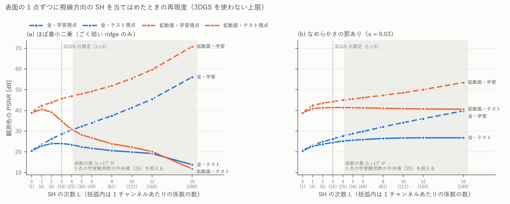

# 光沢面で 3DGS は破綻するか（金 vs 拡散面）

2026-11-17。手を加えない 3DGS（このリポジトリの実装、SH 3 次）で、光沢の強い面の再現が崩れることを、
素材以外をすべてそろえた対照付きで確かめた。

## 目的

- 光沢の強い面で 3DGS の再現が崩れるかを確かめる。
- 崩れ方が次のどちらかを区別する。
  - **汎化の失敗**: 学習に使った視点は再現できるが、新しい視点で崩れる
  - **表現力の不足**: 学習に使った視点でも再現できない

そのため、すべての指標を学習視点とテスト視点の両方で測った。

## 方法

### 刺激（GoLD_rayt で描画、[`make_views.py`](make_views.py)）

2 条件で違うのは像の素材だけ。形状・照明・カメラ・乱数の種は同一。

| 項目 | 内容 |
|---|---|
| 形状 | Erato 像（高さ 0.5 m） |
| 条件 | **金**: conductor（Au）、roughness 0.1 ／ **拡散面**: diffuse、albedo (0.80, 0.55, 0.22)（金に近い色） |
| 照明 | 上のソフトボックス（1.8 m 四方、D65、放射輝度 8）、周りの球光源 4 個（半径 0.35 m、放射輝度 7）、一様な環境光（0.15） |
| カメラ | 距離 1.3 m、画角 30°。学習 90 視点（仰角 15 / 35 / 55° × 方位 30）、テスト 10 視点（仰角 12〜65°・方位ランダム、学習視点と重ならない） |
| 描画 | GoLD_rayt RGB 版、256 × 256 px、512 spp、OIDN デノイズ、Reinhard トーンマップ。1 視点約 15 秒（100 視点で約 26 分） |
| 背景 | 環境光がそのまま見えるので、全視点で一様な灰色（0.396） |

照明とカメラの配置は `D:/GoLD_rayt/out/studies/gs_gloss/make_views.py` の v2（床なし）にそろえ、一様な環境光を足した。
環境光がないと、金の映り込みが真っ黒になった部分が背景と見分けられなくなるため。

### 学習

このリポジトリの `train.py` を、2 条件で同じ設定で実行した。

- 7000 iter、SH 3 次
- densification は 500〜3500 iter、opacity reset は 3000 iter
- 初期点 20000 個（像を囲む一辺 0.6 m の立方体内にランダムに配置）、背景色 0.396
- 学習時間（Quadro M4000）: 金 21 分（拡散面の描画と CPU を取り合った）、拡散面 18 分

### 評価（[`evaluate.py`](evaluate.py)、[`geom_eval.py`](geom_eval.py)）

- **画質**: PSNR、SSIM（11 × 11 ガウス窓）、LPIPS（AlexNet）。
  - 像の領域だけで平均した値と、全画面の値の両方を出す。像の領域は、GoLD_rayt が書き出す被覆率マスク（縁は中間値）で重み付けした。
  - 学習視点 90 枚とテスト視点 10 枚で別々に平均する。
- **形状**: 不透明度 0.3 以上のガウシアンの中心と、真のメッシュ表面との距離。符号は正が外側、負が内側。

## 結果

### 画質（像の領域）

| 条件 | 視点 | PSNR [dB] ↑ | SSIM ↑ | LPIPS ↓ |
|---|---|---|---|---|
| 金 | 学習 | 22.78 | 0.812 | 0.136 |
| 金 | テスト | 22.32 | 0.784 | 0.132 |
| 拡散面 | 学習 | 39.79 | 0.976 | 0.015 |
| 拡散面 | テスト | 38.88 | 0.972 | 0.018 |

参考として全画面の値を示す。背景は一様な灰色で再現しやすいため、甘く出る。

| 条件 | 視点 | PSNR [dB] | SSIM | LPIPS |
|---|---|---|---|---|
| 金 | 学習 | 32.15 | 0.975 | 0.037 |
| 金 | テスト | 31.83 | 0.973 | 0.035 |
| 拡散面 | 学習 | 48.29 | 0.997 | 0.003 |
| 拡散面 | テスト | 47.65 | 0.996 | 0.004 |

視点ごとの値は [`results.json`](results.json) にある。

### 定性的な結果

**テスト視点**（学習に使っていない視点）。各視点は左から正解、3DGS、誤差（4 倍に強調）。上段が金、下段が拡散面。


**学習視点**（学習に使った視点）。並びは同じ。


**拡大**（テスト視点 0 で金の誤差が最も集中する 56 px 四方を 4 倍に拡大。拡散面も同じ位置）。


### 形状（不透明度 0.3 以上）

| 条件 | ガウシアン数（全体 / 0.3 以上） | 表面までの距離 平均 / 中央値 [mm] | 符号付き平均 [mm] | 浮遊物（2 cm 以上） | 表面の被覆 平均 [mm] |
|---|---|---|---|---|---|
| 金 | 17740 / 4850 | 5.45 / 4.27 | −4.54 | 1.7 % | 10.4 |
| 拡散面 | 11993 / 3050 | 3.04 / 2.27 | −2.74 | 0.3 % | 8.3 |

閾値 0.5、0.7 でも傾向は同じ（[`geometry.json`](geometry.json)）。
参考までに、この解像度での 1 画素は像の位置で約 2.7 mm に当たる。

## 考察

1. **破綻は確認できた。** 金は拡散面より、像の領域の PSNR で 16〜17 dB 低い。LPIPS では 7〜9 倍悪い。
   - 誤差は、衣のひだのきらめき・暗い溝・縁の映り込みといった、鋭い映り込みに集中している。
   - 3DGS の金はくすんで、映り込みがひだに沿って帯状にぼけた見た目になる（拡大図）。
   - 拡散面は細部まで再現できていて、誤差は輪郭のわずかな画素だけ。
2. **崩れ方は「汎化の失敗」ではなく「表現力の不足」だった。** 金は学習視点でも 22.8 dB しか出ていない。学習視点とテスト視点の差は、PSNR で 0.5 dB と拡散面（0.9 dB）より小さく、LPIPS ではむしろテスト視点の方がわずかに良い。
   - 学習した視点ですら見え方を覚えられていない、ということになる。
   - 各ガウシアンは 90 方向から見られ、方向ごとに映り込む光源が大きく変わる。ところが 3 次の SH（1 チャンネル 16 係数）は、方向に対してなだらかな変化しか表せない。そのため、方向について平均したような色（くすんだ金）に落ち着いたと考えられる。
   - ただし、SH の次数を上げるだけでは治らない。次数を上げると学習視点は覚えられるようになるが、テスト視点は頭打ちになる。このことは、下の[追加の検証](#追加の検証-sh-の次数を上げれば治るか3dgs-を使わない-1-点ずつの当てはめ)で確かめた。
3. **形状への影響は小さい。**
   - 金ではガウシアンが表面の内側に寄り（符号付き −4.5 mm、拡散面は −2.7 mm）、表面から離れた浮遊物も 5 倍ある。映り込みを表面の奥に置いて説明する傾向は見える。
   - ただし内側へのずれの差は 1.8 mm で、1 画素（約 2.7 mm）より小さい。
   - 主な破綻は、形状よりも色（視点依存の見え方）の方にある。
   - 金の方がガウシアン数は多い（17740 対 11993）。誤差の大きさに応じて densification が増やしたが、それでも表せていない。

## 限界

- **学習が短い**: 7000 iter（公式は 30000）で、densification も 3500 iter で止めた。長く学習してガウシアンを増やすと、学習視点の当てはまりが上がり、学習視点とテスト視点の差が開く可能性がある。
- **試行数**: 各条件 1 回（乱数の種 1 つ）だけ。
- **水準が少ない**: 解像度は 256 px と低く、光沢は roughness 0.1 の 1 水準だけ。
- **学習画像の処理**: OIDN でデノイズしているので、視点ごとにわずかに異なる処理が入っている。
- **初期化**: ランダムな初期点で、SfM の点群は使っていない。

## 追加の検証: SH の次数を上げれば治るか（3DGS を使わない 1 点ずつの当てはめ）

### 問い

上の結果から、「視点で変わる色を 3 次の SH で表しているのがボトルネックで、SH をいじれば治る」という予測が立つ。
これを、3DGS の最適化の影響を除いて確かめた。

当てはめる前に、表すべき関数の細かさを見積もっておく。

- **金のローブの幅**: GoLD_rayt の roughness は GGX の α = roughness² なので、金は α = 0.01 で、ローブの幅は 1° 程度とほぼ鏡面。
- **表面の 1 点が表すべき関数**: 視線方向に対する色は、「法線で折り返した方向の照明」をこの幅でぼかしたもの。ぼかしはほぼ効かないので、細かさは照明で決まる。球光源は像から見て約 19°、ソフトボックスは約 57° で、どちらも縁がくっきりしている。
- **SH が表せる細かさ**: 次数 L の SH が表せる特徴は、大きさがおよそ 180°/L まで（L=3 で約 60°）。
- **観測の粗さ**: 1 点を見ている学習視点は、方位 12°・仰角 20° 間隔で、仰角 15〜55° の帯の中にしかない。

この見積もりから、次の予測が立つ: 次数を上げると学習視点は覚えられるが、テスト視点は良くならない（表現力の不足が汎化の失敗に置き換わる）。

### 方法（[`sh_oracle.py`](sh_oracle.py)）

1. **点を取る**: 真のメッシュ上に 10000 点を面積に比例して取る。
2. **見えている視点を集める**: 各点が見えている視点での画像の値（観測色）と視線方向を集める。見えているかどうかは次の 3 つで判定する。
   - 表面を密に覆う 200 万点で作った z バッファの深度以下である
   - 75° より斜めから見ていない
   - 像の縁の画素ではない
3. **点を絞る**: 学習視点で 10 回以上見えている 7705 点を使う。1 点あたりの学習視点での観測は、中央値 26 回。
4. **当てはめる**: 点ごとに独立に、次数 L の SH を最小二乗で当てはめる。係数が観測より多くても解が決まるよう、ごく弱い ridge（λ = 10⁻³）を付ける。
5. **評価する**: 学習視点の観測（当てはまり）と、テスト視点の観測（予測）の PSNR を測る。

ガウシアン 1 個が表面の 1 点だけを受け持つ、理想化した場合の 3DGS に当たる。

**正則化を変えた確認**: 結論が正則化の弱さに左右されないかを見るため、なめらかさの罰も試した。
- 罰の形: 次数 l の係数に s·l(l+1) を掛ける。球面上の勾配の大きさの二乗和に当たる。定数項には掛けないので、平均の色は偏らない。
- 強さ: s = 0.003〜0.1。
- 定数項まで縮める普通の ridge では、色そのものが暗く偏り、比較にならなかった。

### 結果



| 次数 L（係数の数） | 金 学習 | 金 テスト | 拡散面 学習 | 拡散面 テスト |
|---|---|---|---|---|
| 0（1） | 20.6 | 20.5 | 39.1 | 38.8 |
| 2（9） | 26.2 | 24.0 | 43.8 | 39.1 |
| **3（16）**: 3DGS の既定 | 28.6 | **24.0** | 45.7 | 34.8 |
| 4（25） | 30.5 | 23.5 | 46.9 | 30.8 |
| 6（49） | 34.0 | 21.7 | 49.2 | 26.7 |
| 12（169） | 45.4 | 19.2 | 59.6 | 20.2 |
| 16（289） | 56.1 | 13.8 | 70.8 | 11.8 |

単位は dB（観測色の PSNR）。正則化はごく弱い ridge だけ。全次数の値と、なめらかさの罰を変えた結果は [`sh_oracle.json`](sh_oracle.json) にある。

なめらかさの罰を入れたときの、テスト視点の最高値:

| 罰の強さ s | 金 | 拡散面 |
|---|---|---|
| 0.003 | 26.3 dB（L=16） | 41.1 dB（L=2） |
| 0.01 | 26.6 dB（L=16） | 41.3 dB（L=2） |
| 0.03 | 26.8 dB（L=12） | 41.4 dB（L=3） |
| 0.1 | 26.7 dB（L=12） | 41.4 dB（L=5） |

**金の像の 1 点の例。** 学習・テストの両方でよく見えていて、見え方の変化が最も大きい点を選んだ。
- 点は実際の観測、背景は当てはめた SH による補間。
- 横軸はカメラの方位（この点の観測の中心からの相対値）、縦軸は仰角。


### 考察

1. **予測どおり、次数を上げるだけでは治らない。**
   - 罰がほぼない場合、学習視点の PSNR は次数とともに上がり続ける（L=16 で 56 dB）。
   - 一方テスト視点は、L=2〜3 の 24.0 dB が最高で、それより上では下がっていく（L=12 で 19.2 dB）。
   - 下がり始めるのは、係数の数 (L+1)² が 1 点あたりの観測数（中央値 26）を超えるあたり（L ≥ 4）。表現力の不足が、そのまま汎化の失敗に置き換わっている。
   - 1 点の例でも、強いハイライトは学習視点の 1 つにしか写っていない（一番下の段の中央）。
     - L=3 はそれをなだらかな塊にして無視する。
     - L=12 はその 1 点に合わせるため、観測のない所に縦縞の偽の明るさを作っている。
2. **SH の扱い方で数 dB は改善するが、天井は観測の粗さで決まる。**
   - なめらかさの罰を入れると高い次数が使えるようになり、金のテスト視点は 26.8 dB まで上がる（L=3 の 24.0 dB より +2.8 dB）。
   - ただし罰の強さを 30 倍変えても 26.3〜26.8 dB で頭打ちで、拡散面（41.4 dB）との差は 14 dB 以上残る。
   - 1 点あたり 26 回・12°×20° 間隔・3 段の帯という観測の粗さに対し、ほぼ鏡面の金の映り込み（約 19° の光源、縁が鋭い）は細かすぎる。
   - したがって、**点ごとに独立に視点依存の色を持つ方式では、SH でも他の関数でも越えられない**。
   - 越えるには、点の間で観測を共有する必要がある。多数の点が、それぞれ別の反射方向から同じ照明を見ているので、反射方向で引く共有の環境として表せば、まとめて密に観測できる。光沢に対応した手法がその設計をとる理由がここにある。
3. **3DGS は、L=3 の表現力すら使い切れていない。**
   - 1 点ずつ理想的に当てはめると、L=3 で金の学習視点は 28.6 dB 出る。
   - 3DGS 本体（上の結果）は 22.8 dB だった。
   - 考えられる理由は 3 つ:
     - 1 個のガウシアンが、映り込みの異なる複数の点にまたがっている
     - 7000 iter と短い
     - 1 次以上の SH 係数の学習率が 0 次の 1/20
   - 本体の SH の次数を上げると学習視点はある程度伸びるはずだが、テスト視点の天井は上の 24〜27 dB の範囲を超えないと予想される。
4. **拡散面でも少しだけ視点依存がある。**
   - 本来は視点によらない色だが、L=1〜3 で（罰があれば）テスト視点が 38.8 → 41 dB に上がる。画素の大きさやデノイズの視点ごとの違いによる、系統的な差を拾っていると考えられる。
   - 罰がないと、ほぼ一定の信号に雑音まで当てはめるので、金より早く崩れる（L=3 で 34.8 dB）。

### この検証の限界

- 点ごとの独立な当てはめで、3DGS のように 1 個のガウシアンが複数の点にまたがることや、空間的になめらかになることは入っていない。
- 見えているかの判定は、点群で作った z バッファによる近似。
- 観測色は、トーンマップ後の画像の値を画素の範囲で平均したもの（3DGS が当てはめている値と同じ）。

## 再現手順

`D:\GoLD_rayt`（RGB 版の `out\cli-dev\GoLD_rayt.exe` と Erato のメッシュ）が必要。評価には追加のパッケージが要る:

```bash
.venv/Scripts/python -m pip install torchvision==0.22.1 --index-url https://download.pytorch.org/whl/cu118
.venv/Scripts/python -m pip install lpips scipy matplotlib
```

```bash
.venv/Scripts/python experiments/gloss/make_views.py gold --render
.venv/Scripts/python experiments/gloss/make_views.py matte --render
.venv/Scripts/python train.py --datadir data/gloss_gold --expname gloss_gold --iters 7000 --bg 0.396 0.396 0.396 --init-center 0 0.25 0 --init-extent 0.3
.venv/Scripts/python train.py --datadir data/gloss_matte --expname gloss_matte --iters 7000 --bg 0.396 0.396 0.396 --init-center 0 0.25 0 --init-extent 0.3
.venv/Scripts/python experiments/gloss/evaluate.py logs/gloss_gold/ckpt_007000.pt logs/gloss_matte/ckpt_007000.pt --masks data/gloss_matte
.venv/Scripts/python experiments/gloss/geom_eval.py logs/gloss_gold/point_cloud.ply logs/gloss_matte/point_cloud.ply
.venv/Scripts/python experiments/gloss/sh_oracle.py
```

## 次に試すこと

- **3DGS 本体で SH の次数を上げる**: `gs/sh.py` の `sh_basis` は任意次数に対応した。1 点ずつの当てはめからは、学習視点は伸びるが、テスト視点は 24〜27 dB を超えないと予想される。
- **SH 0 次で金を学習する**: 3 次との差から、本体で SH がどれだけ効いているかを見る。
- **roughness を振る**: 粗い面（α が大きく、関数がなめらか）では、次数を上げるとテスト視点も良くなるはず。どの粗さで天井が観測の粗さに当たり始めるかを見る。
- **30000 iter で学習する**: 長く学習すると、学習視点とテスト視点の差が開くかを見る。
