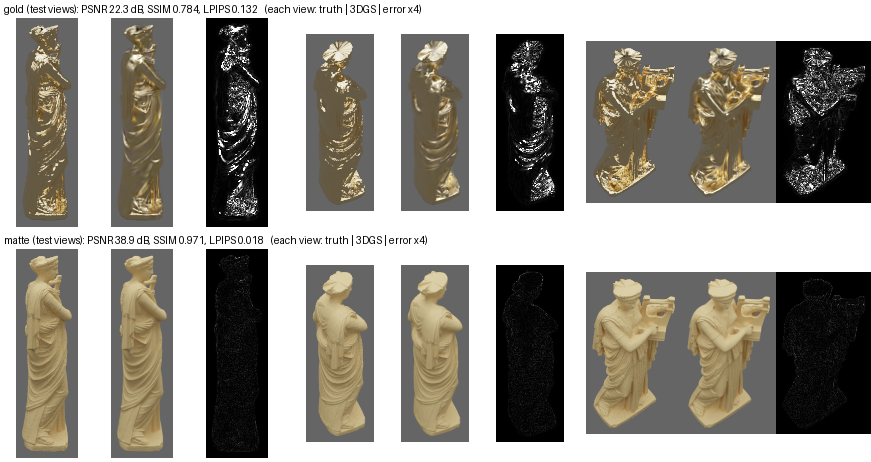
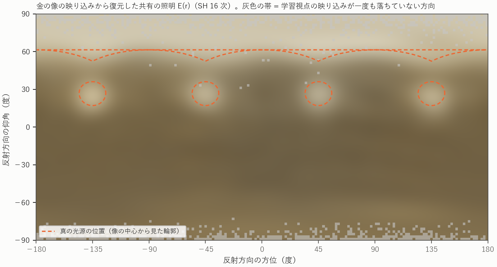
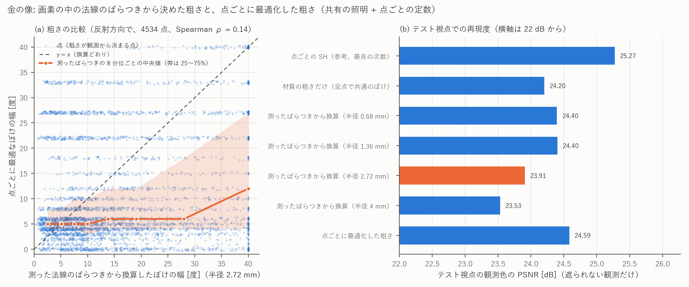
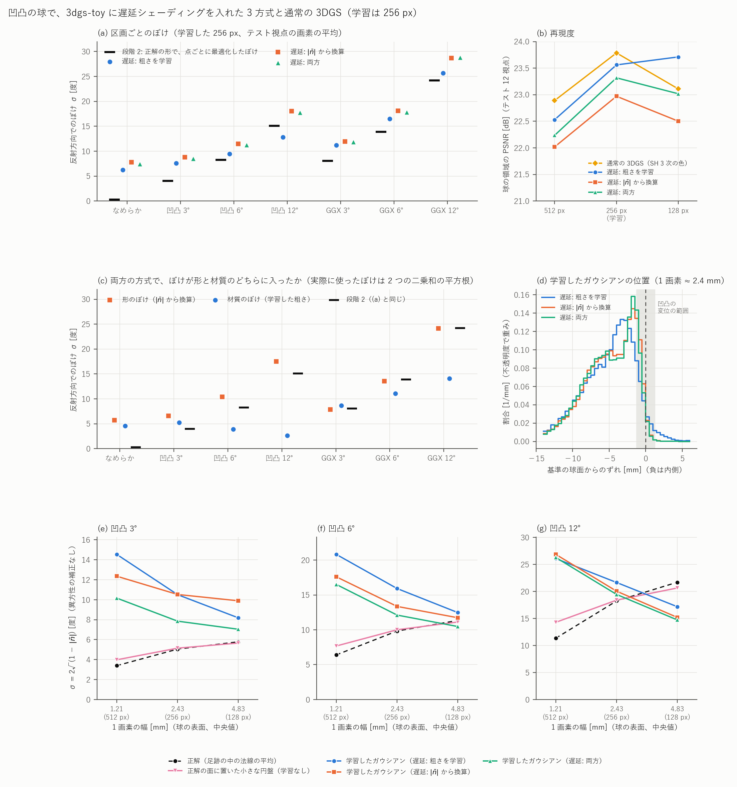

# Does 3DGS break on glossy surfaces? (gold vs diffuse)

2026-11-17. Using unmodified 3DGS (the implementation in this repository, SH degree 3), I confirmed that reconstruction of strongly glossy surfaces breaks down.
The test is controlled: everything except the material is kept the same.

## Summary

This page is long because it is a chain: each step answers one question, and its answer raises the next.
The table is the whole story. Each row links to the section with the method, numbers, and limits.

| Step | Question | Answer |
|---|---|---|
| [Main experiment](#results) | Does 3DGS break on a gold statue? | Yes. Gold is 16–17 dB below a diffuse statue of the same colour, and equally bad on the training views: a lack of capacity, not a failure to generalize |
| [Follow-up 1](#follow-up-does-raising-the-sh-degree-fix-it-per-point-fits-without-3dgs) | Does a higher SH degree fix it? | No. Higher degrees memorize the training views, but test views stay at 24–27 dB. The ceiling is set by how coarsely each point is observed |
| [Follow-up 2](#follow-up-2-can-sharing-the-lighting-between-points-get-past-the-ceiling) | Does sharing one lighting across all points get past the ceiling? | The lighting is recovered correctly, but on this statue it loses overall: 38% of reflections see the statue itself, and normals vary inside a pixel. It wins only where those are excluded (28.8 vs 27.9 dB) |
| [Follow-up 3](#follow-up-3-does-normal-variation-within-a-pixel-act-as-roughness) | Is the roughness a method learns just the normal variation inside a pixel? | Not measurable on the statue (rank correlation 0.14), although the procedure can detect it (0.89 on synthetic data). Other errors bury it |
| [Follow-up 4](#follow-up-4-check-the-conversion-from-variation-to-roughness-on-a-sphere-with-controlled-bumps) | Same question on a sphere with controlled bumps | Yes (rank correlation 0.90–0.93). With a correction for oblique views, roughness computed from geometry matches or beats roughness optimized per point, with no learned parameter |
| [Follow-up 5](#follow-up-5-add-deferred-shading-to-3dgs-toy-and-use-normal-variation-as-roughness) | Does that work inside 3DGS with deferred shading? | Partly. The relative blur per region is learned correctly, but the Gaussians form a thick semi-transparent layer, so the cue changes in the wrong direction with pixel size, and vanilla 3DGS is not beaten |

How to read the rest: every step has the same parts (Question, Method or Model, Results, Discussion,
Limitations). The numbered items under each Discussion are the conclusions. Statements marked
"(conjecture)" were not tested. Commands are in [Reproduction](#reproduction).


## Goal

- Check whether 3DGS reconstruction breaks down on strongly glossy surfaces.
- Tell apart which of the following kinds of breakdown it is.
  - **Generalization failure**: the views used for training are reproduced, but new views break down
  - **Lack of capacity**: even the views used for training cannot be reproduced

For this reason, every metric was measured on both the training views and the test views.

## Method

### Stimuli (rendered with GoLD_rayt, [`make_views.py`](make_views.py))

The only difference between the two conditions is the material of the statue. Geometry, lighting, cameras, and random seed are identical.

| Item | Details |
|---|---|
| Geometry | Erato statue (0.5 m tall) |
| Conditions | **Gold**: conductor (Au), roughness 0.1 / **Diffuse**: diffuse, albedo (0.80, 0.55, 0.22) (a colour close to gold) |
| Lighting | A softbox above (1.8 m square, D65, radiance 8), 4 sphere lights around the statue (radius 0.35 m, radiance 7), uniform ambient light (0.15) |
| Cameras | Distance 1.3 m, field of view 30°. 90 training views (elevation 15 / 35 / 55° × 30 azimuths), 10 test views (elevation 12–65°, random azimuth, no overlap with the training views) |
| Rendering | GoLD_rayt RGB version, 256 × 256 px, 512 spp, OIDN denoising, Reinhard tone mapping. About 15 s per view (about 26 min for 100 views) |
| Background | The ambient light is seen directly, so the background is a uniform grey (0.396) in every view |

The lighting and camera layout follow v2 (no floor) of `D:/GoLD_rayt/out/studies/gs_gloss/make_views.py`, with uniform ambient light added.
Without ambient light, the parts of the gold where the reflection is pure black cannot be told apart from the background.

### Training

`train.py` of this repository was run with the same settings for both conditions.

- 7000 iter, SH degree 3
- densification from 500 to 3500 iter, opacity reset at 3000 iter
- 20000 initial points (placed at random inside a cube of side 0.6 m around the statue), background colour 0.396
- Training time (Quadro M4000): gold 21 min (it competed for the CPU with the rendering of the diffuse condition), diffuse 18 min

### Evaluation ([`evaluate.py`](evaluate.py), [`geom_eval.py`](geom_eval.py))

- **Image quality**: PSNR, SSIM (11 × 11 Gaussian window), LPIPS (AlexNet).
  - Both the value averaged over the statue region only and the full-frame value are reported. The statue region is weighted by the coverage mask written out by GoLD_rayt (intermediate values at the edges).
  - The 90 training views and the 10 test views are averaged separately.
- **Geometry**: distance between the centres of Gaussians with opacity 0.3 or higher and the true mesh surface. The sign is positive outside and negative inside.

## Results

### Image quality (statue region)

| Condition | Views | PSNR [dB] ↑ | SSIM ↑ | LPIPS ↓ |
|---|---|---|---|---|
| Gold | Training | 22.78 | 0.812 | 0.136 |
| Gold | Test | 22.32 | 0.784 | 0.132 |
| Diffuse | Training | 39.79 | 0.976 | 0.015 |
| Diffuse | Test | 38.88 | 0.972 | 0.018 |

The full-frame values are shown for reference. The background is a uniform grey and easy to reproduce, so these values are lenient.

| Condition | Views | PSNR [dB] | SSIM | LPIPS |
|---|---|---|---|---|
| Gold | Training | 32.15 | 0.975 | 0.037 |
| Gold | Test | 31.83 | 0.973 | 0.035 |
| Diffuse | Training | 48.29 | 0.997 | 0.003 |
| Diffuse | Test | 47.65 | 0.996 | 0.004 |

Per-view values are in [`results.json`](results.json).

### Qualitative results

**Test views** (views not used for training). For each view, from left: ground truth, 3DGS, error (amplified 4×). Top row is gold, bottom row is diffuse.



**Training views** (views used for training). Same layout.


**Zoom** (the 56 px square where the gold error is most concentrated in test view 0, enlarged 4×. The diffuse condition is shown at the same position).


### Geometry (opacity 0.3 or higher)

| Condition | Number of Gaussians (all / 0.3 or higher) | Distance to surface, mean / median [mm] | Signed mean [mm] | Floaters (2 cm or more) | Surface coverage, mean [mm] |
|---|---|---|---|---|---|
| Gold | 17740 / 4850 | 5.45 / 4.27 | −4.54 | 1.7 % | 10.4 |
| Diffuse | 11993 / 3050 | 3.04 / 2.27 | −2.74 | 0.3 % | 8.3 |

The trend is the same with thresholds 0.5 and 0.7 ([`geometry.json`](geometry.json)).
For reference, one pixel at this resolution corresponds to about 2.7 mm at the position of the statue.

## Discussion

1. **The breakdown was confirmed.** Gold is 16–17 dB lower than diffuse in PSNR over the statue region. In LPIPS it is 7–9 times worse.
   - The error is concentrated in sharp reflections: glints on the folds of the drapery, dark grooves, and reflections at the edges.
   - The 3DGS gold looks dull, with reflections blurred into bands along the folds (zoom figure).
   - The diffuse statue is reproduced down to fine detail, and the error is only a few pixels on the silhouette.
2. **The breakdown was "lack of capacity", not "generalization failure".** Gold reaches only 22.8 dB even on the training views. The gap between training and test views is 0.5 dB in PSNR, smaller than for diffuse (0.9 dB), and in LPIPS the test views are in fact slightly better.
   - This means the appearance is not memorized even for the views that were trained on.
   - Each Gaussian is seen from 90 directions, and the light source reflected in it changes a lot from direction to direction. But degree-3 SH (16 coefficients per channel) can only represent gentle variation over direction. So it probably settled on a colour that is like an average over directions (a dull gold).
   - However, raising the SH degree alone does not fix it. With a higher degree the training views can be memorized, but the test views hit a ceiling. This was confirmed in the [follow-up](#follow-up-does-raising-the-sh-degree-fix-it-per-point-fits-without-3dgs) below.
3. **The effect on geometry is small.**
   - For gold, the Gaussians sit further inside the surface (signed −4.5 mm, versus −2.7 mm for diffuse), and there are 5 times as many floaters away from the surface. There is a visible tendency to explain reflections by placing them behind the surface.
   - However, the difference in the inward shift is 1.8 mm, which is less than one pixel (about 2.7 mm).
   - The main breakdown is in colour (view-dependent appearance) rather than in geometry.
   - Gold has more Gaussians (17740 vs 11993). Densification added them in response to the size of the error, but it is still not represented.

## Limitations

- **Short training**: 7000 iter (the official setting is 30000), and densification was stopped at 3500 iter. With longer training and more Gaussians, the fit to the training views may improve and the gap between training and test views may widen.
- **Number of runs**: only one run per condition (one random seed).
- **Few levels**: the resolution is low at 256 px, and gloss has only one level, roughness 0.1.
- **Processing of the training images**: they are denoised with OIDN, so slightly different processing is applied to each view.
- **Initialization**: random initial points. No SfM point cloud is used.

## Follow-up: does raising the SH degree fix it? (per-point fits without 3DGS)

### Question

The results above suggest a prediction: "representing view-dependent colour with degree-3 SH is the bottleneck, and changing the SH will fix it."
I checked this with the effect of the 3DGS optimization removed.

Before fitting, estimate how fine the function to be represented is.

- **Width of the gold lobe**: in GoLD_rayt, roughness maps to GGX α = roughness². So gold has α = 0.01, and the lobe is about 1° wide, almost a mirror.
- **The function one surface point must represent**: colour as a function of view direction is "the lighting in the direction mirrored about the normal", blurred by this width. The blur has almost no effect, so the fineness is set by the lighting. The sphere lights subtend about 19° as seen from the statue and the softbox about 57°, and both have sharp edges.
- **The fineness SH can represent**: SH of degree L can represent features down to a size of roughly 180°/L (about 60° for L=3).
- **Coarseness of the observations**: the training views that see one point are spaced 12° in azimuth and 20° in elevation, and lie only within the band of elevation 15–55°.

This estimate gives the following prediction: raising the degree lets the training views be memorized, but the test views do not improve (lack of capacity is replaced by generalization failure).

### Method ([`sh_oracle.py`](sh_oracle.py))

1. **Sample points**: take 10000 points on the true mesh, in proportion to area.
2. **Collect the views that see each point**: for each point, collect the image values (observed colours) and view directions in the views where it is visible. Visibility is decided by the following three tests.
   - The depth is no greater than that of a z-buffer built from 2 million points densely covering the surface
   - The point is not seen more obliquely than 75°
   - The pixel is not on the edge of the statue
3. **Filter points**: use the 7705 points that are visible in 10 or more training views. The median number of training-view observations per point is 26.
4. **Fit**: fit SH of degree L by least squares, independently for each point. A very weak ridge (λ = 10⁻³) is added so that the solution is determined even when there are more coefficients than observations.
5. **Evaluate**: measure the PSNR on the training-view observations (fit) and on the test-view observations (prediction).

This corresponds to an idealized 3DGS in which each Gaussian is responsible for exactly one surface point.

**Check with different regularization**: to see whether the conclusion depends on the regularization being weak, a smoothness penalty was also tried.
- Form of the penalty: the coefficients of degree l are multiplied by s·l(l+1). This corresponds to the sum of squared gradient magnitudes on the sphere. It is not applied to the constant term, so the mean colour is not biased.
- Strength: s = 0.003–0.1.
- With an ordinary ridge that also shrinks the constant term, the colour itself was biased toward dark, and no comparison was possible.

### Results


| Degree L (number of coefficients) | Gold, training | Gold, test | Diffuse, training | Diffuse, test |
|---|---|---|---|---|
| 0 (1) | 20.6 | 20.5 | 39.1 | 38.8 |
| 2 (9) | 26.2 | 24.0 | 43.8 | 39.1 |
| **3 (16)**: 3DGS default | 28.6 | **24.0** | 45.7 | 34.8 |
| 4 (25) | 30.5 | 23.5 | 46.9 | 30.8 |
| 6 (49) | 34.0 | 21.7 | 49.2 | 26.7 |
| 12 (169) | 45.4 | 19.2 | 59.6 | 20.2 |
| 16 (289) | 56.1 | 13.8 | 70.8 | 11.8 |

Units are dB (PSNR of the observed colours). The only regularization is the very weak ridge. Values for all degrees, and the results with different smoothness penalties, are in [`sh_oracle.json`](sh_oracle.json).

Best test-view values with the smoothness penalty:

| Penalty strength s | Gold | Diffuse |
|---|---|---|
| 0.003 | 26.3 dB (L=16) | 41.1 dB (L=2) |
| 0.01 | 26.6 dB (L=16) | 41.3 dB (L=2) |
| 0.03 | 26.8 dB (L=12) | 41.4 dB (L=3) |
| 0.1 | 26.7 dB (L=12) | 41.4 dB (L=5) |

**An example point on the gold statue.** I chose the point that is well seen in both training and test views and has the largest change in appearance.
- Dots are the actual observations. The background is the interpolation by the fitted SH.
- The horizontal axis is camera azimuth (relative to the centre of the observations of this point), and the vertical axis is elevation.


### Discussion

1. **As predicted, raising the degree alone does not fix it.**
   - With almost no penalty, the training-view PSNR keeps rising with the degree (56 dB at L=16).
   - The test views, on the other hand, peak at 24.0 dB for L=2–3 and fall above that (19.2 dB at L=12).
   - The fall begins around where the number of coefficients (L+1)² exceeds the number of observations per point (median 26), that is, L ≥ 4. Lack of capacity is replaced directly by generalization failure.
   - In the one-point example too, the strong highlight appears in only one training view (centre of the bottom row).
     - L=3 turns it into a gentle blob and ignores it.
     - L=12, to match that one point, creates false brightness in vertical stripes where there are no observations.
2. **The way SH is handled gains a few dB, but the ceiling is set by the coarseness of the observations.**
   - With the smoothness penalty, higher degrees become usable, and the gold test views rise to 26.8 dB (+2.8 dB over the 24.0 dB of L=3).
   - However, even when the penalty strength is varied by a factor of 30, it levels off at 26.3–26.8 dB, and a gap of more than 14 dB to diffuse (41.4 dB) remains.
   - The reflections on the nearly mirror-like gold (light sources of about 19°, with sharp edges) are too fine for the coarseness of the observations: 26 per point, 12°×20° spacing, a band of 3 rows.
   - Therefore, **a scheme in which each point independently holds a view-dependent colour cannot get past this, with SH or with any other function**.
   - To get past it, observations must be shared between points. Many points see the same lighting, each from a different reflection direction. If it is represented as a shared environment looked up by reflection direction, it can be observed densely as a whole. This is why the methods that handle gloss take that design.
3. **3DGS does not even use up the capacity of L=3.**
   - With an ideal per-point fit, L=3 gives 28.6 dB on the gold training views.
   - 3DGS itself (results above) gave 22.8 dB.
   - Three possible reasons:
     - One Gaussian spans several points with different reflections
     - Training is short at 7000 iter
     - The learning rate of SH coefficients of degree 1 and above is 1/20 of that of degree 0
   - Raising the SH degree in 3DGS itself should improve the training views to some extent, but the ceiling for test views is expected not to exceed the 24–27 dB range above.
4. **The diffuse statue also has a little view dependence.**
   - The colour should not depend on the view, but with L=1–3 (with a penalty) the test views rise from 38.8 to 41 dB. It is probably picking up systematic differences due to the pixel size and the per-view differences in denoising.
   - Without a penalty, it fits even the noise in a nearly constant signal, so it breaks down sooner than gold (34.8 dB at L=3).

### Limitations of this follow-up

- The fit is independent per point. It does not include the fact that in 3DGS one Gaussian spans several points, nor that it becomes spatially smooth.
- The visibility test is an approximation using a z-buffer built from a point cloud.
- The observed colour is the image value after tone mapping, averaged over the extent of a pixel (the same value that 3DGS fits).

## Follow-up 2: can sharing the lighting between points get past the ceiling?

### Question

As long as each point independently holds a view-dependent colour, the ceiling is set by the coarseness of the observations per point. So the observations of many points are pooled into one.

- Many points see the same lighting, each from a different reflection direction.
- If it is represented as shared lighting looked up by reflection direction, it should be possible to get past the ceiling.

This is the central idea of the methods that handle gloss (Ref-NeRF, GaussianShader, 3DGS-DR, etc.), so I checked it in the same way, with fits that do not use 3DGS.

### Model and solver ([`env_oracle.py`](env_oracle.py))

```
observed colour y(p, v) ≈ per-point term Σ_k c_{p,k} Y_k(d)  +  shared lighting Σ_j e_j Y_j(r)
r = 2(ω·n)n − ω   (ω: direction from the point to the camera, n: normal) … the view direction mirrored about the normal
```

- **Two terms**: the per-point term takes care of the diffuse component (determined by the normal, not by the reflection direction). There is only one shared lighting for all points.
- **Models compared**:
  - No per-point term
  - Per-point constant
  - Per-point SH of degree 2 (smoothness penalty 0.03)
  - The SH degree of the lighting (16 / 32 / 48) and the smoothness penalty (0.1 / 1 / 10) are also varied, and the best setting is reported for each model (the same way of comparing as for the per-point SH).
- **Solver**: once the shared coefficients are fixed, the per-point coefficients are determined by a small per-point least squares, so they are eliminated first (Schur complement). Then the normal equations of the shared lighting (at most 2401 × 2401) are solved once.
- **Normals**: the same smooth normals as the renderer are used, interpolated from vertex normals.
  - They differ from the face normals of the triangles by 3.1° at the median and 11.3° at the 90th percentile.
  - For a near mirror this difference is doubled in the reflection direction, so face normals are not suitable for computing reflections. The first version, which tried face normals, was 0.2–0.4 dB worse.
  - The visibility test was left on the same face normals as before, to keep the set of observations the same.

### Result 1: the lighting is recovered correctly, but overall reconstruction quality goes down


The shared lighting recovered from the reflections on the gold statue alone (the best setting for per-point constant + shared lighting):



- **The lighting map is correct.** The 4 sphere lights at the sides appeared exactly at their true positions (orange dashed lines). The bright region straight above corresponds to the softbox. The effect of sharing itself was confirmed: collecting the reflections on the statue reveals the surrounding lighting.
- **Even so, the reconstruction quality for gold fell below the per-point SH (26.8 dB).**
  - Shared lighting only: 19.7 dB
  - Adding a per-point constant: 22.0 dB
  - Adding per-point SH of degree 2: 24.5 dB
- **The resolution of the lighting does not matter.** Changing the degree of the lighting (16–48) or the smoothness penalty hardly changes the result. The observations themselves, arranged by reflection direction, have "the same direction but scattered brightness", which shows that the assumption of the model is broken.
- **Diffuse is as expected.** Shared lighting alone is poor at 24.2 dB (diffuse is not determined by the reflection direction). Adding a per-point term brings it back to 38.9–41.4 dB. The numbers show that splitting into diffuse and specular is the reasonable approach.

### Result 2: what breaks the assumption ([`env_diagnose.py`](env_diagnose.py))

To separate the causes, two things were checked geometrically for each observation.

- Whether a ray cast in the reflection direction hits a light source (the 4 spheres and the softbox at their true positions)
- Whether it is occluded by the statue itself on the way (an approximation that represents the statue on a 2 mm grid and marches the ray)

I also measured how much the surface normal varies around each point (within the width of one pixel). The result was 8.2° at the median and 27.6° at the 90th percentile.

Luminance (image values) of the training-view observations (197,000 of them):

| Where the reflected ray goes | Bumps at the point | Share of observations | Median | 25–75% |
|---|---|---|---|---|
| Light source (not occluded) | Few (< 5°) | 0.7 % | 0.895 | 0.847–0.923 |
| Light source (not occluded) | Many | 1.8 % | 0.846 | 0.758–0.901 |
| Dark area (not occluded) | Few | 26.7 % | 0.352 | 0.350–0.354 |
| Dark area (not occluded) | Many | 33.3 % | 0.352 | 0.349–0.393 |
| Occluded by the statue itself | Few | 12.6 % | 0.357 | 0.349–0.546 |
| Occluded by the statue itself | Many | 25.0 % | 0.383 | 0.345–0.567 |

Results of comparing again on restricted sets (test-view PSNR [dB]). The per-point SH is the best among L = 2–6 with penalty 0.03. The shared lighting is degree 32 with penalty 1.

| Set | Number of points | Per-point SH | Constant + shared lighting | SH degree 2 + shared lighting |
|---|---|---|---|---|
| All points, all observations | 7705 | **25.9** | 22.0 | 24.5 |
| All points, unoccluded observations only | 4879 | **26.5** | 24.2 | 25.8 |
| Points with few bumps, unoccluded observations only | 2093 | 27.9 | 28.1 | **28.8** |

### Discussion

1. **Shared lighting works where the assumption holds.**
   - Observations whose ray hits a light source are bright (median 0.85–0.90), and observations that go to a dark area without being occluded line up neatly at 0.352. Both agree with the shared-lighting assumption.
   - When restricted to observations with few bumps and no occlusion, the model that shares one lighting across all points overtakes the per-point SH (28.8 dB vs 27.9 dB).
2. **On this statue, that assumption is badly broken.**
   - **Interreflection**: 38% of the reflected rays are occluded by the statue itself. The top quarter of those observations are bright, at 0.55 or more: lit gold is reflected in gold. Distant lighting cannot represent this.
   - **Sub-pixel bumps**: within one pixel the normal varies by 8° at the median and 28° at the 90th percentile, so the pixel colour is an average of reflections from many directions. This is the same as each point having a different roughness, and it cannot be predicted from a single normal at the point.
   - **Little information on the light sources**: only 2.5% of all observations hit a light source.
   - The per-point SH memorizes all of these wholesale as "the appearance of that point", so overall it has the advantage. However, it cannot get past the ceiling set by the coarseness of the observations.
3. **The correspondence with the classes of methods becomes concrete.**
   - Reflections of distant light sources → methods that share an environment map (GaussianShader, 3DGS-DR, etc.).
   - Reflections of the statue itself → methods that cast reflection rays into the scene (NeRF-Casting, methods that use ray tracing of Gaussians, etc.). On this statue this involves 40% of the observations.
   - Sub-pixel bumps → directional encoding blurred according to roughness (the IDE of Ref-NeRF), and per-pixel normals (3DGS-DR).
   - An environment map alone is not enough for this statue, and it becomes clear which breakdown each paper is trying to solve.
4. **Even after restricting, it stays at 28–29 dB.** Possible reasons are the following.
   - The resolution of the lighting (about 6° at degree 32) is not enough for the sharp steps at the edges of the light sources
   - The lighting is not at infinity (the light sources are about 2 m from the statue, the statue is 0.5 m in size, and directions shift by several degrees)
   - At the edge of a light source, the light source appears in only part of a pixel

### Limitations of this follow-up

- The occlusion test is an approximation on a 2 mm grid. The normal variation was measured from the face normals of dense points on the surface.
  Measured again with the same interpolated normals as the renderer, it becomes smaller (all 10000 points, radius 1.36 mm: median 8.3° → 6.0°, 90th percentile 26.4° → 19.7°. Follow-up 3).
- For each model, "the best setting on the test views" is reported, so the values of every model are somewhat optimistic (the conditions of the comparison are the same for all).
- Restricting to points with few bumps changes the kind of points (more flat areas), so values cannot be compared directly between sets. What can be compared is the difference between models within the same set.

## Follow-up 3: does normal variation within a pixel act as roughness?

### Question

Check, without using 3DGS, a gap found in the [literature survey](reports/glossy_3dgs_literature_survey.md).

- Glossy 3DGS methods determine roughness by learning it as a per-Gaussian value.
- In graphics, on the other hand, when normals vary within the area covered by one pixel, the reflection in that pixel is blurred in the same way as on a rough surface. Methods that convert this variation into roughness and add it are well established (Toksvig's method, LEAN mapping, Kaplanyan et al. 2016, etc.).
- I found no example in glossy 3DGS that connects these two.

So the question is this. Does the roughness determined from the normal variation within a pixel agree with the roughness optimized per point? If it does, most of the roughness determined by learning is set by geometry, not by the material.

Whether the effective roughness changes with viewing distance (the scale question) cannot be checked with this data, because all cameras are at a distance of 1.3 m.

### Model ([`env_rough.py`](env_rough.py))

Add a per-point blur to the "shared lighting + per-point term" of Follow-up 2:

```
y(p, v) ≈ Σ_k c_{p,k} Y_k(d)  +  Σ_j a_{l(j)}(σ_p) e_j Y_j(r)
a_l(σ) = exp(−l(l+1) σ² / 2)
```

- Blurring on the sphere with a Gaussian of width σ (standard deviation per axis) corresponds, in SH, to multiplying the coefficients of degree l by a_l (heat diffusion on the sphere. The same form as the attenuation in the IDE of Ref-NeRF). Checked numerically, intended widths of 4°, 10°, 20° came out as 4.00°, 9.97°, 19.79°.
- Once σ_p is fixed, the prediction remains linear in the lighting e. So the same solver as in Follow-up 2 can be used (eliminate the per-point term and solve for e once).

Three ways of setting σ_p are compared.

| How it is set | Details | Free parameters per point |
|---|---|---|
| Material roughness only | σ_p = 0. The material roughness (α = 0.01, about 1° in reflection direction) is finer than the resolution of the lighting SH (about 4°). A blur common to all points is absorbed by the lighting e itself becoming blurred, so this is also the "same roughness at all points" model | None |
| Conversion from the measured variation | On the true mesh, measure the mean vector n̄ of the surface normals within radius R around the point, and set σ_p = 2√(1 − \|n̄\|) | None |
| Optimized per point | Choose σ_p from a grid of 0–40° (the one with the smallest error on the training views). Update alternately with the lighting 10 times. A stand-in for the roughness that existing methods learn | 1 |

The basis for the conversion is as follows. When normals vary with a standard deviation of σ_n per axis, the mean vector becomes shorter, |n̄| ≈ 1 − σ_n² (the cue used by Toksvig's method). The reflection direction shifts by twice the shift of the normal.

- **Normals**: as in the renderer, interpolated from vertex normals.
- **The default radius R is 2.72 mm** (the width of one pixel at a distance of 1.3 m). Combining the average within a pixel (box) and the bilinear interpolation used when picking up observations (a triangle of ±1 pixel), the spread is a standard deviation of 1.36 mm per axis. This is the same as a uniform disc of radius 2.72 mm. 0.68–4.0 mm were also tried.
- **Value space**: the images are turned into display values by "radiance → Reinhard → sRGB curve". Averaging within a pixel happens in radiance, so the model is built in radiance and the error is measured in display values (the evaluation is PSNR of display values, as before).
  - The conversion to display values is nonlinear, so it is linearized around the prediction, a weighted least squares is solved, and the linearization is redone, repeatedly (Gauss-Newton. Converges in 6 iterations).
  - At first the weights were fixed at the observed values. Then the weight of bright reflections became a few thousandths of that of the background, and missing them was ignored. Even the per-point SH was 1.7 dB worse.
- **Observations**: interreflection is not handled, so observations judged in Follow-up 2 to be occluded by the statue itself are removed. There are 4879 points, and 115,000 training and 12,000 test observations.
- **Check**: solving in display values, with no blur, lighting of degree 32, and penalty 1 gives 24.24 dB, which matches "All points, unoccluded observations only" in Follow-up 2.

### Result 1: reconstruction quality

Test-view PSNR [dB] (unoccluded observations only). The lighting is degree 48, and the value is the best among smoothness penalties 0.03, 0.1, 0.3. The per-point SH is refitted from radiance with Gauss-Newton.

| Model | Converted blur (median) | Per-point constant + shared lighting | Per-point SH degree 2 + shared lighting |
|---|---|---|---|
| Material roughness only | 0° | 24.20 | 25.33 |
| Conversion from the measured variation (R = 0.68 mm) | about 3° | 24.40 | 25.49 |
| Conversion from the measured variation (R = 1.36 mm) | about 6° | 24.40 | 25.48 |
| Conversion from the measured variation (**R = 2.72 mm**, default) | about 12° | 23.91 | 25.06 |
| Conversion from the measured variation (R = 4.0 mm) | about 17° | 23.53 | 24.75 |
| Optimized per point | 6° (result of the optimization) | **24.59** | **25.57** |
| Reference: per-point SH (no lighting, degree 6) | | 25.27 | |



### Result 2: relation between the optimized roughness and the measured variation ([`env_rough_check.py`](env_rough_check.py))

With the per-point constant model (penalty 0.1), the blur optimized per point was compared with the blur converted from the measured variation (left of the figure, the 4534 points where changing σ changes the training-view error).

- The rank correlation is weak, **ρ = 0.14**. With other radii it is 0.13–0.15.
- The magnitude does not agree either. The median of the optimized blur is 6°, half of the 12° of the conversion (R = 2.72 mm).

Is the correlation weak because the optimized roughness is full of noise, or because the procedure has no power to discriminate? These two were checked.

| Check | Result |
|---|---|
| Split-half reliability: split the training views into even-numbered and odd-numbered ones, and take the rank correlation of the blur optimized on each | 0.55 (0.71 when corrected to all views). The optimized roughness reproduces fairly well when the views are swapped |
| Correlation corrected for attenuation (divide by the reliability above) | 0.17 |
| Recovery test (no noise): apply the same procedure to synthetic observations made by blurring exactly as the conversion says | ρ = 0.99, median 12.3° → 12.0° |
| Recovery test (with noise): add independent noise of the same size as the fit residual on the real data (0.060 in display values) | ρ = 0.89, median 12.7° → 10.0° |


I also looked at what the optimized blur correlates with (the same 4534 points, Spearman ρ).

| Candidate | ρ |
|---|---|
| Measured normal variation (R = 2.72 mm) | +0.14 |
| Parallax of the light sources (difference between the direction to a light source seen from the centre of the statue and seen from that point. Median 3.7°) | −0.15 |
| Distance from the centre of the statue | −0.16 |
| Share of observations whose reflected ray hits a light source | −0.15 |
| Number of training-view observations | −0.22 |
| Mean cos between view direction and normal | −0.17 |

### Discussion

1. **On this statue, the hypothesis "the learned roughness is determined by the normal variation within a pixel" was not supported.**
   - The procedure has the power to discriminate. If the data follow the hypothesis, it recovers it with ρ = 0.89 even with noise.
   - The optimized roughness reproduces as a property of each point (reliability 0.71).
   - Even so, it hardly correlates with the measured variation (0.17 even after correction). The per-point roughness has reproducible differences, but they are not the normal variation within a pixel.
2. **The blur given by the conversion is too strong.**
   - The median optimized blur of 6° is half of the 12° of the conversion at the default radius, and about the same as the conversion with half the radius (R = 1.36 mm).
   - When the converted blur is 6° or less (R ≤ 1.36 mm), it is 0.2 dB better than material roughness only. At 12° or more it is worse.
   - The reason has not been isolated. There are three candidates.
     - Anisotropy: the folds of the drapery are close to cylinders, and the normal varies in only one direction. Giving the same variance with an isotropic blur blurs too much in the direction along the fold.
     - Estimate of the footprint: the pixel filter of the renderer and the denoising have not been checked.
     - Oblique viewing: "the reflection shifts by twice the normal" is an approximation for normal incidence.
3. **It is not known what the optimized roughness is absorbing.** Every candidate tried had |ρ| ≤ 0.22. It is probably a mixture of several errors.
   - Observations where only part of the blurred lobe is occluded, which remain when the test uses a single ray
   - The change in Fresnel reflection at oblique viewing (which a per-point constant cannot represent)
   - Shifts due to the light sources being near

   The roughness learned by 3DGS methods may also be acting as "a degree of freedom that absorbs model error" rather than "blur due to geometry" (conjecture).
4. **Varying the roughness per point gives only a small improvement.** +0.4 dB over the same roughness at all points (+0.2 dB with the degree-2 term). For the unoccluded observations of this statue, differences in roughness are not the main bottleneck.
5. **Next step**: on the statue the factors are entangled, and this question cannot be isolated. It is necessary to make data with a convex object (a sphere), an HDR environment map (the distant-lighting assumption holds exactly), and bumps with controlled amplitude, and to check the conversion itself (especially the factor-of-2 discrepancy). Rendering at different distances would let the same data address the scale question as well.

### Corrections

- "Normal variation within one pixel: median 8.2°, 90th percentile 27.6°" in Follow-up 2 is the value measured with face normals. With the same interpolated normals as the renderer it becomes smaller (see "Limitations of this follow-up" above).
- In the literature survey report, this variation was converted as "roughly 0.2–0.75 in Beckmann α". However, the variation is an angle obtained from the length of the mean vector as acos|n̄|, so α is about the same as the angle of the variation (in radians), and comes to 0.14–0.48 (|n̄| ≈ 1 − α²/2). The conclusion that it is more than an order of magnitude larger than the material's 0.01 does not change.

### Limitations of this follow-up

- The blur is an isotropic Gaussian. Taking the shift of the reflection direction as twice that of the normal is an approximation for normal incidence.
- The footprint was approximated by a disc one pixel wide. Differences in distance between views (about 1.1–1.5 m) and stretching on oblique surfaces were ignored.
- The lighting is SH of degree 48 (about 4°), so blurs finer than that cannot be distinguished.
- Occlusion was tested with a single ray in the reflection direction, so observations where only part of the blurred lobe is occluded remain.
- For each model, "the best penalty on the test views" is reported.

## Follow-up 4: check the conversion from variation to roughness on a sphere with controlled bumps

### Question

On the statue in Follow-up 3, the blur optimized per point hardly agreed in rank with the blur converted from the normal variation within a pixel (ρ = 0.14), and its magnitude was half of the conversion. On the statue, interreflection, near light sources, folds with aligned orientation, and the denoiser all overlap, and the cause could not be isolated.

So the same question is posed again on a sphere with those removed.

1. When there are only sub-pixel bumps, does the blur optimized per point agree with the conversion σ = 2√(1 − |n̄|) (in rank and in magnitude)?
2. When the pixel size changes, does the optimal blur follow the change in the conversion (the scale question)?
3. What width of Gaussian does the blur due to material roughness (GGX) correspond to?

### Data ([`make_sphere.py`](make_sphere.py))


- **Shape and lighting**: a gold sphere of radius 20 cm (the same GGX as the statue, roughness 0.1), lit only by an HDR environment map (grace-new, 2× brightness). It is convex, so there is no interreflection and no self-occlusion, and the distant-lighting assumption holds exactly.
- **Sectors**: divided into 8 sectors of 45° of longitude each.

  | Sector | Shape | Material roughness |
  |---|---|---|
  | Smooth A, B | No bumps | Same as the statue (α = 0.01) |
  | Bumps 3°, 6°, 12° | Isotropic bumps. The tilt of the normal has a standard deviation of 3°, 6°, 12° per axis | Same as the statue |
  | GGX 3°, 6°, 12° | No bumps | GGX whose normal distribution has the same half width at half maximum as the bump sectors (α = 0.096, 0.19, 0.39) |

- **Bumps**: an isotropic Gaussian field made as a sum of 256 plane waves (wavelength 4 mm, random direction and phase) was baked as displacement into a fine mesh (about 2.6 million vertices). The normals are computed analytically and written as vertex normals.
  - At sector boundaries the amplitude is blended over 4°, and it is brought down to 0 between latitude 60° and 70°.
  - The standard deviation of the tilt measured on the mesh is 2.9°, 5.9°, 11.4–12.1°, almost as designed.
- **Cameras**: distance 1.3 m, field of view 30°, 512 px, 512 spp, box pixel filter. 96 training views (24 views each at latitude −30, 0, 30, 60°), 12 test views (random).
- **Pixel size**: the 512 px radiance is averaged over 2×2 and 4×4 to make 256 and 128 px (the same as shooting with a camera with larger pixels). The width of one pixel on the surface of the sphere is 1.21, 2.43, 4.83 mm (median). 256 px is the same size as in the analysis of the statue.

### Model ([`sphere_rough.py`](sphere_rough.py))

The solver is the same as in Follow-up 3 (shared lighting of SH degree 48 + per-point constant, smoothness penalty 0.1). There are 800 points per sector, within latitude 50° and at least 7° away from the boundaries. The normals are computed from the analytic expression for the bumps.

The ways of setting the blur are compared as follows.

| How it is set | Details |
|---|---|
| No blur | σ = 0 |
| Conversion: per-point footprint | Average the normals over an isotropic footprint on the tangent plane (pixel box ⊗ bilinear-interpolation triangle, with the width of one pixel set by the mean depth of the training views that see the point), and set σ = 2√(1 − \|n̄\|). Same as the analysis of the statue |
| Conversion: per-observation footprint | For each observation, project the pixel footprint onto the sphere (it stretches at oblique viewing). Reflect about that mean normal, and convert σ per observation as well |
| Conversion: per-observation × anisotropy correction | Multiply the σ above by √((1 + cos²θ)/2) (θ is the angle between the view direction and the mean normal). The reason is given below |
| Conversion: per-observation × scale factor k | Multiply the σ of "per-observation footprint" uniformly by k (k = 0.5–1.0. The best k on the training views is chosen) |
| Optimized per point | Choose σ from a grid of 0–40° (same as Follow-up 3) |
| Average the reflection within the footprint | An exact model that does not use the blur approximation. For each observation, reflect about the normal of each of 64 samples in the footprint, average the SH of those directions, and multiply by the lighting |

The reason for the anisotropy correction is as follows.
- Tilting the normal by δ within the plane of incidence turns the reflection direction by 2δ. Tilting it perpendicular to the plane of incidence turns it by only 2δ cosθ.
- The more oblique the view, the narrower the blur becomes along one axis. "Twice the normal" holds only when viewed head-on.
- The correction is the isotropic blur that corresponds to the mean of the variances of the two axes.

σ takes only grid values, so the sector median sticks to the grid steps. The tables and figures below use the sector mean.

### Result 1: magnitude of the blur

Mean per sector [degrees]. "Optimized" is the mean over only the points where changing σ changes the training-view error. In the bump sectors this is almost all points (2379–2395 / 2400 points).

| Sector | Pixels | Conversion: per-point footprint | Conversion: per-observation | Conversion: anisotropy correction | Equivalent σ (from the exact model) | Optimized |
|---|---|---|---|---|---|---|
| Bumps 3° | 512 | 3.9 | 4.6 | 3.8 | 3.9 | 3.3 |
| | 256 | 5.4 | 5.6 | 4.7 | 4.8 | 4.1 |
| | 128 | 5.8 | 6.0 | 5.1 | 5.2 | 4.3 |
| Bumps 6° | 512 | 8.0 | 9.5 | 7.9 | 8.0 | 6.7 |
| | 256 | 11.1 | 11.4 | 9.6 | 9.7 | 8.4 |
| | 128 | 11.7 | 11.8 | 10.1 | 10.2 | 8.7 |
| Bumps 12° | 512 | 15.6 | 18.3 | 15.1 | 16.1 | 13.5 |
| | 256 | 21.2 | 21.8 | 18.3 | 21.0 | 15.3 |
| | 128 | 22.2 | 22.4 | 19.1 | 20.9 | 16.0 |
| Smooth A, B | 512–128 | 0.3–1.4 | 0.6–2.1 | 0.4–1.7 | 0.5–1.9 | 0.3–0.5 |

- The conversion with a sufficiently large footprint gives 6°, 12°, 24° (twice the tilt) for bumps of 3°, 6°, 12°.
- "Equivalent σ" is the width read off by assuming that the degree-4 component of the averaged SH of the exact model is the SH in the direction of the mean normal multiplied by exp(−l(l+1)σ²/2). It corresponds to measuring the spread of reflection directions within the footprint without using the blur approximation.

The rank correlations (Spearman ρ, optimized vs conversion: per-point footprint) are as follows.

| Pixels | The 5 smooth and bump sectors | Within bumps 3° only | Within bumps 6° only | Within bumps 12° only |
|---|---|---|---|---|
| 512 | 0.90 | 0.65 | 0.61 | 0.68 |
| 256 | 0.93 | 0.67 | 0.68 | 0.70 |
| 128 | 0.93 | 0.60 | 0.57 | 0.59 |

The blur optimized in the GGX sectors was about the same at every pixel size (within 1° across 512–128 px).

| Sector | Gaussian with matched half width | Optimized | Bumps with the same half width (128 px) |
|---|---|---|---|
| GGX 3° | 6° | 7.8–8.3 | 4.3 |
| GGX 6° | 12° | 13.5–14.4 | 8.7 |
| GGX 12° | 24° | 23.8–24.5 | 16.0 |

### Result 2: reconstruction quality

Test-view PSNR [dB] (points of the 5 smooth and bump sectors. Observations: 116,000 training and 13,000 test; for 128 px, 108,000 and 12,000).

| Model | 512 px | 256 px | 128 px |
|---|---|---|---|
| No blur | 24.63 | 23.53 | 23.06 |
| Conversion: per-point footprint | 26.28 | 25.82 | 26.05 |
| Conversion: per-observation footprint | 26.32 | 25.76 | 25.59 |
| Conversion: per-observation × anisotropy correction | 26.61 | **26.05** | **26.06** |
| Conversion: per-observation × scale factor k (best k on training = 0.7) | **26.68** | 25.99 | 25.79 |
| Optimized per point | 26.33 | 25.89 | 26.05 |
| Average the reflection within the footprint (exact) | 27.64 | 26.57 | 26.25 |
| Reference: per-point SH degree 6 (no lighting) | 19.25 | 19.42 | 19.80 |


- The per-point SH of degree 6 has fewer training observations per point (about 29) than coefficients (49), and breaks down on the test views. It is not useful as a reference for comparison.
- The gap to the exact model is concentrated in the bump sectors. For bumps 6° at 512 px, it is 29.52 dB against 26.58 dB for the anisotropy-corrected conversion.
- The smooth sectors also change with the blur of the bump sectors. Smooth A at 512 px is 24.46 dB with no blur and 27.18 dB with the conversion (per-point footprint). If the blur of the bumpy points is not given correctly, the shared lighting blurs to match those points, and even the smooth points get worse.
- Optimizing on the denoised 256 px images did not change the blur (mean 4.1°, 8.6°, 15.5° for bumps 3°, 6°, 12°. Before denoising: 4.1°, 8.4°, 15.3°).

### Discussion

1. **Sub-pixel bumps do act as roughness.** With controlled conditions, the blur optimized per point agrees well in rank with the conversion (ρ = 0.90–0.93 over the 5 sectors). Even within a single sector it is 0.57–0.70.
   - The ρ = 0.14 on the statue is not because bumps do not act as blur. It is probably because errors other than bumps were large and buried it (conjecture).
   - The candidates are interreflection, near light sources, occlusion, and so on, as seen in Follow-ups 2 and 3. The denoiser did not change the optimized blur on the sphere.
2. **The magnitude is 0.72–0.87 times the conversion (per-point footprint). The cause splits into two.**
   - **Anisotropy of the reflection**: the equivalent σ read from the exact model agreed with the anisotropy-corrected conversion to within 0.1° for bumps 3° and 6°. For bumps 12°, the blur is large and even degree 4 departs from the small-blur approximation, so they differ.
     - "The reflection shifts by twice the shift of the normal" is a head-on approximation, and for oblique observations the conversion is too large. This is one of the candidates listed in Discussion 2 of Follow-up 3 (oblique viewing).
   - **Approximating with an isotropic Gaussian**: even after the anisotropy correction, the optimized blur is a further 0.84–0.89 times smaller. When the σ of the conversion was multiplied uniformly by a scale factor k, the best k on the training views was also 0.7.
     - A blur whose width differs by direction keeps fine patterns in the narrow direction. Giving the same variance with an isotropic Gaussian erases them too much. The isotropic width that minimizes the error becomes smaller than the variance-matched width (conjecture).
     - A small blur common to all points (the conversion of 0.4–1.7° in the smooth sectors) is absorbed by the shared lighting becoming blurred. This also makes the optimized blur a little smaller.
   - Of the "half of the conversion" on the statue (256 px), the part that also appears on the sphere is a factor of 0.72–0.76. The rest (roughly a factor of 0.7) is due to factors specific to the statue (candidates include the anisotropy of the folds. Not confirmed).
3. **The anisotropy-corrected conversion is as good as or better than the roughness optimized per point.** With no free parameters, on the test views it is +0.28 dB at 512 px, +0.16 dB at 256 px, and +0.01 dB at 128 px.
   - Per-point optimization is good on the training views, but on the test views it does not reach the conversion.
   - The blur due to geometry can be determined from the geometry (the normals within the footprint) and the view direction, without learning.
4. **Isotropic blur has an upper limit, and averaging the reflection within the footprint gets past it.** The exact model is better than any isotropic blur by +0.96 dB at 512 px, +0.52 dB at 256 px, and +0.19 dB at 128 px.
   - The smaller the footprint relative to the wavelength of the bumps, the more skewed the distribution of normals within the footprint, and the further it is from a Gaussian. So the gap is larger for finer pixels.
   - The small gap at 128 px also includes the fact that 64 samples cannot fully capture the bumps within the footprint (for bumps 12° the exact model is 0.2 dB worse).
5. **The scale question: the optimal blur follows the change in the conversion.**
   - From 512 → 256 px, the conversion (per-point footprint) increased by a factor of 1.36–1.39 and the optimized blur by a factor of 1.13–1.25. From 256 → 128 px, both were almost saturated (factors of 1.05–1.07 and 1.04–1.05).
   - Giving each point a single roughness stops fitting when the viewing distance (pixel size) changes. However, in this data the footprint covers nearly one wavelength of the bumps even at 512 px, so the blur has already reached 60–70% of the value for a sufficiently large footprint. Only differences of up to about a factor of 1.5 could be tested.
6. **Material roughness (GGX) acts as a blur 1.5–1.9 times wider than Gaussian bumps with the same half width.** This is because the GGX distribution has heavy tails, and the tails pick up the bright parts of the lighting (conjecture).
   - For example, the optimal blur of the bumps 12° sector (15–16°) is close to that of the GGX 6° sector (13.5–14.4°).
   - Reading a learned GGX α as "the size of the geometric bumps" underestimates it by about half.
7. **Implications for 3DGS (design of stage 3)**: in deferred shading, the normals of the Gaussians that overlap a pixel are averaged by α blending. The length of the averaged normal |n̄| is directly Toksvig's cue. So it is enough to add the following two things.
   - Compute σ = 2√(1 − |n̄|) from |n̄|, multiply by √((1 + cos²θ)/2), and blur the lighting (no learned parameters).
   - Hold the material roughness separately.
   
   From the results above, this can be expected to be equal to or better than a roughness learned per point (conjecture). The scheme that computes the reflection per Gaussian and then composites (forward shading) is close to the exact model that averages the reflection within the footprint. If the Gaussians are small enough to resolve the bumps, it can be better than deferred shading (conjecture).

### Limitations of this follow-up

- **Normals**: computed from the analytic expression. The renderer interpolates vertex normals within triangles, so the tilt is about 3% smaller (the difference in direction is 0.16° at the median).
- **Position shift due to the bumps** (at most 1.3 mm) was ignored in the projection, and the reference sphere was used.
- **Range of pixel sizes**: even at 512 px the footprint (box ⊗ triangle, standard deviation 0.5 pixel per axis) is close to the wavelength of the bumps, so the blur changes by at most about a factor of 1.5. To make the scale question clear, data with twice the bump wavelength is needed.
- **256 and 128 px**: made by averaging the 512 px images. The check after denoising used averages of the denoised 512 px images, which is not the same as images rendered at 256 px and then denoised.
- **Optimized σ**: chosen from a grid (…3, 4, 5, 6, 8, 10, 12, 15, 18…°), so the value for each individual point is coarse.
- **Exact model**: with 64 samples in the footprint, the bumps may not be fully captured at 128 px.
- **Equivalent σ**: a small-blur approximation read from the degree-4 attenuation. It does not hold for bumps 12°.
- **Number of conditions**: one environment map, one bump wavelength, and one material. The bias of the isotropic approximation (scale factor 0.7) and the GGX conversion should depend on how fine the lighting is.
- **Excluded conditions**: interreflection, near light sources, and occlusion are excluded by design.

## Follow-up 5: add deferred shading to 3dgs-toy and use normal variation as roughness

### Question

In Follow-up 4, when the true shape is used, the blur converted from the normal variation within the pixel footprint (with anisotropy correction) was equal to or better than the roughness optimized per point. To do the same in 3DGS, the straightforward implementation is to composite the normals of the Gaussians that overlap a pixel by α blending and use the length |n̄| (Discussion 7 of Follow-up 4).

1. Can a surface represented by Gaussians hold the normal variation within a pixel as |n̄| (checked without training)?
2. Does training produce such Gaussians? How does the conversion from |n̄| compare with a learned roughness?
3. Can geometric bumps and material roughness be separated into a geometric blur (converted) and a material blur (learned)?
4. Does the conversion work correctly at pixel sizes that were not trained on?

### Preparation: can the representation hold it? ([`splat_normals.py`](splat_normals.py))

Small discs lying along the surface (standard deviation 0.3 mm along the surface, 0.01 mm in the normal direction) were placed at the vertices of the true mesh (about 1.6 million). The normals are composited with the 3dgs-toy rasterizer, and the per-pixel |n̄| is compared with the ground truth (the analytic normals averaged within the box footprint of the pixel).

Sector means [degrees] over 6 views on the equator. σ = 2√(1 − |n̄|) (no anisotropy correction):

| Pixels | Sector | Ground truth | Discs (opacity 0.99) | Discs (opacity 0.3) |
|---|---|---|---|---|
| 512 | Bumps 3° | 3.1 | 3.8 | 4.1 |
| | Bumps 6° | 6.1 | 7.5 | 8.2 |
| | Bumps 12° | 11.6 | 14.5 | 15.9 |
| 256 | Bumps 3° | 4.8 | 5.0 | 5.1 |
| | Bumps 6° | 9.6 | 9.8 | 10.2 |
| | Bumps 12° | 18.7 | 18.9 | 19.7 |
| 128 | Bumps 3° | 5.7 | 5.5 | 5.6 |
| | Bumps 6° | 11.3 | 10.9 | 11.1 |
| | Bumps 12° | 21.9 | 21.1 | 21.4 |

- If discs smaller than the bumps are lined up along the surface, the |n̄| composited by α blending can mostly hold the normal variation within the footprint. At 256 and 128 px, the difference from the ground truth is 0.1–1.0°. The smooth sectors are 0.3–1.0° (the ground truth is also 0.3–1.0°), and the accumulated opacity is almost 1.
- At 512 px it is 20–40% larger. This is because the screen-space dilation in 3DGS (adding 0.3 px² to the covariance) makes the effective footprint wider than the pixel box.

### Model ([`deferred.py`](deferred.py), [`train_deferred.py`](train_deferred.py))

Instead of colour SH, each Gaussian holds a constant term base (3) and a roughness rough (1). The normal is the shortest axis turned toward the camera, and has no parameters.

1. The rasterizer α-blends the normal, base, and rough in the same way as colour (`gs/rasterize.py` was extended to an arbitrary number of channels).
2. For each pixel, the view direction is reflected about the composited normal, and the shared environment lighting is looked up blurred by a Gaussian of width σ.
   - radiance = composited base + A·L(r, σ) + (1 − A)·background (A is the accumulated opacity).
   - The error is taken in display values (Reinhard → sRGB).

| Mode | Blur σ used |
|---|---|
| Learned | composited rough / A (roughness is learned, as in existing methods) |
| Converted | 2√(1 − \|n̄\|) · √((1 + cos²θ)/2), \|n̄\| = \|Σwn\| / A. Roughness is not learned (the anisotropy-corrected conversion of Follow-up 4) |
| Both | √(converted² + learned²). The geometric blur comes from the conversion, and only the material roughness is learned |

- **Lighting**: SH of degree 48 (same as Follow-ups 2–4). SH blurred from 0 to 40° in steps of 2° is expanded into equirectangular textures (128 × 256), and looked up by 3D linear interpolation over reflection direction and σ. Gradients flow to all of the lighting, the direction, and σ.
- **Training**: the 96 training views at 256 px, 5000 iterations.
  - The initial state is 40,000 discs placed uniformly on the reference sphere (opacity 0.9, roughness 2°). A rough initial shape is assumed to be known (this corresponds to the SfM points in 3DGS).
  - The loss is L1 + 0.2 SSIM, plus a penalty for departing from a disc (mean of shortest axis / longest axis, weight 0.1) and a smoothness penalty on the lighting (weight 1e−6).
- **Disabled steps**: densification and opacity reset.
  - With densification on, the count grew from 30,000 to 100,000 by iteration 3400, and one update slowed from 0.2 s to 2 s (an estimated 10 hours or so for the 3 modes on the GPU at hand).
  - When the opacity is lowered, the normals of the Gaussians on the back of the sphere mix into the composite and |n̄| becomes shorter, so the converted blur appears even in smooth areas (with an initial opacity of 0.5, 18° even on a smooth sphere).
- **Evaluation**: render the 12 test views at 512, 256, 128 px and measure the following two things.
  - PSNR over the sphere region (the interior of the mask eroded by 3×3)
  - Sector means (pixels in the same range as Follow-up 4)
- **Baseline for comparison**: vanilla 3DGS (colour of SH degree 3, `train.py` for 7000 iterations, with densification. 17,500 Gaussians at the end). Evaluated with [`eval_sphere_vanilla.py`](eval_sphere_vanilla.py).

### Result 1: reconstruction quality

PSNR over the sphere region [dB] (12 test views). The training views are 12 views at 256 px.

| Model | 512 px | 256 px (trained) | 128 px | Training views | Gaussians | Training time |
|---|---|---|---|---|---|---|
| Vanilla 3DGS | **22.89** | **23.79** | 23.11 | 24.91 | 17,500 | 23 min |
| Deferred: learned | 22.53 | 23.56 | **23.71** | 24.40 | 40,000 | 48 min |
| Deferred: both | 22.24 | 23.32 | 23.02 | 24.35 | 40,000 | 42 min |
| Deferred: converted | 22.02 | 22.97 | 22.50 | 24.14 | 40,000 | 40 min |




- At 512 and 256 px, deferred shading did not reach vanilla 3DGS in any mode. Even the training views are in the 24 dB range, so either the representation or the optimization is not sufficient.
- The reflections are patchy, and black dots appear in the bump sectors (second figure).
- Only at 128 px did the learned mode exceed vanilla 3DGS, by 0.6 dB.

### Result 2: blur per sector

Mean over the pixels of each sector [degrees], on the test views at 256 px. "Stage 2" is the blur optimized per point with the true shape in [`sphere_rough.py`](sphere_rough.py) (the 8 sectors solved together).

| Sector | Stage 2 | Learned | Converted | Both: geometric / material (blur used) |
|---|---|---|---|---|
| Smooth | 0.3 | 6.2 | 7.8 | 5.7 / 4.6 (7.4) |
| Bumps 3° | 4.0 | 7.6 | 8.8 | 6.6 / 5.3 (8.5) |
| Bumps 6° | 8.3 | 9.4 | 11.5 | 10.4 / 3.9 (11.3) |
| Bumps 12° | 15.1 | 12.8 | 18.0 | 17.5 / 2.6 (17.8) |
| GGX 3° | 8.0 | 11.2 | 11.9 | 7.9 / 8.7 (11.9) |
| GGX 6° | 13.9 | 16.5 | 18.1 | 13.6 / 11.1 (17.9) |
| GGX 12° | 24.2 | 25.7 | 28.7 | 24.1 / 14.1 (28.8) |

Values with the smooth-sector value treated as a floor and subtracted in quadrature [degrees]. This reading treats the blurs as a superposition of independent Gaussians, and includes conjecture.

| | Bumps 3° | Bumps 6° | Bumps 12° | GGX 3° | GGX 6° | GGX 12° |
|---|---|---|---|---|---|---|
| Learned | 4.4 | 7.1 | 11.2 | 9.3 | 15.3 | 24.9 |
| Converted | 4.1 | 8.4 | 16.2 | 9.0 | 16.3 | 27.6 |
| Both (blur used) | 4.2 | 8.5 | 16.2 | 9.3 | 16.3 | 27.8 |
| Stage 2 | 4.0 | 8.3 | 15.1 | 8.0 | 13.9 | 24.2 |

In the learned mode, the geometric blur (converted), which is not used for rendering, also became larger in the bump sectors (at 256 px: smooth 6.3, bumps 8.8, 13.8, 19.6, GGX 7.6, 10.6, 13.1).

### Result 3: when the pixel size is changed

On the 12 test views, σ = 2√(1 − |n̄|) (no anisotropy correction) was compared on the same pixels ([`plot_deferred.py`](plot_deferred.py), (e)–(g) of the first figure). Sector means [degrees]:

| Sector | Pixels | Ground truth | Placed discs (no training) | Learned | Converted | Both |
|---|---|---|---|---|---|---|
| Smooth | 512 | 0.3 | 0.3 | 8.8 | 9.7 | 7.4 |
| | 256 | 0.5 | 0.6 | 7.3 | 9.0 | 6.6 |
| | 128 | 1.1 | 0.9 | 6.1 | 8.6 | 6.2 |
| Bumps 3° | 512 | 3.4 | 4.0 | 14.5 | 12.4 | 10.2 |
| | 256 | 5.0 | 5.1 | 10.5 | 10.5 | 7.9 |
| | 128 | 5.8 | 5.7 | 8.2 | 9.9 | 7.0 |
| Bumps 6° | 512 | 6.4 | 7.7 | 20.8 | 17.6 | 16.5 |
| | 256 | 9.8 | 10.0 | 15.9 | 13.4 | 12.1 |
| | 128 | 11.3 | 11.1 | 12.5 | 11.7 | 10.5 |
| Bumps 12° | 512 | 11.3 | 14.3 | 26.1 | 26.9 | 26.3 |
| | 256 | 18.2 | 18.4 | 21.6 | 20.0 | 19.4 |
| | 128 | 21.7 | 20.6 | 17.2 | 15.2 | 14.7 |

- For the ground truth and the placed discs, the variation is larger for larger pixels. For the trained Gaussians, in every mode it is the opposite and becomes smaller.
- Shape and position of the trained Gaussians (medians. About the same for the 3 modes):
  - The standard deviation of the longest axis is 4.7–4.8 mm (about twice the 2.4 mm of one pixel at 256 px), and the shortest axis is 0.002 mm or less (almost flat discs).
  - 44–55% have opacity below 0.5.
  - They lie 3.2–3.9 mm inside the reference sphere (the 5th percentile is 10 mm inside). This forms a layer much thicker than the displacement of the bumps (at most 1.3 mm).

### Discussion

1. **3DGS can also learn the relative size of the blur correctly per sector.** In every mode, the order of the sectors was the same as in stage 2.
   - When the smooth-sector value (6–8°) is subtracted in quadrature, the bump sectors in the converted and both modes fall within 10% of stage 2. The learned mode is smaller the stronger the bumps (11.2° vs 15.1° for bumps 12°). The GGX sectors are 0–20% larger in every mode.
   - The floor is due to the error in the learned normals. When the shape is patchy, the shared lighting cannot be looked up correctly, so the whole is blurred a little to reduce the error (conjecture). This is why the blur does not go to 0 in smooth areas.
2. **In the both mode, bumps went to the geometric side, but GGX was split between geometric and material.**
   - The stronger the bumps, the more the geometric blur increased, and the material blur decreased from 5.3° to 2.6°. In the learned mode too, the normals varied in the bump sectors.
   - In the ground-truth images at 256 px, the sub-pixel bumps remain as glints in the reflections (a pattern in which brightness changes from pixel to pixel) (the ground truth at the top left of the second figure). The normals probably vary in an attempt to match this (conjecture).
   - In the GGX sectors the images are smooth, and the geometric blur and the material blur both act on the rendering as a blur of the same form (Gaussian). So they cannot be distinguished from images at a single resolution, and how they split is determined by the initial values and the course of the optimization. To distinguish them, it is necessary to use the fact that only the geometric blur changes with pixel size (train at multiple resolutions).
3. **The learned |n̄| is not the average within the pixel footprint.**
   - For discs placed on the true surface, the variation became larger for larger pixels and followed the ground truth. For the trained Gaussians, in every mode it was the opposite: smaller for larger pixels. In the converted mode for bumps 12° it is 26.9 → 20.0 → 15.2°, while the ground truth is 11.3 → 18.2 → 21.7°.
   - The trained Gaussians were semi-transparent discs about twice the size of a pixel, stacked as a layer several mm thick inside the surface. |n̄| probably comes not from the average of normals side by side within a pixel, but from the mixing of layers stacked in the depth direction.
   - The screen-space dilation (+0.3 px²) is smaller in world size for finer pixels. The back layers become easier to see through the gaps in the front layer, so |n̄| becomes shorter for finer pixels (conjecture).
   - As a result, the converted mode could not produce the correct blur at pixel sizes that were not trained on, and it also lost to the learned mode in reconstruction quality (by 1.2 dB at 128 px in particular). Material roughness does not change with pixel size, so the learned mode did not break down at 128 px either.
4. **Under these conditions, vanilla 3DGS was equal to or better than deferred shading.**
   - It is 24.9 dB even on the training views, better than deferred shading (24.1–24.4 dB). This is because the test views lie within the distribution of the training views, and SH colour could also interpolate between observations (conjecture).
   - The current value of deferred shading lies not in reconstruction quality but in being able to extract roughness and lighting (the per-sector blur agrees with stage 2). To win on reconstruction quality, the error in the normals (the floor) must be reduced.
5. **Conditions for using |n̄| as roughness** (conjecture):
   - **Keep the surface thin**: a penalty that pushes opacity toward 0 or 1, a penalty on the spread in depth, Gaussians attached to the surface (2DGS, etc.). If the mixing of layers goes away, |n̄| becomes only the lateral average, and should approach the behaviour of the placed discs.
   - **Train at multiple resolutions**: the fact that only the geometric blur changes with pixel size is the cue for separating geometry and material.
   - **Make the screen-space dilation independent of resolution**: set it in world size, like the 3D filter of Mip-Splatting.

### Limitations of this follow-up

- **Amount of training**: the number of Gaussians was fixed at 40,000 and training was stopped at 5000 iterations. Even the training views are in the 24 dB range, and it has not converged. Long training with densification was not tried, because it takes too long on the GPU at hand.
- **Conditions of the comparison**: vanilla 3DGS used densification and 7000 iterations, while deferred shading used a fixed 40,000 Gaussians and 5000 iterations. Neither the number of Gaussians nor the number of iterations is matched.
- **Random seed**: one.
- **Normals**: the shortest axis is used as is. There is no normal supervision and no smoothness penalty.
- **Form of the blur**: both the geometric blur and the material blur are isotropic Gaussians. The heavy tails of GGX and the orientation of the reflection blur (anisotropy) are not represented.
- **Sector pixels**: the sectors are defined on the true sphere, not on the learned shape.
- **Data**: the same single sphere as Follow-up 4 (one environment map, one bump wavelength, one material).

## Reproduction

`D:\GoLD_rayt` (the RGB version `out\cli-dev\GoLD_rayt.exe` and the Erato mesh) is required. The evaluation needs additional packages:

```bash
.venv/Scripts/python -m pip install torchvision==0.22.1 --index-url https://download.pytorch.org/whl/cu118
.venv/Scripts/python -m pip install lpips scipy matplotlib
```

```bash
.venv/Scripts/python experiments/gloss/make_views.py gold --render
.venv/Scripts/python experiments/gloss/make_views.py matte --render
.venv/Scripts/python train.py --datadir data/gloss_gold --expname gloss_gold --iters 7000 --bg 0.396 0.396 0.396 --init-center 0 0.25 0 --init-extent 0.3
.venv/Scripts/python train.py --datadir data/gloss_matte --expname gloss_matte --iters 7000 --bg 0.396 0.396 0.396 --init-center 0 0.25 0 --init-extent 0.3
.venv/Scripts/python experiments/gloss/evaluate.py logs/gloss_gold/ckpt_007000.pt logs/gloss_matte/ckpt_007000.pt --masks data/gloss_matte
.venv/Scripts/python experiments/gloss/geom_eval.py logs/gloss_gold/point_cloud.ply logs/gloss_matte/point_cloud.ply
.venv/Scripts/python experiments/gloss/sh_oracle.py
.venv/Scripts/python experiments/gloss/env_oracle.py
.venv/Scripts/python experiments/gloss/env_diagnose.py
.venv/Scripts/python experiments/gloss/env_rough.py
.venv/Scripts/python experiments/gloss/env_rough_check.py
```

Follow-up 4 (bumpy sphere). Rendering takes about 80 s per view (512 spp, about 2.3 hours for 108 views), and the analysis about 30 min:

```bash
.venv/Scripts/python experiments/gloss/make_sphere.py mesh
.venv/Scripts/python experiments/gloss/make_sphere.py views --render
.venv/Scripts/python experiments/gloss/sphere_rough.py
```

Follow-up 5 (deferred shading). Training deferred shading takes 40–48 min per mode, and vanilla 3DGS 23 min:

```bash
.venv/Scripts/python experiments/gloss/make_sphere.py post
.venv/Scripts/python experiments/gloss/splat_normals.py
for m in learned toksvig both; do .venv/Scripts/python experiments/gloss/train_deferred.py --mode $m --expname dr_$m --iters 5000 --init-points 40000 --densify-until 0; done
.venv/Scripts/python train.py --datadir data/gloss_sphere/s256 --expname sphere_vanilla --iters 7000 --bg 0.396 0.396 0.396 --init-extent 0.25
.venv/Scripts/python experiments/gloss/eval_sphere_vanilla.py logs/sphere_vanilla/ckpt_007000.pt
.venv/Scripts/python experiments/gloss/plot_deferred.py
```

## Next steps

- **Keep the surface thin and train at multiple resolutions** (Discussion 5 of Follow-up 5): add a penalty that pushes opacity toward 0 or 1 and a penalty on the spread in depth, and train on a mix of 512, 256, 128 px. See whether |n̄| follows the pixel size correctly, and whether GGX goes to the material side in the both mode.
- **Reduce the error in the normals**: the 6–8° blur that remains even in smooth areas is holding down the reconstruction quality of deferred shading. Add a smoothness penalty on the normals, or consistency with normals computed from depth (GaussianShader, 3DGS-DR).
- **Render a sphere with twice the bump wavelength**: in Follow-up 4 the blur changed with pixel size by at most about a factor of 1.5. With a wavelength of 8 mm, the bumps are larger than a pixel at 512 px and smaller at 128 px, so the scale question can be tested clearly.
- **Compare shared lighting and per-point SH again on the convex sphere**: the per-point SH of degree 6 in Follow-up 4 broke down because there were fewer observations than coefficients. Lower the degree to 2–4 and see how far shared lighting comes out ahead in the smooth sectors.
- **Train deferred shading on the statue** (stage 5): use `deferred.py` from Follow-up 5 on the gold statue. However, on this statue interreflection involves 40% of the observations, so an environment map alone is expected to have limits.
- **Raise the SH degree in 3DGS itself**: `sh_basis` in `gs/sh.py` now supports arbitrary degree. From the per-point fits, the training views are expected to improve but the test views are not expected to exceed 24–27 dB.
- **Train gold with SH degree 0**: from the difference with degree 3, see how much SH is contributing in 3DGS itself.
- **Vary roughness**: on a rough surface (large α, smooth function), raising the degree should also improve the test views. See at which roughness the ceiling starts to be set by the coarseness of the observations.
- **Train for 30000 iter**: see whether longer training widens the gap between training and test views.
