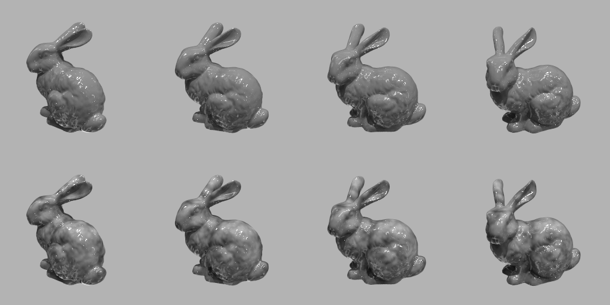
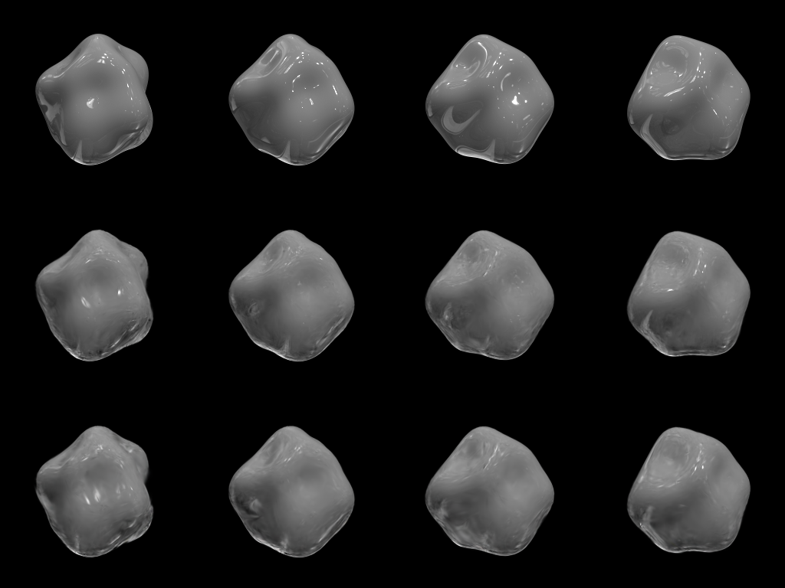
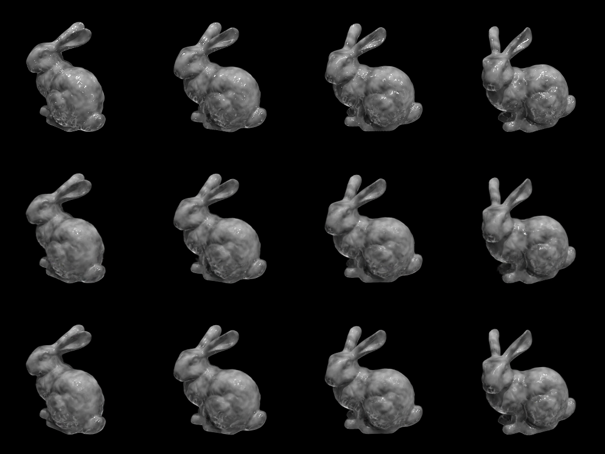
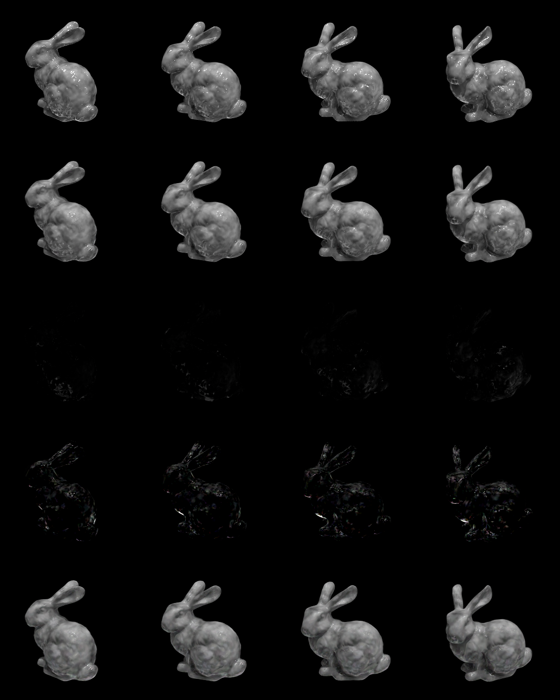

# Gloss in motion: a glossy object that turns under a fixed environment

2026-11-28. Stimuli rendered (blob, bunny). Vanilla Deformable 3D Gaussians and 4DGS-DR trained on the blob; 4DGS-DR
trained on the textured bunny, then with the motion and the normals pinned.

Where it stands:

- On a uniform, almost round blob the deformation field does not turn the object (two thirds of the true rotation,
  normals nearly fixed in the world). A textured, asymmetric object (the bunny) fixes the positions but not the
  normals: the deformation changes the sizes, so the shortest axis, which is the normal, switches with time.
- Fixed sizes over time, a flatness loss and a local-rigidity loss, all taken from existing methods, bring the normal
  error from 30° to 7° at the same PSNR, and the motion visibly improves.
- In every dynamic run, including that one, the reflection component of 4DGS-DR carries almost nothing (at most 1% of
  the brightness of the highlights). The highlights are painted onto the surface as constant colour. What looked like
  "a reflection model with wrong normals" was a model that does not use its reflections.
- A visible-difference loss (the achromatic pathway of ColorVideoVDP) was written and validated on images. Added to
  the training of that model it changed nothing on test views; as long as the highlights are painted on, no image loss
  can make them slide.

The [gloss perception experiment](../gloss_percept/README.md) ended with a goal for a perceptual loss: not the exact
gloss of the truth, but a reconstruction that observers see as the same material. Gloss is judged on moving objects
as much as on still ones, and a reconstruction is meant to be looked at in motion, so the judgement is moved to a
dynamic scene: the object turns in front of a fixed environment.

## Why a turning object is a different problem

| | Static scene, moving camera (gloss_percept) | Turning object, fixed environment (here) |
|---|---|---|
| What moves the highlights | The view direction | The surface normals turn under a fixed environment |
| What the surface pattern does | Moves with the object in the image | Moves with the object; the highlights slide over it |
| What 3DGS / 4DGS has for it | View-dependent SH per Gaussian | The same SH, carried by the deformation: evaluated with the world-space view direction and never rotated |

In this repository's deformation-field 4DGS, a Gaussian keeps its SH coefficients while it moves. Seen from a fixed
camera, a point on a turning glossy object changes its radiance over time, but its SH evaluated in the same direction
cannot. The diffuse shading of a turning point also changes under a non-uniform environment, so a matte object is
the control.

## Stimuli ([`make_motion.py`](make_motion.py))

Everything except the motion is the static stimulus of gloss_percept (shapes, materials, `grace-new` luminance
environment, background 0.15, camera distance 1.3 m, field of view 30°, 256 px).

| Item | Details |
|---|---|
| Motion | A rotation about the vertical axis through the object's centre. `sweep`: −A/2 + A·t (constant speed); `swing`: (A/2)·sin 2πt. Default A = 60° |
| Training views | D-NeRF layout: 150 times evenly spaced in [0, 1], one view each, the camera at a random position in the elevation band of the static training rings (15–55°), 512 spp |
| Test views | One fixed camera (elevation 25°, azimuth 20°), the observer's view, at 30 intermediate times (k + 0.5)/30, 1024 spp. `test_seed2` repeats them with other seeds (noise floor) |
| Ground-truth motion | `rotation_deg` in every frame of `transforms_*.json`, and `motion.json` |
| Renderer | Blender 4.5 Cycles on the GPU ([`blender_render.py`](blender_render.py)), matched to GoLD_rayt (below). `--renderer gold` renders with GoLD_rayt |

### Checks of the rotation (`make_motion.py check`, `bcheck`)

- GoLD_rayt: a sphere turned by 40° renders like the unturned one (mean luminance difference on the object 0.059 of
  the mean, against 0.35 between two seeds at 64 spp), so positions and normals turn together. The blob turned by +40°
  seen from azimuth 20° has the silhouette of the unturned blob seen from azimuth −20° (IoU 1.000; 0.845 for +60°): a
  positive angle increases the azimuth of the object's points.
- Blender against GoLD_rayt, the blob turned by +40°: silhouette IoU 0.998 at 128 px, mean luminance ratio 0.999.

### Blender instead of GoLD_rayt (`bcompare`, `bcalib`, `btime`)

GoLD_rayt renders a training view in about 20 s on the CPU. Blender Cycles takes 2.3 s on the Quadro M4000 (CUDA;
OptiX 2.5 s, Blender's CPU 7.8 s), 512 spp at 256 px.

The two were compared on the static test views of gloss_percept (GoLD_rayt at 1024 spp and its second seed), on the
pixels fully covered by the object:

| | Mean luminance | Highlights (brightest 5%) | Peaks (0.5%) | Mean \|ΔY\| / mean Y | Same, two GoLD seeds |
|---|---|---|---|---|---|
| Matte blob | 1.000 | 0.99–1.00 | 0.97–0.99 | 0.02 | |
| Coated, Principled as it is | 1.59–1.95 | 1.11–1.34 | 1.01–1.15 | 0.60–0.95 | 0.03–0.13 |
| Coated, base colour 0.092 | 0.99–1.03 | 0.99–1.05 | 0.99–1.10 | 0.04–0.12 | 0.03–0.13 |

Ratios are Blender / GoLD_rayt; sphere and blob with coat 0.05 and blob with coat 0.15, two views each.

- Geometry, camera, environment orientation and intensity agree: the matte object matches.
- GoLD_rayt's coat sums the walks between coat and base exactly (pbrt-v4's LayeredBxDF), so light trapped under the
  coat darkens the base. Blender's Principled coat only scales the base by the coat's albedo, and the body comes out
  1.6–1.9 times too bright while the reflections match.
- Setting Principled's base colour to 0.092 (fitted per condition: 0.089–0.094) brings the difference to the level of
  GoLD_rayt's own noise. The fit is for this base (albedo 0.2) and coat (IOR 1.5, roughness 0.05–0.15).

### Data rendered

| Condition | Views | Time | Checks ([`check_data.py`](../gloss_percept/check_data.py) `--pattern "t_*[0-9].pfm"`) |
|---|---|---|---|
| blob1, coat 0.05, sweep 60° | 150 train, 30 test, 30 test_seed2 | 9.6 min (Blender, CUDA) | No non-finite or negative pixels. Fireflies 7.6–9.6 per view (GoLD_rayt's static data: 8.6–8.7). Test frame 18 is flagged as bright in both seeds: a lamp's reflection crosses the view in frames 15–21 |
| bunny, coat 0.05, sweep 60° | same | 7.4 min | No non-finite or negative pixels. Fireflies 12–15 per view, 76% of them at the same pixels in the other seed (blob1: 92%): mostly sparkles of the scan's fine bumps, not noise |
| bunny, coat 0.05, sweep 60°, textured base (`__tex`) | same | 7.5 min | As the plain bunny |

### The bunny (2026-11-28)

The blob turned out to give too few cues to its motion (below): it is smooth, almost round and uniform, so its surface
can slide over itself and still fit the images. The Stanford bunny is asymmetric in every direction, which pins the
rotation through the silhouette, and has curvatures from the ears to the back.

- Mesh ([`make_bunny.py`](make_bunny.py)): `bun_zipper.ply` of the Stanford 3D Scanning Repository (kept outside the
  repository), its five holes closed with fans, centred on its bounding box and scaled to the size of blob1 (largest
  side 0.43 m). The scan's fine bumps stay: they break the highlights into many small ones.
- Material: the same Blender parameters as the blob (coat roughness 0.05, IOR 1.5, Principled base 0.092). New
  conditions are not matched to GoLD_rayt: there is no GoLD_rayt data to compare them with.
- Textured base (`views --texture noise`): Blender's noise in object coordinates (scale 15 per metre, detail 2), its
  Fac mapped from 0.3–0.7 to base × 0.2–1.8. The pattern turns with the object and anchors the motion for the model
  and for observers. It is drawn by Blender only.



*Test view, frames 0, 10, 18 and 29. Top: plain base; bottom: textured base.*

## Training on this data

`train_dynamic.py` now takes `--color-mode`, `--loss-knee` and `--bg` as `train.py` does, so the linear data is
trained and scored in the same encoding as the static gloss runs. It also writes `test_sequence.gif`, the fixed test
view in time order (truth | render).

Smoke test on blob1, coat 0.05 (`--color-mode linear-srgb --bg 0.15 0.15 0.15 --init-extent 0.3`, deformation from
iteration 1000 as in the earlier dynamic runs): 1,500 iterations in 4.6 min (185–320 ms per iteration, 2.9 GB),
test PSNR 30.3 dB, a blurred blob without highlights at this length. Loading, loss, evaluation and outputs work.
Starting the deformation at iteration 100 instead pushed every Gaussian out of view (median offset 3.7 m), the failure
already known from the 4DGS experiments: before a rough shape has formed, an empty image beats it.

### Official code: 4DGS-DR (3DGS-DR with the deformation field of Deformable 3D Gaussians)

The compiled rasterizers are far faster than this repository's PyTorch one, so the long runs use official code, kept
outside the repository (3DGS-DR has no licence file; the rasterizers carry the Inria research licence). Both codes are
already built for sm_52 in the conda environment of the R3DG experiment (Python 3.7, torch 1.12.1 + cu116).

- Data: `to_png.py ... --src-root data/gloss_motion --dst-root data/gloss_motion_png` writes the display-referred copy
  (as for 3DGS-DR in gloss_percept; Blender's premultiplied renders are divided by the coverage, `time` is kept).
- Vanilla dynamic baseline: the official Deformable 3D Gaussians (Yang et al., CVPR 2024), in `D:\dgs_work`.
- 4DGS-DR: a copy of 3DGS-DR (`D:\3dgsdr_work\3DGS-DR-deform`, run with `run_deform.bat`) with Yang et al.'s
  deformation network. With `--deform --is_blender`, the Gaussians are moved to each frame's time before rasterizing,
  and the normals (shortest axes) are taken from the moved Gaussians, so they turn with the object while the cube map
  stays fixed in the world. The first 3,000 iterations (3DGS-DR's vanilla stage) are the warm-up. The base colour is
  still per-Gaussian SH, so diffuse shading stays attached to the surface; only the reflection slides.
- Trial, 4,000 iterations: 40 it/s before the deformation starts and 8–15 it/s after it (Quadro M4000); saving and
  `eval.py` with the deformation work. At this length the render is still a blurred blob without highlights.

### Results on blob1, coat 0.05: vanilla Deformable 3DGS and 4DGS-DR

| | Deformable 3DGS (vanilla) | 4DGS-DR |
|---|---|---|
| Schedule | Official defaults: 40,000 iterations, deformation from 3,000 | 3DGS-DR's: 61,000 iterations, deformation from 3,000 |
| Time (Quadro M4000) | 1 h 36 min (9 it/s after the warm-up, with a test evaluation every 1,000 iterations) | 2 h 15 min (7 it/s after the warm-up) |
| Gaussians | 45,415 | 38,485 |
| Test PSNR, whole image on black | 30.9 (31.0 at 35–39k) | 30.3 (`eval.py`: SSIM 0.925, LPIPS 0.091; peak 30.7 at 30k) |
| Training PSNR | 34.6 | 35.6 |

Test views are the fixed observer camera at the 30 intermediate times. Both fit the training views (one per time)
better than the test view.



*Fixed test view, frames 0, 10, 18 and 29. Rows: truth, vanilla Deformable 3DGS, 4DGS-DR. Over time:
[`results/blob1_r0.05.gif`](results/blob1_r0.05.gif).*

Gloss cues ([`eval_png.py`](../gloss_percept/eval_png.py), display values on black, [`results/png_blob1_r0.05.json`](results/png_blob1_r0.05.json)):

| | Truth | Other seed | Deformable 3DGS | 4DGS-DR | Static 3DGS-DR (gloss_percept) |
|---|---|---|---|---|---|
| Found | 1.00 | 1.00 | 0.77 | 0.77 | 0.91 |
| Blobs (render / truth) | 1.00 | 1.00 | 0.60 | 0.60 | 0.86 |
| Sharpness | 1.00 | 0.98 | 0.15 | 0.18 | 0.47 |
| Skew | 0.42 | 0.42 | −0.12 | −0.12 | 0.36 (truth 0.66) |
| p99 − median | 0.256 | 0.256 | 0.163 | 0.169 | 0.259 (truth 0.307) |
| Object PSNR (display) | | 43.1 | 25.8 | 25.3 | 28.6 |

The static column is a different data set (many views of a still object) and is only a reference.

- The reflection model brings nothing here: 4DGS-DR scores like the vanilla model on every cue, while on the still
  object 3DGS-DR had lifted "found" from 0.11 to 0.91 and the sharpness from 0.05 to 0.47.
- 4DGS-DR's cube map again holds the lamps of the probe, recovered from the reflections. The highlights on the object
  are faint and smeared in both models: the window's sharp reflection that slides over the left of the object in frames
  10–20 is missing, and the shape's relief is softened.

#### The deformation does not turn the object ([`deform_rotation.py`](deform_rotation.py))

The Gaussians are moved to each time with the trained network and compared with themselves at t = 0.5, where the truth
has turned by 60 (t − 0.5) degrees about the vertical axis ([`results/rotation_blob1_r0.05_dgs.txt`](results/rotation_blob1_r0.05_dgs.txt),
[`results/rotation_blob1_r0.05_dr.txt`](results/rotation_blob1_r0.05_dr.txt)):

| t | Truth | Positions: vanilla / DR | Orientations: vanilla / DR | Normals off the truth's turn: vanilla / DR |
|---|---|---|---|---|
| 0.0 | −30.0° | −19.9° / −19.0° | −2.2° / −6.0° | 26.5° / 22.2° |
| 0.2 | −18.0° | −12.1° / −11.2° | −1.5° / −3.5° | 14.9° / 12.9° |
| 0.8 | +18.0° | +12.3° / +11.6° | +2.1° / +3.5° | 14.5° / 12.9° |
| 1.0 | +30.0° | +20.6° / +19.2° | +3.9° / +7.1° | 25.5° / 21.7° |

- In both models the positions turn by about two thirds of the truth (64–68%), and the outer shell, which is the
  visible surface, least: at t = 1, 15–17° of 30° for the outermost tenth of the Gaussians that are off the axis,
  against 23–25° for the inner quarter.
- The orientations turn by 10% of the truth in the vanilla model and 22% in 4DGS-DR. The reflection pulls them a
  little, but the normals that 4DGS-DR reflects about stay almost fixed in the world.
- With a uniform base colour nothing in the images pins a point of the surface: the surface can slide over itself and
  the frames still fit (the aperture problem of an untextured object). Nothing ties the rotation of a Gaussian to the
  motion of its neighbours either: the network outputs dq independently of dx.
- The reflections are then computed with wrong normals, and the cube map and the per-Gaussian base colour absorb what
  they can. This is a failure of the motion, not of the reflection model, and it bounds what a perceptual loss on the
  images can do as long as the motion is left free.
- Added 2026-11-28: the split of the render into its parts (below, "Where the highlights are") shows that this model's
  reflection part is empty (0.0003 of 0.55 inside the highlights). The base colour did not absorb "what it can" but
  everything.

A low-spp preview of the test view (glossy and matte blob side by side) is written by `make_motion.py preview`
(24 frames at 192 px and 128 spp: 3.3 min).

## The textured bunny: pinning the motion and the normals (2026-11-28)

All runs: `bunny__coat_r0.05__sweep60__tex`, display-referred PNGs, 4DGS-DR (`D:\3dgsdr_work\3DGS-DR-deform`), Quadro
M4000.

### 4DGS-DR as it was: positions right, normals wrong

Run with 3DGS-DR's schedule (61,000 iterations, deformation from 3,000), stopped at 30,000 once the problem was clear.

| Iteration | Positions at t = 0 / 1 (truth ∓30°) | Orientations | Normals off the truth's turn | Test PSNR |
|---|---|---|---|---|
| 7,000 | about ∓29° | about ∓11° | 22° | |
| 15,000 | about ∓29° | about ∓11° | 27° | 29.6 (10k) |
| 30,000 | −29.0° / +28.9° | −10.8° / +12.4° | 30° | 31.6 |

- The texture and the silhouette pin the positions: they turn by 97% of the truth from 7,000 iterations on (the blob:
  two thirds).
- The orientations follow by about 40%, and the normal error grows during training.
- Cause: the deformation network also changes the sizes (median |Δsize| / size of 1.8, 1.1 and 1.1 on the three axes).
  3DGS-DR takes the shortest axis as the normal, and for 30% of the opaque Gaussians the shortest axis is a different
  one at t = 0 or 1 than at t = 0.5. The Gaussians are not flat either (shortest / middle size 0.36), so the shortest
  axis is weakly defined to begin with.

### What existing methods do

Collected before changing the code (see also [`literature.md`](literature.md)):

| Problem | Existing answer | Source |
|---|---|---|
| Sizes that change with time make the normal axis switch | Stated as a failure of rotation-only normal transport when the relative axis lengths change | SpectroMotion (Fan et al., CVPR 2025) |
| | Sizes constant over time | Dynamic 3D Gaussians (Luiten et al. 2024), Shape of Motion, MoSca, SC-GS (paper) |
| The shortest axis is not a normal unless the Gaussian is flat | A loss on the shortest size; or a fixed normal axis with zero thickness | PGSR, NeuSG (weight 100); Gaussian Surfels, 2DGS |
| Nothing ties a Gaussian's rotation to the motion of its neighbours | Local rigidity: the rotation must carry the offsets to the k nearest neighbours; or control points with skinning | Dynamic 3D Gaussians (k = 20, weights exp(−2000 d²), loss weight 4; without it the tracking error doubles); SC-GS |
| Reflections fitted before shape and motion exist | Reflections switched on late (9,000 iterations) | SpectroMotion, ReflFlow |

3DGS-DR itself has no loss on normals or flatness: its normals are shaped only by the gradient through the cube map.
No paper was found that treats the switching of the shortest axis directly.

### Changes to 4DGS-DR

Options added to the copy's `train.py` (the copy stays outside the repository):

| Option | What it does |
|---|---|
| `--no_deform_scale` | The deformation's size output is ignored: sizes, and with them the normal axis, are fixed over time |
| `--lambda_flat 100` | Mean shortest size as a loss, from iteration 3,000 |
| `--lambda_rigid 4` | Local rigidity between the canonical space and the frame's time (k = 20 canonical neighbours, 8,192 Gaussians per iteration; the canonical side is detached, so the loss ties the deformation's rotation output to its position output) |
| `--init_until_iter 9000 --longer_prop_iter 6000` | Reflections from 9,000 iterations; 3DGS-DR's normal propagation keeps its length (9,000–30,000), 67,000 iterations in all |
| `--stop_at`, `--finetune_from` | Stop with a checkpoint under the full run's schedules; continue from a saved model |

### Result

51 min to 15,000 iterations (trial), then 3 h 19 min to 67,000. 63k Gaussians.

| Iteration | Positions at t = 0 / 1 | Orientations | Normals off the truth's turn | Axis switches | Test PSNR |
|---|---|---|---|---|---|
| 7,000 | −29.6° / +25.0° | −24.1° / +20.2° | 6.1° / 8.3° | 0% | |
| 15,000 | −26.7° / +27.3° | −25.6° / +26.6° | 5.1° / 4.6° | 0% | 29.7 (10k) |
| 30,000 | −29.3° / +29.3° | −25.8° / +25.8° | 5.8° / 5.7° | 0% | 31.7 |
| 45,000 | −29.4° / +29.4° | −25.7° / +25.1° | 6.7° / 6.8° | 0% | 32.0 (40k) |
| 67,000 | −29.4° / +29.4° | −25.4° / +24.5° | 7.0° / 7.3° | 0% | 32.05 (SSIM 0.950, LPIPS 0.048) |

(7,000 and 15,000 were saved right after an opacity reset and are measured with `--min-opacity 0.0099`;
[`results/rotation_bunny_tex_dr2_*.txt`](results).)

- The orientations turn by 82–86% of the truth (before: about 40%) and the normal error is 5–7° (before: 30°), at
  the same or slightly better PSNR (32.05 against 31.60 at 30,000 before).
- The last 15% of the orientation did not close, and the normal error crept from 5° to 7° after 30,000.
- The flatness weight of 100 is stronger than needed: shortest / middle size falls to about 0.001 within 2,000
  iterations. It did not hurt the images, but the number of Gaussians peaked at 88k and the run slowed to 3.5–4.5 it/s.



*Fixed test view, frames 0, 10, 18 and 29. Rows: truth; 4DGS-DR as it was (30,000 iterations); with the changes
(67,000). Over time: [`results/bunny_tex_r0.05.gif`](results/bunny_tex_r0.05.gif).*

Gloss cues ([`results/png_bunny_tex_r0.05.json`](results/png_bunny_tex_r0.05.json)):

| | Truth | Other seed | As it was (30k) | With the changes (67k) |
|---|---|---|---|---|
| Found | 1.00 | 0.97 | 0.79 | 0.83 |
| Blobs (render / truth) | 1.00 | 1.00 | 0.46 | 0.61 |
| Sharpness | 1.00 | 0.75 | 0.08 | 0.12 |
| p99 − median | 0.363 | 0.364 | 0.300 | 0.304 |

- In the GIF the change is clearly visible: the surface turns as one piece and the shading stays on the shape. The
  cues understate it.
- The truth carries fireflies and real sparkles of the scan's bumps (12–15 per view), which twinkle over time. The
  sharpness and the visible-difference score count them as sharp highlights, so both read worse than the renders look:
  even the truth with another noise seed reaches only 0.75 in sharpness. What remains by eye is a somewhat lower gloss.

### A visible-difference loss ([`vdp_loss.py`](vdp_loss.py))

Render and truth share shape, light and view. For such pairs a visible-difference predictor (HDR-VDP-3) predicted how
discriminable two glosses are (Cheeseman et al.; the image statistics and learned gloss predictors do not qualify, see
[`literature.md`](literature.md)). `vdp_loss.py` is the achromatic, still-image pathway of ColorVideoVDP (Mantiuk et
al. 2024, MIT; its package needs Python 3.9 and PyTorch 1.13), rewritten for PyTorch 1.12: display model, Laplacian
pyramid, contrast, castleCSF sensitivity, mutual masking, pooling to JOD. It pools over the object instead of the whole
image and pads by replication. Viewing: 24 inch full HD at 0.6 m (37.8 pixels per degree). The package's sensitivity
table and parameters are read from `D:\assets\cvvdp`.

Check on images (30 test views; JOD: 10 is no visible difference; [`results/vdp_bunny_tex_r0.05.json`](results/vdp_bunny_tex_r0.05.json)):

| Image against the truth | JOD | L1 |
|---|---|---|
| Truth, other noise seed | 8.88 | 0.0055 |
| Truth blurred, σ 0.5 px | 9.42 | 0.0081 |
| Truth blurred, σ 1 px | 8.36 | 0.0213 |
| Truth blurred, σ 2 px | 6.75 | 0.0349 |
| 4DGS-DR as it was (30k) | 7.56 | 0.0247 |
| With the changes (67k) | 7.74 | 0.0234 |

- The order follows the blur, and the renders sit between a blur of 1 and 2 px.
- Optimising the pixels of a render directly brings 10 − JOD from 1.93 to 0.03, and L1 falls with it; the gradients
  are finite, also at identical images. 48 ms per forward and backward on the CPU.
- Rendering noise alone costs 1.1 JOD, which is the ceiling for a model.

Fine-tuning the 67,000-iteration model with this loss added (`--finetune_from 67000 --lambda_vdp 0.0025`, the weight
at which its gradient on the image equals L1's) was stopped after 5,000 iterations: test JOD 7.743 → 7.744, sharpness
0.123 → 0.126, PSNR 32.05 → 31.99. In that run the loss was pooled over the whole image, not the object: the reader
composites the RGBA images and dropped the coverage (fixed afterwards in `utils/camera_utils.py`).

### Where the highlights are ([`render_parts.py`](render_parts.py))

The image of 4DGS-DR is (1 − r) · base + r · reflection. The base is split by rendering it again without the higher
SH coefficients. Mean display value inside the truth's highlights (the brightest 5% of the object in each view), test
views:

| Model | Truth | Render | Reflection | View-dependent colour | Constant colour | JOD test / train |
|---|---|---|---|---|---|---|
| Blob, 4DGS-DR (61k) | 0.642 | 0.549 | 0.0003 | 0.023 | 0.526 | 6.56 / 8.13 |
| Bunny, as it was (30k) | 0.725 | 0.646 | 0.0000 | 0.022 | 0.623 | 7.56 / 7.95 |
| Bunny, with the changes (67k) | 0.725 | 0.652 | 0.006 | 0.028 | 0.618 | 7.74 / 8.21 |

(JOD on 30 test views and 30 training views, both pooled over the object;
[`results/parts_*.json`](results).)



*Bunny with the changes, test frames 0, 10, 18 and 29. Rows: truth, render, reflection part, view-dependent colour
(× 4), constant colour.*

- The reflection part is empty in all three models: at most 1% of the highlights' brightness (3% on training views of
  the last model). The reflection strength starts at 0.001. Share of the opaque Gaussians above
  0.02, the level from which 3DGS-DR treats a Gaussian as reflective: static 3DGS-DR on the blob 24% at 7,000
  iterations and 58% at the end (mean strength 0.19); dynamic blob 7% at the end (0.018); bunny as it was 3% at
  30,000 (0.007); bunny with the changes 15% at 30,000 and 28% at 67,000 (0.075), still rising. With right normals the
  reflections start to be used, but far more slowly than on the still object. These "4DGS-DR" models are, in effect,
  vanilla dynamic models with a cube map they do not use, which is why 4DGS-DR scored like the vanilla model on the
  blob.
- The highlights are in the constant colour: bright patches attached to the surface where highlights are on average,
  with a small view-dependent correction (4%). Such highlights turn with the object instead of sliding over it, which
  is the look the literature calls matte in motion, and they are too dim (0.65 against 0.73).
- So the gain of the changes above is a gain in shape and motion, not in reflections, and the diagnosis written for
  the blob ("the reflections are computed with wrong normals") was incomplete: the reflections are hardly computed
  at all.
- A loss between images cannot move this. The representation has two ways to draw a highlight, and training takes the
  one that does not slide. On the still object 3DGS-DR did use its reflections (gloss_percept), so the question is
  what in the dynamic setting keeps the reflection strength at zero: one view per time, normals that are wrong while
  the motion forms, or a base colour that has already absorbed the highlights when the reflections start.

### Reproduction

```
# 4DGS-DR with pinned motion and normals (inside D:\3dgsdr_work, r3dg environment)
run_deform.bat train.py -s <repo>\data\gloss_motion_png\bunny__coat_r0.05__sweep60__tex -m output\gm_bunny_r0.05_tex_dr2 ^
    --eval --iterations 61000 --deform --is_blender --no_deform_scale --lambda_flat 100 --lambda_rigid 4 ^
    --init_until_iter 9000 --longer_prop_iter 6000
run_deform.bat eval.py --model_path output\gm_bunny_r0.05_tex_dr2 --iteration 67000 --save_images
# motion and normals (CPU), parts (GPU, under a minute), visible difference and cues (CPU)
python experiments/gloss_motion/deform_rotation.py D:/3dgsdr_work/output/gm_bunny_r0.05_tex_dr2 67000
run_deform.bat <repo>\experiments\gloss_motion\render_parts.py --model_path output\gm_bunny_r0.05_tex_dr2 --iteration 67000 --out <prefix>
python experiments/gloss_motion/vdp_loss.py bunny__coat_r0.05__sweep60__tex "label=<render dir>" ...
python experiments/gloss_percept/eval_png.py bunny__coat_r0.05__sweep60__tex --dr "label=<render dir>" ... ^
    --png-root data/gloss_motion_png --src-root data/gloss_motion --out <json>
```

## Literature

[`literature.md`](literature.md) collects what gloss perception says a "same material in motion" reconstruction must
keep: highlights that slide over the surface, congruent with the shape and shading, with the specular flow that follows
from curvature, and contrast, coverage and sharpness. Image statistics such as skewness are not the cue, and the
learned predictors of gloss (all static) are blind to highlight congruence. No study measured how large errors of
highlight position or motion may be for two moving objects to look like the same material.

## Next

- Make the model use its reflections. The motion and the normals are now close enough (7°) that a reflection would
  land near the right place, but the reflection strength stays at zero. Before another long run: how the dynamic
  specular methods force the split (SpectroMotion trains the shading with geometry and deformation frozen; a base
  colour without view dependence leaves the reflections as the only way to draw a highlight), and why 3DGS-DR's own
  mechanism works on the still object and not here.
- Only then does a loss on the images matter. `vdp_loss.py` is ready, pooled over the object; its one training run
  so far was pooled over the whole image and on a model that could not respond.
- Evaluation: the truth's fireflies and sparkles lower every score that rewards sharp detail. Either the truth is
  rendered cleaner or the scores are read against the other-seed truth, not against 1.
- The tolerance for highlight errors in a moving scene (how far from the truth still looks like the same material) is
  not in the literature and stays a question for an observer experiment.
