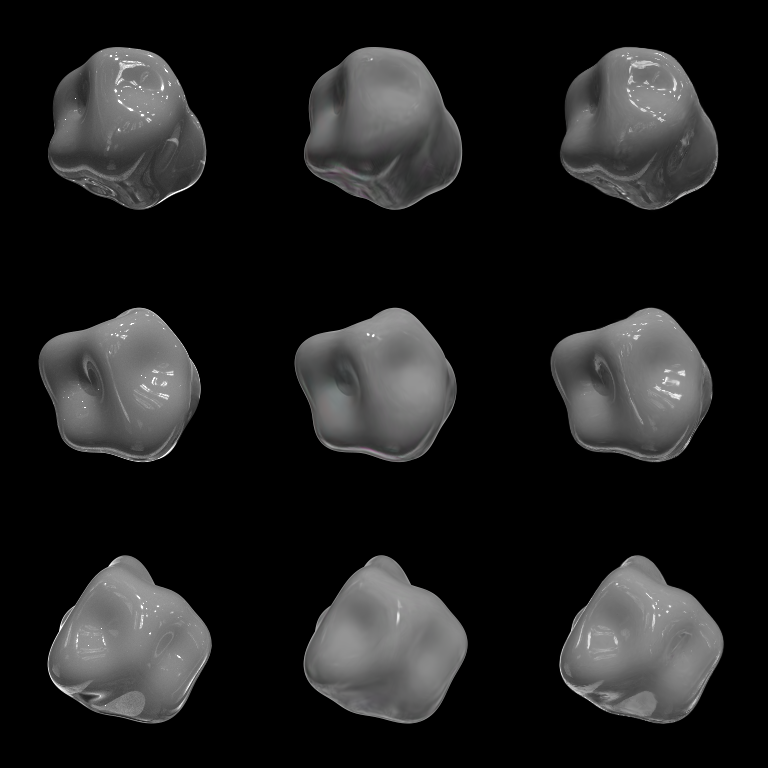
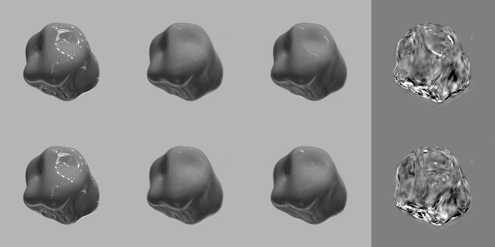
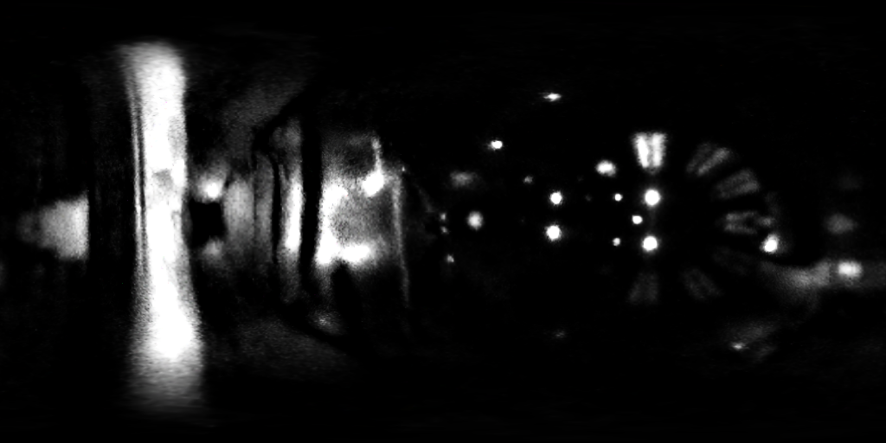

# Gloss perception of 3DGS: the loss, a perceptual loss, and a reflection model

2026-11-26. The [gloss experiment](../gloss/README.md) showed that 3DGS breaks on a gold statue. This one asks the
question again with stimuli built for gloss perception: achromatic objects under an environment map, with a ladder of
coat roughness. It measures what 3DGS loses with image cues that gloss psychophysics names and with a learned
predictor of perceived gloss, then tries two ways to get the gloss back: a perceptual loss and a representation that can
draw reflections.

## Summary

| Step | Question | Answer |
|---|---|---|
| [Baseline](#baseline-vanilla-3dgs) | Does vanilla 3DGS lose the gloss of these objects? | Yes. On the blob with a sharp coat it keeps 31% of the highlight energy and 11% of the highlights. Positive skew turns negative (0.64 to −0.09) |
| [A perceptual ruler](#a-perceptual-ruler-clip) | What can predict perceived gloss well enough to score renders? | Not the gloss lab's cue model: its prediction peaks at roughness 0.3. A linear readout of CLIP image embeddings, trained on Serrano et al.'s ratings, does (r = 0.81 in cross-validation) and orders the roughness ladder |
| [Perceptual loss](#perceptual-loss-match-the-clip-readout-in-training) | Does matching the CLIP readout during training bring the gloss back? | No. The readout of the 3DGS renders gets close to the truth's, but the highlights do not come back: the change is below one 8-bit step. CLIP is fooled. A control on the whole embedding raises the readout even more |
| [A reflection model](#a-representation-that-can-draw-highlights-3dgs-dr) | Does a representation built for reflections keep the highlights? | Mostly. 3DGS-DR keeps 91% of the highlights (noise floor 98%) and lifts the readout to 0.4 below the truth's. The highlights stay softer and dimmer than in the truth |

The loss of gloss comes from the representation, not from the loss function: a better loss cannot make SH draw sharp
moving highlights, but a deferred reflection with a learned environment map can. [Next](#next) lists what is left.



*Blob, coat roughness 0.05, test views 0, 3 and 6. Left: ground truth. Middle: vanilla 3DGS (this repository, linear
HDR data, 7,000 iterations). Right: 3DGS-DR (official code, display-referred PNG data, 61,000 iterations).*

## Stimuli ([`make_stimuli.py`](make_stimuli.py))

Gloss research mostly uses achromatic stimuli, and shape changes perceived gloss, so the gold statue was replaced.

| Item | Details |
|---|---|
| Light | Only a distant environment: the luminance of `grace-new.hdr` (× 2), as in Fleming, Dror & Adelson (2003) |
| Shapes | A sphere (radius 0.2 m) and a "blob": the sphere displaced along its normal by a low-frequency random field (standard deviation 0.10 × radius) |
| Materials | A clear coat (IOR 1.5) over a grey diffuse base (albedo 0.2), coat roughness 0.05 / 0.15 / 0.3 / 0.5 (GoLD_rayt roughness, α = roughness²), and a matte reference (albedo 0.2) |
| Cameras | The views of the colour experiment: distance 1.3 m, field of view 30°, 90 training views (3 rings × 30), 10 random test views |
| Rendering | GoLD_rayt (RGB build), 256 × 256 px, linear Rec.2020 (equal to linear sRGB for these grey scenes). Training views 512 spp (about 18 s each), test views 1024 spp (about 30 s each) |
| Background | The environment is replaced by a uniform linear 0.15, weighted by the object's coverage of each pixel |
| Noise floor | Every test view is rendered a second time with another seed (`test_seed2`) |

Training data exist for the sphere and the blob with coat roughness 0.05 and 0.15. The test views exist for the whole
ladder (matte and the four roughnesses), which is used to check the perceptual ruler.
[`check_data.py`](check_data.py) checks every data set for non-finite or negative pixels, outlier views and fireflies.

## Baseline: vanilla 3DGS

### Method

- `train.py` of this repository, `--color-mode linear-srgb`, 7,000 iterations, 20,000 initial points in a cube of
  half side 0.3 m, background 0.15. About 18 min per run.
- [`eval_gloss.py`](eval_gloss.py) scores the test views on the object (coverage > 0.99) against the truth:
  - Light ratios on linear luminance: all object pixels, the highlights (the truth's brightest 5%) and the peaks
    (its brightest 0.5%).
  - Image cues on display values: one exposure per data set (the truth's median luminance → 0.18), clipped at 1,
    sRGB curve. These are skewness (Motoyoshi et al. 2007), p99 − median contrast, coverage and sharpness of the
    highlights (Marlow et al. 2012), and "found": the share of the truth's local highlights that the render also has.
    Local highlights are display values above their Gaussian surround (σ 3 px) by more than 0.08, with a tolerance
    of 1 px.

### Results ([`results/run1.json`](results/run1.json), [`results/percept_run1.json`](results/percept_run1.json))

| | Highlight energy | Peak energy | Skew (truth) | Skew (3DGS) | Sharpness | Found |
|---|---|---|---|---|---|---|
| Sphere, 0.05 | 0.30 | 0.08 | 0.54 | 0.23 | 0.19 | |
| Sphere, 0.15 | 0.60 | 0.41 | 1.04 | 0.98 | 0.29 | |
| Blob, 0.05 | 0.31 | 0.06 | 0.64 | −0.09 | 0.05 | 0.11 |
| Blob, 0.15 | 0.46 | 0.20 | 0.99 | 0.66 | 0.18 | |

Energies and sharpness are render / truth. The other-seed truth scores 0.99–1.04 on the energies, 0.84–0.99 on
sharpness and 0.94 on "found". On the blob with coat 0.05, 3DGS keeps 79 of 1,197 highlight blobs.

### Discussion

1. 3DGS loses the highlights, and most of all the sharp ones: the peak energy drops more than the highlight energy, and
   the sharp coat loses more than the rough one.
2. Shape matters: on the blob, the sharp coat's skew changes sign, while on the sphere it only shrinks.

## A perceptual ruler: CLIP

### Question

The image cues show what changed but not how much it matters to an observer. Observer experiments that would only
confirm that 3DGS loses gloss were not run: that is known. A predictor of perceived gloss is used instead. It is
trusted only if it orders the truth's roughness ladder (matte < 0.5 < 0.3 < 0.15 < 0.05) on each shape.

### The gloss lab's cue model fails the ladder

The best model of `D:\ML\gloss-perception-lab` under shape hold-out is a ridge on highlight cues and luminance
quantiles ([`lab_cues.py`](lab_cues.py)). On the truth it predicts, on the 1–7 scale:

| | matte | 0.5 | 0.3 | 0.15 | 0.05 |
|---|---|---|---|---|---|
| Sphere | 3.14 | 3.93 | 4.48 | 4.38 | 3.90 |
| Blob | 3.24 | 3.99 | 4.42 | 4.25 | 3.86 |

It peaks at roughness 0.3 and rates the sharpest coat like the roughest one, so it is not used.

### A linear readout of CLIP ([`clip_readout.py`](clip_readout.py))

- Encoder: CLIP ViT-L/14 image embeddings (768 values), the one of Zero-1-to-3 XL in `D:\project\image-to-3d-diffusion`
  (its translucency readout uses the same encoder). The images are prepared the same way: 256 px, bicubic to 224.
- Readout: a ridge regression on standardised embeddings, fitted on Serrano et al. (2021)'s glossiness ratings.
- Data: a subset of 5,022 of their 42,120 images, the same number in every geometry × illumination cell. Its learning
  curve is flat beyond about 2,000 images (r 0.735 at 250, 0.801 at 2,000, 0.809 at 4,017).
- Validation: 5-fold cross-validation over material groups gives r = 0.81. Leaving one of the nine geometries out
  gives r = 0.71–0.83.
- Our images: display values (exposure × 3), the object cropped to 80% of the frame, on a grey background
  ([`export_display.py`](export_display.py)).

Readout of the truth and of vanilla 3DGS (grey background, mean over the 10 test views):

| | matte | 0.5 | 0.3 | 0.15 | 0.05 | 3DGS, 0.15 | 3DGS, 0.05 |
|---|---|---|---|---|---|---|---|
| Sphere | 0.60 | 2.73 | 4.32 | 5.05 | 5.58 | 4.65 | 4.94 |
| Blob | −0.01 | 1.56 | 3.52 | 4.28 | 4.13 | 3.40 | 2.28 |

The ladder is ordered on the sphere. On the blob, 0.05 and 0.15 tie (the other-seed truth reads 4.41 and 4.32).
3DGS loses 1.85 on the blob with the sharp coat, far more than anywhere else. The same holds on the environment
background ([`results/clip_readout.json`](results/clip_readout.json)).

## Perceptual loss: match the CLIP readout in training

### Method ([`gloss_loss.py`](gloss_loss.py), `train.py --percept`)

- The render goes through the readout's preparation, all differentiable: luminance × 3, clip at 1, sRGB curve, onto
  grey with the truth's coverage, crop, CLIP.
- `gloss`: (readout of the render − readout of the training image of the same view)².
- `embed`, a control: 1 − cosine between the whole CLIP embeddings of render and training image. It tests whether the
  gloss direction matters or only CLIP's features in general.
- Weight: set at iteration 2000 so that the loss's gradient on the means is `--percept-ratio` times the image loss's
  (median over 8 views). The loss is added every 2 iterations.
- Runs on the blob with coat 0.05 in image-to-3d-diffusion's environment (it holds transformers and the weights). About
  34 min per run, against 18 min without it.
- Criteria set before the runs:
  1. The readout gets closer to the truth's.
  2. The independent cues (found, sharpness, skew) improve too.
  3. PSNR does not get worse.
  4. The change is visible.

### Results ([`results/percept_blob1_r0.05.json`](results/percept_blob1_r0.05.json), [`score_clip.py`](score_clip.py))

| | Truth | Baseline | gloss, ratio 0.5 | gloss, ratio 2 | embed, ratio 2 |
|---|---|---|---|---|---|
| CLIP readout | 4.44 | 2.33 | 3.76 | 3.95 | **4.06** |
| Found | 1.00 | 0.11 | 0.11 | 0.14 | 0.12 |
| Sharpness | 1.00 | 0.047 | 0.055 | 0.048 | 0.044 |
| Skew | 0.64 | −0.09 | −0.04 | −0.06 | −0.00 |
| Object PSNR | | 29.46 | 29.47 | 29.54 | 29.44 |

The readout here prepares the images in floating point (4.44 for the truth). The table above uses 8-bit PNGs (4.13).



*Rows: gloss ratio 2 and embed ratio 2. Columns: truth, baseline, run, 10 × |run − baseline|.*

### Discussion

1. Criterion 1 holds and criterion 2 fails. The readout closes most of the gap, but the highlights stay where they
   were: the mean change is 0.0035 in display values, below one 8-bit step. It is a faint texture over the surface and
   a few new bright points. This is an adversarial change to CLIP, not gloss.
2. The control raises the gloss readout more than the gloss loss does (4.06 against 3.95). Pulling the embedding
   towards the truth's raises the readout as a side effect, so the gloss direction itself adds nothing.
3. SH of degree 3 cannot draw the highlights, so the loss is met the cheapest way the representation allows.

## A representation that can draw highlights: 3DGS-DR

### How it represents gloss (read from its code)

- Each Gaussian holds a base colour (SH, as in 3DGS) and a reflection strength r in [0, 1]. r is the same from every
  direction.
- Its normal is the Gaussian's shortest axis, turned towards the camera.
- The rasterizer blends base colour, normal and r per pixel (7 channels). Each pixel then reflects the view ray about
  its normal and looks up a learned cube map (6 × 128 × 128, values in [0, 1]):
  `colour = (1 − r) · base + r · envmap(reflect(view, normal))`.
- Where a highlight appears follows from the normal and the view, so it is consistent across views. Vanilla 3DGS has
  to store a sharp function of direction per Gaussian in SH, which it cannot.
- The paper's contribution is the training of the normals: gradients of the deferred reflection propagate correct
  normals across the surface.
- It has no roughness, no Fresnel term, and assumes distant light.

### Setup

- **Why the official CUDA code.** The same 10,893 Gaussians at 256 px take 121 ms per render and backward with this
  repository's PyTorch rasterizer, and 6.6 ms with the compiled CUDA rasterizer: 18 times faster.
- **Code.** 3DGS-DR (Ye et al., SIGGRAPH 2024) at commit `4077f1d`, cloned outside this repository (it has no licence
  file; its rasterizers carry the Inria research licence).
- **Build.** Its three CUDA extensions were built in place for sm_52 in the conda environment of the R3DG experiment
  (Python 3.7, torch 1.12.1 + cu116, nvcc 11.8, VS2019, `TORCH_CUDA_ARCH_LIST=5.2`). One local change: the unused
  `open3d` import is made lazy. Runs need `KMP_DUPLICATE_LIB_OK=TRUE`, as for R3DG.
- **Data.** 3DGS-DR reads 8-bit RGBA PNGs, so [`to_png.py`](to_png.py) writes a display-referred copy:
  - Each raw render (linear, environment behind it) × 3, clipped at 1, sRGB curve, 8 bit, with alpha = coverage.
  - Highlights above the display's white are clipped: 0.3% of the object pixels.
  - `points3d.ply` holds 20,000 random points in the same cube as the baseline. The code's default is a cube of side
    2.6, far larger than this object.
- **Training.** Official synthetic settings: 61,000 iterations, black background. 36 min on the Quadro M4000 (about
  45 iterations/s in the first 3,000 vanilla iterations, about 30/s afterwards). 52,175 Gaussians at the end.
- **Scoring.** [`eval_png.py`](eval_png.py) scores the renders in the space the model was trained in: display values
  on black, against the test PNGs, with the cues of `eval_gloss.py` and the CLIP readout.

### Results ([`results/png_blob1_r0.05.json`](results/png_blob1_r0.05.json))

| | Truth | Other seed | 3DGS-DR, 61k | 3DGS-DR, 30k |
|---|---|---|---|---|
| Found | 1.00 | 0.98 | **0.91** | 0.90 |
| Blobs (render / truth) | 1.00 | 0.97 | **0.86** | 0.70 |
| Sharpness | 1.00 | 0.93 | 0.47 | 0.34 |
| Skew | 0.66 | 0.65 | 0.36 | 0.25 |
| p99 − median | 0.307 | 0.304 | 0.259 | 0.238 |
| Clipped share | 0.003 | 0.003 | 0.000 | 0.000 |
| CLIP readout | 4.57 | 4.73 | **4.15** | 3.97 |
| Object PSNR (display) | | 36.1 | 28.6 | 28.2 |

For comparison, vanilla 3DGS on this object scores found 0.11, blobs 0.07, sharpness 0.05 and skew −0.09. Its CLIP
readout is 2.33 against 4.44 in the loss's preparation.



*The cube map learned by 3DGS-DR, unwrapped. The lamps and the bright window of the probe are recovered from the
reflections alone.*

### Discussion

1. The highlights come back: 91% of the truth's local highlights and 86% of its highlight blobs. Here the readout rises
   because the highlights are drawn. Unlike the perceptual loss, the independent cues move with it.
2. The environment map is recovered from the reflections, so reflection and base colour are separated as the model
   intends.
3. What is left is the quality of the highlights. Sharpness is half the truth's, the peaks never reach the display's
   white, and the skew is about half. Two parts of the model may explain it (conjecture):
   - r is constant over directions and every term is in [0, 1], so a highlight can reach white only where r and the
     map are both near 1 in every view.
   - Normals are blended per pixel before the reflection, and the map has finite resolution.
4. Follow-up 5 of the [gloss experiment](../gloss/README.md) added deferred shading to this repository's 3DGS and
   did not beat vanilla 3DGS. 3DGS-DR, with its normal-propagation schedule, does here.

### On roughness

A uniform coat roughness does not break this model in principle. Under the split-sum approximation, a glossy
reflection is the environment pre-filtered by the lobe, looked up in the reflected direction, times a factor of the
view angle. The learned map can become the pre-filtered environment. What it cannot follow:

- The view-angle factor (Fresnel), because r is constant. This holds at every roughness.
- The change of the lobe's shape at grazing angles, which grows with roughness.
- Spatially varying roughness, since the map has one blur level.

Rougher coats also make the reflection low-frequency, which SH can represent, so the gap to vanilla 3DGS is
expected to shrink with roughness. The model's real limits are the distant-light assumption (the object reflecting
itself in its concavities) and Fresnel. Later reflection methods (e.g. Ref-Gaussian, ICLR 2025) add
inter-reflection.

## Next

- **A perceptual loss on a representation that can draw highlights.** With 3DGS-DR the remaining gap is in the quality
  of the highlights, the part a perceptual loss is meant for. To test whether the CLIP loss now sharpens the highlights
  or again fools CLIP, it needs:
  - Random augmentation of the CLIP input (crop jitter, scale, blur, noise), to close the adversarial route.
  - CLIP in 3DGS-DR's environment (Python 3.7 and torch 1.12; transformers is not installed there).
- **The highlight quality itself:** where the softness comes from (normals or map resolution), and a view-dependent
  reflection strength.

## Limitations

- One object (the blob) and one roughness (0.05) for the perceptual loss and for 3DGS-DR.
- The vanilla baseline and 3DGS-DR were trained on different data: linear HDR against 8-bit display values. Their
  lengths also differ: 7,000 against 61,000 iterations.
- The CLIP readout is validated on Serrano et al.'s images and ratings, not on observers looking at these stimuli.
  Its noise floor is up to 0.3: other-seed truth renders read 0.04–0.28 apart.
- Only 3DGS-DR was tested among the reflection-aware methods.

## Reproduction

```bash
# stimuli (GoLD_rayt) and checks
python experiments/gloss_percept/make_stimuli.py env
python experiments/gloss_percept/make_stimuli.py mesh
python experiments/gloss_percept/make_stimuli.py views blob1 coat_r0.05
python experiments/gloss_percept/check_data.py data/gloss_percept/blob1__coat_r0.05

# vanilla 3DGS and its cues
python train.py --datadir data/gloss_percept/blob1__coat_r0.05 --expname gp_blob1_r0.05 --iters 7000 \
    --color-mode linear-srgb --init-extent 0.3 --bg 0.15 0.15 0.15
python experiments/gloss_percept/eval_gloss.py logs/gp_blob1_r0.05/ckpt_007000.pt --out experiments/gloss_percept/results/run1.json

# CLIP readout and perceptual loss (image-to-3d-diffusion's environment, HF_HOME=D:\project\image-to-3d-diffusion\data\hf)
python experiments/gloss_percept/export_display.py --ckpts logs/gp_*/ckpt_007000.pt --background grey --crop 0.8 \
    --out data/gloss_percept/clip_input/grey
python experiments/gloss_percept/clip_readout.py
python experiments/gloss_percept/gloss_loss.py export
python train.py ... --percept gloss --percept-ratio 2      # or --percept embed
python experiments/gloss_percept/score_clip.py logs/<run>/ckpt_007000.pt ...

# 3DGS-DR: run inside the clone, with the r3dg environment on PATH, PYTHONPATH set to the three in-place builds
# (submodules/diff-gaussian-rasterization_c3, _c7, cubemapencoder) and KMP_DUPLICATE_LIB_OK=TRUE
python experiments/gloss_percept/to_png.py blob1__coat_r0.05
python train.py -s <this repo>/data/gloss_percept_png/blob1__coat_r0.05 -m output/gp_blob1_r0.05 --eval --iterations 61000
python eval.py -m output/gp_blob1_r0.05 --iteration 61000 --save_images
python experiments/gloss_percept/eval_png.py blob1__coat_r0.05 --dr "3DGS-DR 61k=<output>/test/ours_61000/renders/rgb" --clip \
    --out experiments/gloss_percept/results/png_blob1_r0.05.json
```
