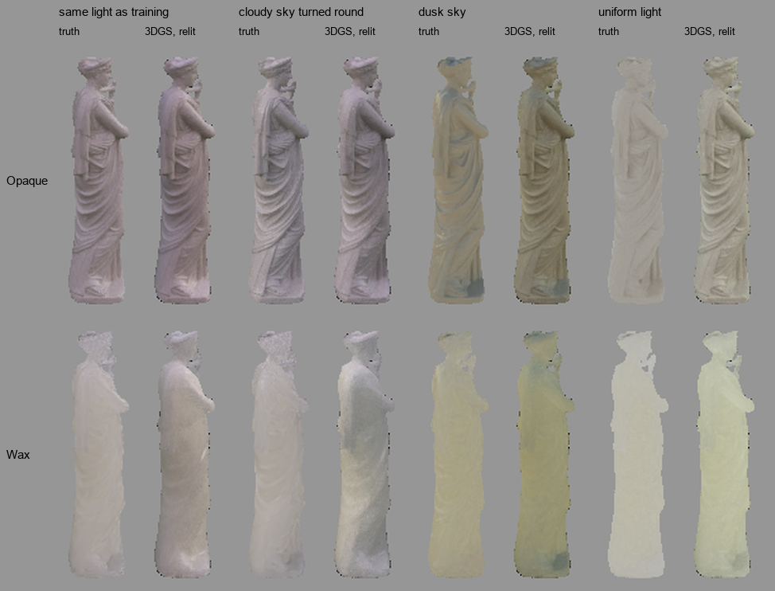

# Relighting a translucent object with Relightable 3D Gaussians

Does a relightable 3DGS method keep the look of a translucent material, in the same view and under new light?
This page records a test with Relightable 3D Gaussian (R3DG; Gao et al., ECCV 2024) on a wax-like statue and an
opaque control, scored with image metrics and with image cues that are known to drive material perception.

This experiment does not use the implementation in this repository. R3DG was run from a clone of the official
code, which is not included here (it has its own license). Only the numbers, one figure, and this write-up are
in the repository. The motivation comes from the [gloss experiment](../gloss/README.md): plain 3DGS has no way
to express what is outside "a colour per point and direction", and a relightable method has to commit to a
material model. R3DG's model is an opaque surface BRDF, so a scattering material is outside it by design.

## Summary

- Novel views under the training light keep the look of both materials (35–37 dB).
- Relit, the wax has two to three times the shading contrast of the truth under every light. Low shading
  contrast is a cue to translucency, so the relit wax is predicted to look more opaque than it is.
- Training the material stage five times longer does not change this. The error comes from the material
  model, which has no scattering.
- PSNR does not show it: the condition with the best PSNR has the largest contrast error.

Details: [Results](#results), [Findings](#findings), [Limitations](#limitations).

## Setup

### Stimuli (rendered with GoLD_rayt)

The Erato statue (0.5 m tall), lit by an environment map only, 256 × 256 px. The two conditions differ only in material.

| | Material |
|---|---|
| **Opaque** (`opaque_sharp`) | Clear coat (IOR 1.5, roughness 0.05) over a diffuse base, albedo (0.74, 0.70, 0.63) |
| **Wax** (`wax_thin`) | Dielectric surface (IOR 1.5, roughness 0.05) with a scattering medium inside: σ_t = 80 m⁻¹ (mean free path 12 mm), albedo (1.0, 0.997, 0.972), g = 0.4. Folds and fingers glow through |

| Split | Views | Light |
|---|---|---|
| train | 120 (3 rings), camera distance 1.3 m, field of view 30° | Training light: a sky environment map (`bryanston_park_sunrise`) |
| test | 20 random | Training light |
| relit, turned | first 8 test cameras | The training sky rotated by 180° |
| relit, dusk | first 8 test cameras | A low-sun sky (elevation 12°) |
| relit, uniform | first 8 test cameras | Uniform white |

The relit splits are ground-truth renders under the new light. Each was rendered a second time with a fresh
random seed, so the noise floor of every score is known.

### Reconstruction

- R3DG at commit `a102f14`, official hyperparameters. Stage 1 (geometry and normals): 30,000 iterations.
  Stage 2 (BRDF and lighting, 64 ray samples): **2,000 iterations instead of the official 10,000**, because one
  stage-2 iteration took 6–7 s on the Quadro M4000 (3.3–3.7 h for 2,000).
- Input images carry the hard-edge statue mask as alpha. Initial points: 100,000 random points inside the statue's box.
- One local change to the clone: `update_visibility` is limited to 2,000 Gaussians per CUDA launch.
  Windows stops a kernel that runs longer than about 2 s on the display GPU.

### Relighting and scoring

- The environment-map convention of R3DG was found by rendering the test views under the true training light
  with each of 8 candidate conventions and keeping the one with the smallest error.
- R3DG leaves a scale ambiguity between albedo and light. A per-channel gain was fitted **on the training-light
  views only** and then kept for the other lights.
- Scores are on the statue pixels only (both images on the same flat grey): PSNR, SSIM, LPIPS (VGG), DISTS.

## Results

### Novel views under the training light (whole image, the method's own learned lighting)

| | Stage 1 PSNR / SSIM / LPIPS | Stage 2 PSNR / SSIM / LPIPS |
|---|---|---|
| Opaque | 36.88 / 0.991 / 0.012 | 35.60 / 0.988 / 0.014 |
| Wax | 35.88 / 0.991 / 0.017 | 34.87 / 0.990 / 0.018 |

### Relighting with the true environment map (statue only, 8 views)

| | Light | PSNR | SSIM | LPIPS | DISTS | Noise floor (PSNR / LPIPS) |
|---|---|---|---|---|---|---|
| Opaque | training | 28.10 | 0.901 | 0.131 | 0.137 | 38.0 / 0.054 |
| | turned | 28.25 | 0.829 | 0.192 | 0.146 | 37.6 / 0.056 |
| | dusk | 26.06 | 0.681 | 0.280 | 0.191 | 43.0 / 0.040 |
| | uniform | 27.08 | 0.663 | 0.321 | 0.242 | 43.4 / 0.051 |
| Wax | training | 22.15 | 0.816 | 0.362 | 0.263 | 41.4 / 0.116 |
| | turned | 23.72 | 0.794 | 0.384 | 0.258 | 41.1 / 0.111 |
| | dusk | 23.07 | 0.904 | 0.332 | 0.284 | 43.5 / 0.114 |
| | uniform | 29.69 | 0.923 | 0.285 | 0.216 | 44.9 / 0.078 |

Full numbers: [`results/relight_opaque_sharp.json`](results/relight_opaque_sharp.json),
[`results/relight_wax_thin.json`](results/relight_wax_thin.json).

### Image cues (render / ground truth; 1.00 means the cue is kept)

Cues on the luminance inside the statue: shading contrast (SD / mean), sharpness (mean gradient magnitude),
and highlight coverage (fraction of pixels above mean + 1 SD). Sharpness and coverage follow Kiyokawa et al. (2023).

| | Light | Mean | Contrast | Sharpness | Highlight coverage |
|---|---|---|---|---|---|
| Opaque | training | 0.97 | 1.37 | 1.03 | 1.01 |
| | turned | 0.97 | 1.19 | 0.92 | 1.14 |
| | dusk | 0.95 | 0.97 | 1.33 | 1.55 |
| | uniform | 1.01 | 1.53 | 1.95 | 1.73 |
| Wax | training | 0.95 | 2.70 | 2.01 | 1.14 |
| | turned | 0.96 | 2.17 | 1.87 | 1.21 |
| | dusk | 0.90 | 2.65 | 1.54 | 1.09 |
| | uniform | 1.00 | 3.64 | 1.63 | 1.32 |

Source: [`results/cue_check.txt`](results/cue_check.txt). Histogram and sub-band statistics (Motoyoshi-type) are in
[`results/image_stats_relit.txt`](results/image_stats_relit.txt), and the full Kiyokawa cue set with noise floors in
[`results/kiyokawa_cues.txt`](results/kiyokawa_cues.txt).

### Stage-2 length (wax only)

The wax model was later continued from 2,000 to the official 10,000 stage-2 iterations (about 20 h more).
The scores above are from 2,000 iterations; longer training does not change them.

| Stage-2 iterations | 2,000 | 5,000 | 10,000 |
|---|---|---|---|
| Novel views, training light: PSNR (PBR) | 34.87 | – | 35.00 |
| Relit PSNR: training / turned / dusk / uniform | 22.15 / 23.72 / 23.07 / 29.69 | 22.10 / 23.83 / 23.12 / 29.67 | 22.01 / 23.82 / 23.08 / 29.52 |
| Contrast ratio: training / turned / dusk / uniform | 2.70 / 2.17 / 2.65 / 3.64 | 2.71 / 2.16 / 2.65 / 3.72 | 2.75 / 2.18 / 2.59 / 3.75 |
| Sharpness ratio: training / turned / dusk / uniform | 2.01 / 1.87 / 1.54 / 1.63 | 2.07 / 1.91 / 1.63 / 1.77 | 2.18 / 2.01 / 1.71 / 1.91 |

Source: [`results/relight_wax_thin_stage2_5000.json`](results/relight_wax_thin_stage2_5000.json),
[`results/relight_wax_thin_stage2_10000.json`](results/relight_wax_thin_stage2_10000.json),
[`results/cue_check_wax_stage2_length.txt`](results/cue_check_wax_stage2_length.txt).

For comparison, plain 3DGS novel-view synthesis under the training light keeps these statistics
([`results/image_stats.txt`](results/image_stats.txt), 20 test views, trained with Brush, another 3DGS
implementation): mean, contrast, and sub-band contrast are within 5% of the ground truth for both materials,
except the finest band of the wax (0.91).

## Findings

1. **Novel-view synthesis keeps the look; relighting does not.** With its own learned lighting the model
   reaches 35–37 dB on test views for both materials. With the true environment map the same wax model
   scores 22 dB on the statue even under the training light. (The first number is over the whole image and
   the second over the statue only, so they are not an exact pair, but the error is plainly visible in the
   figure.) The learned light and material reproduce the training images without being the true light and
   material (conjecture: the scattered light is baked into base colour and learned lighting).
2. **The relit wax has two to three times the shading contrast and about twice the sharpness of the truth,**
   under every light, including the training light. Low, blurred shading contrast is a main image cue to
   translucency, so the cues predict that the relit wax looks more opaque than the real one. The figure
   agrees: the relit wax shows shaded folds that the truth does not have. The mean luminance is kept
   (0.90–1.00), so this is not a brightness error.
3. **The opaque control is relit acceptably when the new light resembles the training light** (turned sky:
   contrast 1.19, sharpness 0.92) **and fails under very different light.** Under uniform light the truth
   becomes almost flat, while the render keeps shading (sharpness 1.95, highlight coverage 1.73). Shading
   from the training light remains in the recovered material.
4. **The statistics change with the light in the wrong way.** For the opaque statue, the kurtosis of the
   luminance histogram rises from the training light to uniform light in the truth (+3.7) and falls in the
   render (−0.5).
5. **The standard metrics rank the conditions differently from the cues.** The wax under uniform light has
   the best PSNR of all relit conditions (29.7 dB) and the largest contrast error (3.64×): when the truth is
   nearly flat, a wrong shading pattern of small amplitude costs little squared error.

## Limitations

- The main tables use 2,000 stage-2 iterations, a fifth of the official length. For the wax, full-length
  training gave the same result (table above); the opaque control was not continued.
- 256 px, one statue, one translucent material, one training light, one run per condition.
- Relit scores use a gain fitted on the training light. A different gain policy would move PSNR, not the contrast and sharpness ratios.
- The cues are image measurements. That they predict what observers see is an assumption until tested (below).
- R3DG does not model subsurface scattering. The test shows what happens when a translucent object is given to
  an opaque-surface model; it is not a claim about methods that model scattering.

## Next: a perception experiment

The image cues predict a specific perceptual error: the relit wax should look less translucent than the
ground truth, while a novel view under the training light should look the same. The plan is to test this with
observers, to answer whether 3DGS reconstruction and relighting convey material qualities such as translucency
to people in the way the original does. That needs higher resolution, full-length training, and a series of
materials with graded translucency, none of which the old GPU allowed.
